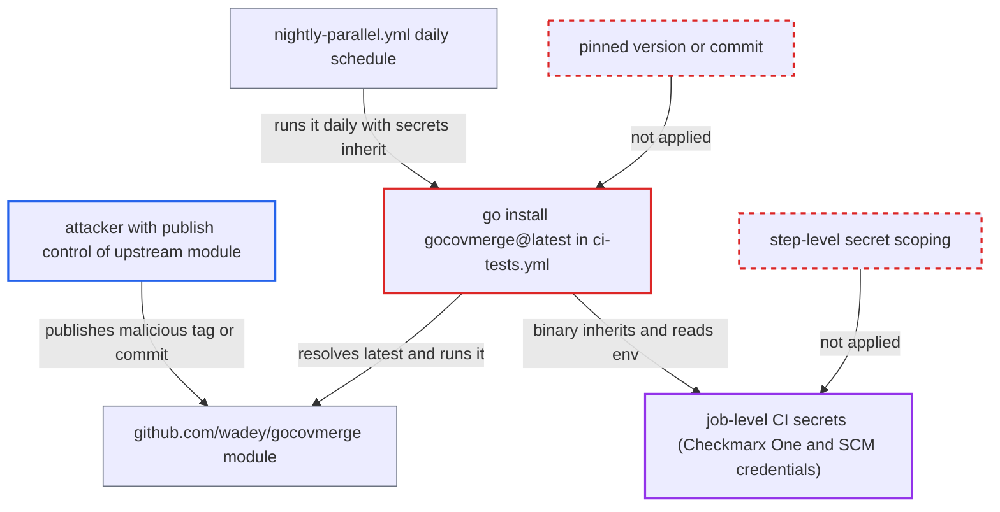

# CI installs gocovmerge@latest and runs it with Checkmarx One and SCM secrets

| Field | Value |
|---|---|
| ID | `find_01VBJqkoAkRU3JZo472zZomu` |
| Severity | **Critical** |
| Status | open |
| CWE | CWE-829 — Inclusion of untrusted functionality |
| Created | 2026-10-22T14:02:07.720137Z |
| Claude Security | https://claude.ai/security/findings/find_01VBJqkoAkRU3JZo472zZomu |

## Description

Whoever controls the third-party Go module `github.com/wadey/gocovmerge` can run their own code in this project's CI and read its secrets. Those secrets include the Checkmarx One credentials and the GitHub, GitLab, Azure and Bitbucket tokens. The workflow `ci-tests.yml` installs the tool with `@latest` and runs it in jobs that hold the secrets as job-level env.

1. **attacker** gains publish control of the upstream module. The report names three ways: a malicious maintainer, a compromised maintainer account, or a takeover of the repository `github.com/wadey/gocovmerge`.
2. **attacker** publishes a new tag or commit. The `latest` query picks the newest tag, or a pseudo-version of the default branch head if there are no tags. The Go checksum database does not stop a new malicious version from becoming `latest`.
3. **the workflow `nightly-parallel.yml`** starts `ci-tests.yml` on its daily schedule. It calls the workflow with `secrets: inherit`, so no one has to act. A same-repository `pull_request` also starts it with secrets, but fork PRs get none. ([`.github/workflows/nightly-parallel.yml:3-23`](https://github.com/cx-benchmark/ast-cli/blob/fd7806d4fa55005863ea1cb272ed9e9aadd49866/.github/workflows/nightly-parallel.yml#L3-L23))
4. **the `merge-coverage` job** installs the tool with `go install github.com/wadey/gocovmerge@latest`. The repository records no version, commit or hash, so the upstream owner decides what is downloaded. ([`.github/workflows/ci-tests.yml:530-531`](https://github.com/cx-benchmark/ast-cli/blob/fd7806d4fa55005863ea1cb272ed9e9aadd49866/.github/workflows/ci-tests.yml#L530-L531))
5. **the `merge-coverage` job** executes `gocovmerge` at line 548. The job has `if: always()`, so it runs whenever coverage artifacts exist. ([`.github/workflows/ci-tests.yml:539-548`](https://github.com/cx-benchmark/ast-cli/blob/fd7806d4fa55005863ea1cb272ed9e9aadd49866/.github/workflows/ci-tests.yml#L539-L548))
6. **the malicious `gocovmerge` binary** reads the inherited job environment. The job-level env holds `CX_CLIENT_SECRET`, `CX_APIKEY`, `CX_AST_USERNAME`, `CX_AST_PASSWORD`, `CX_CLIENT_ID`, `CX_TENANT` and `CX_BASE_URI`, and every child process inherits it. ([`.github/workflows/ci-tests.yml:510-518`](https://github.com/cx-benchmark/ast-cli/blob/fd7806d4fa55005863ea1cb272ed9e9aadd49866/.github/workflows/ci-tests.yml#L510-L518))
7. **the `integration-tests` job** runs the same unpinned tool when a test group retries. This step inherits a larger env that also holds `CX_SCAN_SSH_KEY`, `ECHO_LIBRARIES_ACCESS_KEY`, the proxy credentials and the SCM tokens. ([`.github/workflows/ci-tests.yml:354-382`](https://github.com/cx-benchmark/ast-cli/blob/fd7806d4fa55005863ea1cb272ed9e9aadd49866/.github/workflows/ci-tests.yml#L354-L382))

## Assessment

The attacker must first gain publish control of `github.com/wadey/gocovmerge`, which is outside this project's control. After that no one at the project has to act. The nightly run from `nightly-parallel.yml` (which uses `secrets: inherit`) or any same-repository `pull_request` run picks up the malicious version through `@latest`. Fork PRs get no secrets. In `merge-coverage` the tool always runs. In `integration-tests` it runs when a test group retries. The report notes that the threat model does not name upstream-dependency compromise as a threat actor, but it does list Checkmarx One credentials held in env as its top asset.

Impact: The attacker runs arbitrary code inside the CI job and can read every job-level secret. Those include the Checkmarx One credentials, the scan SSH key, the registry key, the proxy credentials and the SCM tokens. Integrity impact inside the job is limited to falsifying test and coverage results, because `permissions: contents: read` restricts the job's `GITHUB_TOKEN`.

Subsequent-system impact: The stolen credentials give the attacker API access to the Checkmarx One tenant and to the SCM accounts and repositories that the tokens and SSH key reach. The report says the code's own write use is limited to test projects and PR-decoration comments.

## Recommendation

(1) The workflow installs `github.com/wadey/gocovmerge@latest` at `.github/workflows/ci-tests.yml` lines 279 and 531, so the upstream owner decides at run time what CI executes.

Fix criteria: The tool is installed at an immutable version or commit recorded in the repository, or tracked as a pinned tool dependency in `go.mod` and `go.sum`. A new upstream release or commit does not change what CI runs. No `@latest` or other floating reference remains in any workflow or CI script.

(2) Secrets are exported as job-level env in `ci-tests.yml` (lines 221-262 and 510-518), so helper binaries such as `gocovmerge`, which need no credentials, inherit them.

Fix criteria: Credentials are set only on the steps that need them. Coverage merging and other helpers run with no tenant or SCM secrets in their environment. The environment of the `gocovmerge` steps lists none of them.

## Evidence

**https://github.com/cx-benchmark/ast-cli**

- [`.github/workflows/ci-tests.yml:278-279`](https://github.com/cx-benchmark/ast-cli/blob/fd7806d4fa55005863ea1cb272ed9e9aadd49866/.github/workflows/ci-tests.yml#L278-L279)
- [`.github/workflows/ci-tests.yml:530-531`](https://github.com/cx-benchmark/ast-cli/blob/fd7806d4fa55005863ea1cb272ed9e9aadd49866/.github/workflows/ci-tests.yml#L530-L531)
- [`.github/workflows/ci-tests.yml:539-548`](https://github.com/cx-benchmark/ast-cli/blob/fd7806d4fa55005863ea1cb272ed9e9aadd49866/.github/workflows/ci-tests.yml#L539-L548)
- [`.github/workflows/ci-tests.yml:510-518`](https://github.com/cx-benchmark/ast-cli/blob/fd7806d4fa55005863ea1cb272ed9e9aadd49866/.github/workflows/ci-tests.yml#L510-L518)
- [`.github/workflows/ci-tests.yml:354-382`](https://github.com/cx-benchmark/ast-cli/blob/fd7806d4fa55005863ea1cb272ed9e9aadd49866/.github/workflows/ci-tests.yml#L354-L382)
- [`.github/workflows/ci-tests.yml:221-262`](https://github.com/cx-benchmark/ast-cli/blob/fd7806d4fa55005863ea1cb272ed9e9aadd49866/.github/workflows/ci-tests.yml#L221-L262)
- [`.github/workflows/nightly-parallel.yml:3-23`](https://github.com/cx-benchmark/ast-cli/blob/fd7806d4fa55005863ea1cb272ed9e9aadd49866/.github/workflows/nightly-parallel.yml#L3-L23)
- [`.github/workflows/ci-tests.yml:3-5`](https://github.com/cx-benchmark/ast-cli/blob/fd7806d4fa55005863ea1cb272ed9e9aadd49866/.github/workflows/ci-tests.yml#L3-L5)

