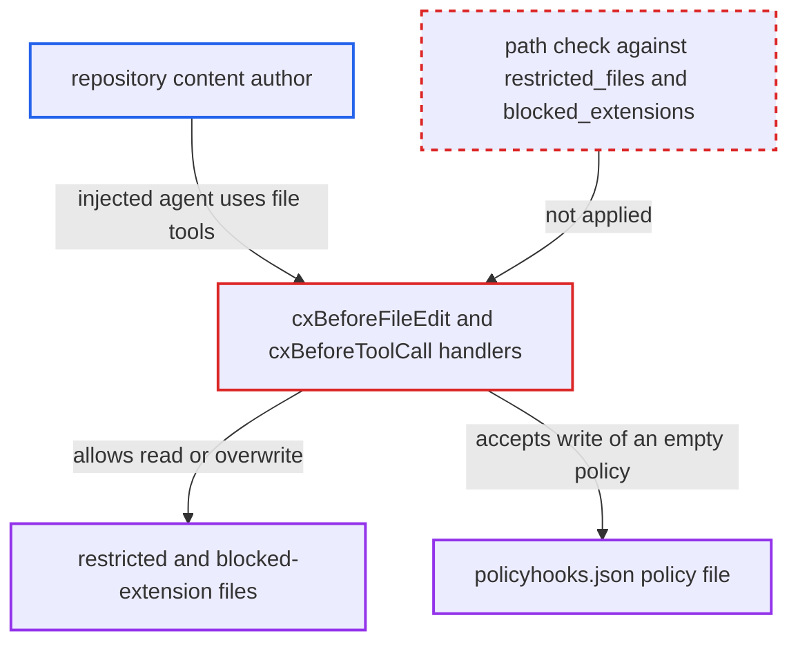

# Agent file tools bypass restricted-path and blocked-extension policy, including writes to the policy file

| Field | Value |
|---|---|
| ID | `find_01PgGa4fsdEDPHKtG6k6GhcM` |
| Severity | **High** |
| Status | open |
| CWE | CWE-424 — Improper protection of alternate path |
| Created | 2026-10-22T14:05:42.272137Z |
| Claude Security | https://claude.ai/security/findings/find_01PgGa4fsdEDPHKtG6k6GhcM |

## Description

A prompt-injected coding agent can read files that the organisation policy restricts or blocks, and can overwrite them. That includes the policy file itself, which switches off every rule. It needs a configured policy and a developer whose cx-hooked agent follows instructions planted in repository content. The file-edit and non-shell tool handlers `cxBeforeFileEdit` and `cxBeforeToolCall` never check file paths.

1. **the attacker** plants prompt-injection text in repository content. The text goes in a README, `CLAUDE.md`, `.cursor/rules` or source comments, and is aimed at a developer's cx-hooked agent.
2. **the developer's agent** follows the injected instructions and picks the target paths itself. The agent chooses file tools instead of `cat`, `echo` or a prompt mention, so the shell and prompt path checks never run.
3. **the handler `cxBeforeToolCall`** allows the agent's native read and search tools. It returns `Allow()` for every tool that is not a shell, so Claude's `Read`, `Grep` and `Glob` reach no path policy. ([`internal/commands/agenthooks/cx/hooks.go:73-77`](https://github.com/cx-benchmark/ast-cli/blob/fd7806d4fa55005863ea1cb272ed9e9aadd49866/internal/commands/agenthooks/cx/hooks.go#L73-L77))
4. **the Cursor read branch of `cxBeforeFileEdit`** runs only a secrets scan on the file being read. `ScanFileForSecrets` applies just a size cap and the secret regexes, so a restricted or blocked-extension file with no secret-shaped bytes is accepted into the context. ([`internal/commands/agenthooks/cx/hooks.go:117-122`](https://github.com/cx-benchmark/ast-cli/blob/fd7806d4fa55005863ea1cb272ed9e9aadd49866/internal/commands/agenthooks/cx/hooks.go#L117-L122))
5. **the handler `cxBeforeFileEdit`** accepts a write to a restricted path when the content is clean. It scans only the proposed content and never compares `ev.FilePath` with `restricted_files` or `restricted_directories`, so it reaches `AcceptEdit()`. ([`internal/commands/agenthooks/cx/hooks.go:115-178`](https://github.com/cx-benchmark/ast-cli/blob/fd7806d4fa55005863ea1cb272ed9e9aadd49866/internal/commands/agenthooks/cx/hooks.go#L115-L178))
6. **the agent** writes `{}` or a permissive policy to `~/.checkmarx/policyhooks.json`. The content has no code, IaC or secret finding, so the write is accepted. Every hook process re-reads this user-writable file, so from the next hook call on every policy rule is gone. ([`internal/commands/agenthooks/guardrails/policy.go:197-219`](https://github.com/cx-benchmark/ast-cli/blob/fd7806d4fa55005863ea1cb272ed9e9aadd49866/internal/commands/agenthooks/guardrails/policy.go#L197-L219))

## Assessment

The attacker only needs to get text into repository content that a developer's cx-hooked agent will read. The report treats this as the main threat actor. The attack needs an organisation policy to be configured, for example restricting `~/.kube/config` or `~/.checkmarx/policyhooks.json`, or blocking `.env` and `.pem`. It also needs an agent that follows the injection. There are two routes. One is the agent's Read tool, which `cxBeforeToolCall` allows as a non-shell tool, or on Cursor the secrets-only read branch. The other is its Write tool, which `cxBeforeFileEdit` content-scans and accepts. The report assumes `github.com/Checkmarx/ast-cx-hooks` v1.0.10 passes events to the handlers without path filtering. That version is not in the checkout. Only Cursor has a dedicated read route (`cursor-before-file-read`). Other agents' read tools reach the guardrail only through their pre-tool-use routes.

Impact: On the developer's machine, the agent can read restricted or blocked files such as credentials, kubeconfigs, keys, `.env` files and proprietary directories into its context. That sends them to the model provider and lets other ungated tools forward them. It can also modify restricted files such as `authorized_keys` or shell rc files, which gives persistence or code execution as the developer. By rewriting the policy file it removes the whole guardrail, after which blacklisted destructive commands run. Once the path is not checked, the code places no further limit.

## Recommendation

(1) `cxBeforeFileEdit`, including its Cursor read branch, and `cxBeforeToolCall` for non-shell file tools never consult `restricted_files` or `restricted_directories`. The native file tools are therefore an unguarded alternate path to resources the shell and prompt guards protect.

Fix criteria: Every agent file read, search or write whose target matches an effective restricted file or directory is denied before content scanning. It uses the same matching semantics as the prompt and shell checks. A Write, Edit or Read of a path in `restricted_files`, or under `restricted_directories`, is rejected even when the content is clean. This holds on `cursor-before-file-read` and on each agent's pre-tool-use and file-write routes.

(2) `context_policy.blocked_extensions` is compared only with prompt text, by `CheckBlockedExtensions`, which only `ScanPrompt` calls. The path of a file the agent actually opens is never checked, so a blocked file type enters the AI context on any agent read.

Fix criteria: A file opened by an agent read tool whose extension is in the effective `blocked_extensions` list is rejected whatever its contents. With `.env` and `.pem` blocked, `cursor-before-file-read` on `repo/.env` and a Claude `Read` of `key.pem` both return a deny, even when the files contain no secret-shaped bytes.

(3) The guardrail's own policy store, `~/.checkmarx/policyhooks.json`, can be written by the agent it constrains, through both the file and shell routes. It is re-read on every hook call, so one write removes every rule.

Fix criteria: Writes by the agent to the hook's policy and configuration files are denied whatever the policy content, on both the file-edit and shell routes. A Write of `{}` to `~/.checkmarx/policyhooks.json` and `echo '{}' > ~/.checkmarx/policyhooks.json` are both rejected. A blacklisted command is still denied afterwards.

## Evidence

**https://github.com/cx-benchmark/ast-cli**

- [`internal/commands/agenthooks/cx/hooks.go:115-178`](https://github.com/cx-benchmark/ast-cli/blob/fd7806d4fa55005863ea1cb272ed9e9aadd49866/internal/commands/agenthooks/cx/hooks.go#L115-L178)
- [`internal/commands/agenthooks/cx/hooks.go:117-122`](https://github.com/cx-benchmark/ast-cli/blob/fd7806d4fa55005863ea1cb272ed9e9aadd49866/internal/commands/agenthooks/cx/hooks.go#L117-L122)
- [`internal/commands/agenthooks/cx/hooks.go:73-77`](https://github.com/cx-benchmark/ast-cli/blob/fd7806d4fa55005863ea1cb272ed9e9aadd49866/internal/commands/agenthooks/cx/hooks.go#L73-L77)
- [`internal/commands/agenthooks/guardrails/prompt.go:600-653`](https://github.com/cx-benchmark/ast-cli/blob/fd7806d4fa55005863ea1cb272ed9e9aadd49866/internal/commands/agenthooks/guardrails/prompt.go#L600-L653)
- [`internal/commands/agenthooks/guardrails/prompt.go:779-858`](https://github.com/cx-benchmark/ast-cli/blob/fd7806d4fa55005863ea1cb272ed9e9aadd49866/internal/commands/agenthooks/guardrails/prompt.go#L779-L858)
- [`internal/commands/agenthooks/guardrails/policy.go:47-67`](https://github.com/cx-benchmark/ast-cli/blob/fd7806d4fa55005863ea1cb272ed9e9aadd49866/internal/commands/agenthooks/guardrails/policy.go#L47-L67)
- [`internal/commands/agenthooks/guardrails/shell.go:117-166`](https://github.com/cx-benchmark/ast-cli/blob/fd7806d4fa55005863ea1cb272ed9e9aadd49866/internal/commands/agenthooks/guardrails/shell.go#L117-L166)
- [`internal/commands/agenthooks/guardrails/prompt.go:687-706`](https://github.com/cx-benchmark/ast-cli/blob/fd7806d4fa55005863ea1cb272ed9e9aadd49866/internal/commands/agenthooks/guardrails/prompt.go#L687-L706)
- [`internal/commands/agenthooks/guardrails/policy.go:197-219`](https://github.com/cx-benchmark/ast-cli/blob/fd7806d4fa55005863ea1cb272ed9e9aadd49866/internal/commands/agenthooks/guardrails/policy.go#L197-L219)
- [`internal/commands/agenthooks/cx/install.go:31-131`](https://github.com/cx-benchmark/ast-cli/blob/fd7806d4fa55005863ea1cb272ed9e9aadd49866/internal/commands/agenthooks/cx/install.go#L31-L131)

