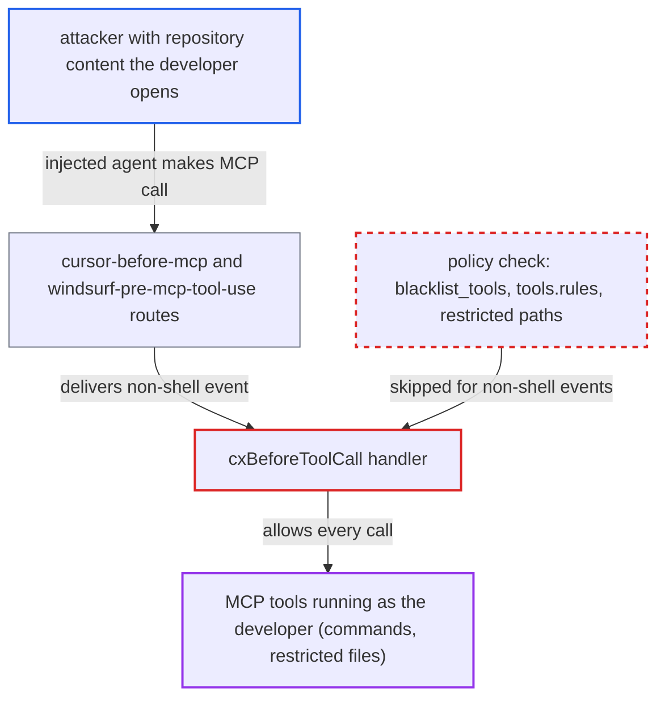

# MCP-gating hook routes allow every MCP tool call without applying guardrail policy

| Field | Value |
|---|---|
| ID | `find_011Dm53vccHSggsWgdUVgADj` |
| Severity | **High** |
| Status | open |
| CWE | CWE-424 — Improper protection of alternate path |
| Created | 2026-10-22T14:18:10.004529Z |
| Claude Security | https://claude.ai/security/findings/find_011Dm53vccHSggsWgdUVgADj |

## Description

A prompt-injected coding agent in Cursor or Windsurf can run any MCP tool call without the organisation's guardrail policy being checked. That includes shell commands and file access the policy would deny on the native shell route. It needs the Checkmarx hooks installed, a policy in force and a shell- or filesystem-capable MCP server configured. The handler `cxBeforeToolCall` returns allow for every event where `!ev.IsShell()`, before it reads any policy.

1. **attacker** plants instructions in repository content that a developer opens in Cursor or Windsurf. The report names a README, `.cursor/rules` and code comments as places for this content.
2. **the IDE agent** calls an MCP tool with a blacklisted command or a restricted path. The IDE runs the dedicated route `cx hooks cursor-before-mcp` (Cursor) or `windsurf-pre-mcp-tool-use` (Windsurf) before the call. ([`internal/commands/agenthooks/cx/install.go:51`](https://github.com/cx-benchmark/ast-cli/blob/fd7806d4fa55005863ea1cb272ed9e9aadd49866/internal/commands/agenthooks/cx/install.go#L51))
3. **`HookDispatchCommands`** sends the MCP event to the production handler. Every route gets a command, and `RegisterGuardrails` registers only `WhenAgentIdle`, `BeforeToolCall`, `BeforeFileEdit` and `BeforePrompt`. There is no MCP handler, so the call can only reach `cxBeforeToolCall`. ([`internal/commands/agenthooks/cx/hooks.go:262-271`](https://github.com/cx-benchmark/ast-cli/blob/fd7806d4fa55005863ea1cb272ed9e9aadd49866/internal/commands/agenthooks/cx/hooks.go#L262-L271))
4. **the handler `cxBeforeToolCall`** returns `agenthooks.Allow()` for the MCP call. The first check is `if !ev.IsShell()`, which is true for MCP events. The blacklist, tool rules and restricted paths further down never run. ([`internal/commands/agenthooks/cx/hooks.go:73-77`](https://github.com/cx-benchmark/ast-cli/blob/fd7806d4fa55005863ea1cb272ed9e9aadd49866/internal/commands/agenthooks/cx/hooks.go#L73-L77))
5. **the MCP server** executes the tool as the developer. Examples are `execute_command "curl … | sh"`, `read_file ~/.ssh/id_rsa` and `write_file ~/.bashrc`. The same action through the native shell tool is denied.

## Assessment

The attacker writes repository content (README, `.cursor/rules`, comments) that a developer opens with Cursor or Windsurf. The Checkmarx hooks must be installed. An organisation policy in `~/.checkmarx/policyhooks.json` must blacklist commands or restrict paths. A shell- or filesystem-capable MCP server must be configured. The agent must also follow the injected instructions. These conditions are outside the attacker's control. The report also says the Claude, Codex, Copilot, Droid and Gemini `*-pre-tool-use` matchers may include `mcp__*` tools. Whether they do is not known. If they do, those MCP calls are allowed the same way. The report assumes the `github.com/Checkmarx/ast-cx-hooks` v1.0.10 library, which is not in the checkout, delivers MCP events to `BeforeToolCall` with a kind for which `IsShell()` is false. If the library maps these routes to no handler instead, the result is the same: no policy decision.

Impact: The guardrail is bypassed completely on the MCP channel, and the handler sets no limit, ask or log. The attacker gets whatever the configured MCP servers can do as the developer. For a shell or filesystem MCP, that means running commands the policy blacklists and reading or writing restricted files.

## Recommendation

(1) `cxBeforeToolCall` allows every non-shell tool call before loading the policy. MCP calls on `cursor-before-mcp`, on `windsurf-pre-mcp-tool-use` and for `mcp__*` tools on any `*-pre-tool-use` route never get a policy decision.

Fix criteria: Every MCP tool call on these routes gets a policy decision. Command-like and path-like arguments are checked against `blacklist_tools`, `tools.rules` and the restricted paths. Alternatively, MCP tools not explicitly allowed are denied or sent to `AskUser` while a policy is in force. The Checkmarx MCP's own remediation tools stay allowed. An MCP `execute_command` with a blacklisted command is denied through `cx hooks cursor-before-mcp` and `cx hooks windsurf-pre-mcp-tool-use`. An MCP `read_file` or `write_file` on a restricted path is denied through both routes too.

(2) The policy schema (`HooksPolicy`, `BlacklistedTool` and `ToolRule` in `guardrails/policy.go`) describes only shell commands. An administrator cannot say which MCP servers or tools may run, or with which arguments.

Fix criteria: The policy can name MCP servers and tools, with allow and deny lists and argument or path rules. The handler applies them to MCP events. With a policy that denies one MCP tool and allows another, the MCP route returns deny for the first and allow for the second.

## Evidence

**https://github.com/cx-benchmark/ast-cli**

- [`internal/commands/agenthooks/cx/hooks.go:73-77`](https://github.com/cx-benchmark/ast-cli/blob/fd7806d4fa55005863ea1cb272ed9e9aadd49866/internal/commands/agenthooks/cx/hooks.go#L73-L77)
- [`internal/commands/agenthooks/cx/install.go:51`](https://github.com/cx-benchmark/ast-cli/blob/fd7806d4fa55005863ea1cb272ed9e9aadd49866/internal/commands/agenthooks/cx/install.go#L51)
- [`internal/commands/agenthooks/cx/install.go:65`](https://github.com/cx-benchmark/ast-cli/blob/fd7806d4fa55005863ea1cb272ed9e9aadd49866/internal/commands/agenthooks/cx/install.go#L65)
- [`internal/commands/agenthooks/cx/install.go:16-19`](https://github.com/cx-benchmark/ast-cli/blob/fd7806d4fa55005863ea1cb272ed9e9aadd49866/internal/commands/agenthooks/cx/install.go#L16-L19)
- [`internal/commands/agenthooks.go:163-187`](https://github.com/cx-benchmark/ast-cli/blob/fd7806d4fa55005863ea1cb272ed9e9aadd49866/internal/commands/agenthooks.go#L163-L187)
- [`internal/commands/agenthooks/cx/hooks.go:262-271`](https://github.com/cx-benchmark/ast-cli/blob/fd7806d4fa55005863ea1cb272ed9e9aadd49866/internal/commands/agenthooks/cx/hooks.go#L262-L271)
- [`internal/commands/agenthooks/guardrails/policy.go:96-112`](https://github.com/cx-benchmark/ast-cli/blob/fd7806d4fa55005863ea1cb272ed9e9aadd49866/internal/commands/agenthooks/guardrails/policy.go#L96-L112)
- [`internal/commands/agenthooks/guardrails/prompt.go:687-694`](https://github.com/cx-benchmark/ast-cli/blob/fd7806d4fa55005863ea1cb272ed9e9aadd49866/internal/commands/agenthooks/guardrails/prompt.go#L687-L694)

