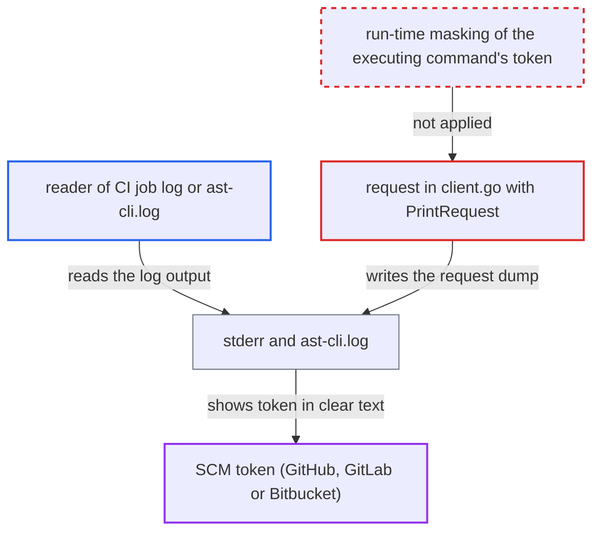

# PR decoration logs GitHub/GitLab/Bitbucket SCM token unmasked in verbose request dump

| Field | Value |
|---|---|
| ID | `find_01HWpzEpXJxPUHjDiqybgWBG` |
| Severity | **High** |
| Status | open |
| CWE | CWE-532 — Sensitive information in log |
| Created | 2026-10-22T13:59:47.434744Z |
| Claude Security | https://claude.ai/security/findings/find_01HWpzEpXJxPUHjDiqybgWBG |

## Description

Anyone who can read the CLI's verbose output can steal the user's GitHub, GitLab or Bitbucket token. The output is the CI job log, or `ast-cli.log` on disk. This needs `--debug`, `--log-file` or `--log-file-console` to be on. The cause is that the log masking for `token` only works for the azure sub-command, so `github`, `gitlab` and `bitbucket` runs log the token in clear text.

1. **CI pipeline or developer** runs `cx utils pr github`, `gitlab` or `bitbucket` with `--token` and verbose logging on. Logging is on when `--debug`, `--log-file` or `--log-file-console` is set.
2. **the sub-command constructors in `pr.go`** bind the viper key `token` to their own `--token` flag, one after another. viper keeps one flag per key. `NewPRDecorationCommand` builds azure last, so `token` ends up bound only to the azure flag, which is empty when another sub-command runs. ([`internal/commands/util/pr.go:49-52`](https://github.com/cx-benchmark/ast-cli/blob/fd7806d4fa55005863ea1cb272ed9e9aadd49866/internal/commands/util/pr.go#L49-L52))
3. **the run function `runPRDecoration`** reads the token from its own command's flag and stores it in `PRModel.ScmToken`. The viper `token` key is never consulted here, so the token reaches the request while viper still returns the azure flag's empty value. The gitlab and bitbucket run functions do the same. ([`internal/commands/util/pr.go:253-291`](https://github.com/cx-benchmark/ast-cli/blob/fd7806d4fa55005863ea1cb272ed9e9aadd49866/internal/commands/util/pr.go#L253-L291))
4. **`PostPRDecoration`** encodes the model as JSON and sends it through `SendHTTPRequestWithJSONContentType`. The body carries the raw token in the `scmToken` field, and the call ends up in `request`. ([`internal/wrappers/pr-http.go:36-50`](https://github.com/cx-benchmark/ast-cli/blob/fd7806d4fa55005863ea1cb272ed9e9aadd49866/internal/wrappers/pr-http.go#L36-L50))
5. **`request` in `client.go`** dumps the whole outgoing request, headers and body, with `logger.PrintRequest`. `PrintRequest` includes bodies under 1 MB and hands the dump to `PrintIfVerbose`, which logs it when verbose logging is on. ([`internal/wrappers/client.go:814-821`](https://github.com/cx-benchmark/ast-cli/blob/fd7806d4fa55005863ea1cb272ed9e9aadd49866/internal/wrappers/client.go#L814-L821))
6. **`sanitizeLogs`** replaces nothing for the token. It masks only non-empty values of the fixed viper keys, including `token`, and values added through `RegisterSensitiveValue`. For these three sub-commands `viper.GetString("token")` is an empty string, and the token was never registered. ([`internal/logger/utils.go:87-100`](https://github.com/cx-benchmark/ast-cli/blob/fd7806d4fa55005863ea1cb272ed9e9aadd49866/internal/logger/utils.go#L87-L100))
7. **the logger** writes the unmasked dump to stderr or to `ast-cli.log`. Without a log file, the output goes to the standard log stream, which in CI is the job log. The log file is opened with mode `0666`, so it is typically world-readable after the umask. ([`internal/commands/root.go:447-450`](https://github.com/cx-benchmark/ast-cli/blob/fd7806d4fa55005863ea1cb272ed9e9aadd49866/internal/commands/root.go#L447-L450))
8. **attacker** reads the log and copies the token. The attacker is someone with read access to the CI job log, or a local user or process that can read the log file.

## Assessment

The attacker needs to read the output of a run of `cx utils pr github`, `gitlab` or `bitbucket` made with verbose logging on. That can be a user with read access to the CI job log, or a local user or process reading `ast-cli.log`. The azure sub-command is not affected, because `token` stays bound to its flag. Verbose logging must be on, and the report names `--debug`, `--log-file` and `--log-file-console` as the ways to turn it on.

Impact: The attacker obtains the user's SCM token in full. The CLI's own data and behaviour are not otherwise affected.

Subsequent-system impact: The leaked token authenticates to GitHub, GitLab or Bitbucket as its owner. The CLI documents that the GitHub token needs `Repo` scope, which gives read and write access to the owner's repositories. Source code can be read, and commits or comments can be pushed. Availability is not affected.

## Recommendation

The four PR sub-commands each bind the single viper key `token` to their own flag when they are constructed. Only the last binding (azure) is consulted by `sanitizeLogs`, so the github, gitlab and bitbucket commands log their SCM token unredacted.

Fix criteria: The SCM token of every `cx utils pr <scm>` run appears as `***`, or not at all, in every log line, including the dumped request body. This holds whenever `--debug`, `--log-file` or `--log-file-console` is active. Masking comes from the executing command's own value, registered or bound at run time, not from a construction-time binding of a shared key. To verify, run each of the four sub-commands with `--debug` against a stub endpoint. Confirm the token value is absent from stderr and from `ast-cli.log`.

## Evidence

**https://github.com/cx-benchmark/ast-cli**

- [`internal/commands/util/pr.go:117-118`](https://github.com/cx-benchmark/ast-cli/blob/fd7806d4fa55005863ea1cb272ed9e9aadd49866/internal/commands/util/pr.go#L117-L118)
- [`internal/commands/util/pr.go:49-52`](https://github.com/cx-benchmark/ast-cli/blob/fd7806d4fa55005863ea1cb272ed9e9aadd49866/internal/commands/util/pr.go#L49-L52)
- [`internal/commands/util/pr.go:253-291`](https://github.com/cx-benchmark/ast-cli/blob/fd7806d4fa55005863ea1cb272ed9e9aadd49866/internal/commands/util/pr.go#L253-L291)
- [`internal/logger/utils.go:87-100`](https://github.com/cx-benchmark/ast-cli/blob/fd7806d4fa55005863ea1cb272ed9e9aadd49866/internal/logger/utils.go#L87-L100)
- [`internal/wrappers/pr-http.go:36-50`](https://github.com/cx-benchmark/ast-cli/blob/fd7806d4fa55005863ea1cb272ed9e9aadd49866/internal/wrappers/pr-http.go#L36-L50)
- [`internal/wrappers/client.go:814-821`](https://github.com/cx-benchmark/ast-cli/blob/fd7806d4fa55005863ea1cb272ed9e9aadd49866/internal/wrappers/client.go#L814-L821)
- [`internal/commands/root.go:447-450`](https://github.com/cx-benchmark/ast-cli/blob/fd7806d4fa55005863ea1cb272ed9e9aadd49866/internal/commands/root.go#L447-L450)
- [`internal/params/flags.go:158-162`](https://github.com/cx-benchmark/ast-cli/blob/fd7806d4fa55005863ea1cb272ed9e9aadd49866/internal/params/flags.go#L158-L162)
- [`internal/commands/util/usercount/github.go:86`](https://github.com/cx-benchmark/ast-cli/blob/fd7806d4fa55005863ea1cb272ed9e9aadd49866/internal/commands/util/usercount/github.go#L86)

