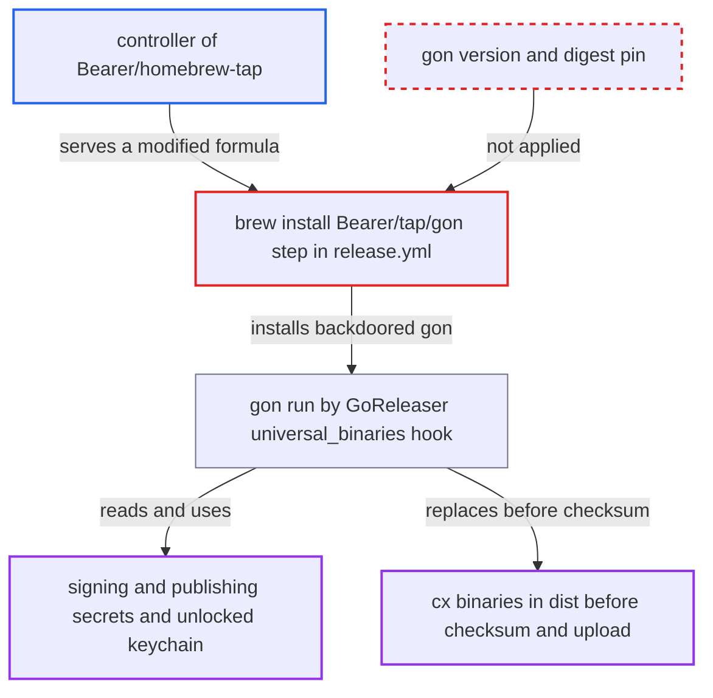

# Release job runs unpinned gon from third-party Homebrew tap with signing secrets

| Field | Value |
|---|---|
| ID | `find_01Rp42RuU66Mm9E7wsv3sHYu` |
| Severity | **High** |
| Status | open |
| CWE | CWE-829 — Untrusted functionality inclusion |
| Created | 2026-10-22T14:02:07.794769Z |
| Claude Security | https://claude.ai/security/findings/find_01Rp42RuU66Mm9E7wsv3sHYu |

## Description

Whoever controls the third-party `Bearer/homebrew-tap` can run their own code in the CLI release job. That code can steal the signing and publishing secrets, sign code as Checkmarx, and replace `cx` binaries before they ship. The release job installs `gon` with `brew install Bearer/tap/gon` and pins no version or digest. GoReleaser then runs it with the job's full environment.

1. **attacker controlling `Bearer/homebrew-tap`** commits a formula that points at a backdoored gon build. This is Bearer's maintainers, or anyone who compromises that GitHub org or the `Bearer/gon` release automation that bumps the formula; no Checkmarx privilege is needed.
2. **release job `build`** runs `brew install Bearer/tap/gon` during a routine `AST CLI Release` run. Nothing fixes a gon version, tap commit or binary digest, so Homebrew taps the repository at its current HEAD and installs the release asset the formula names. ([`.github/workflows/release.yml:126-132`](https://github.com/cx-benchmark/ast-cli/blob/fd7806d4fa55005863ea1cb272ed9e9aadd49866/.github/workflows/release.yml#L126-L132))
3. **`aws-secretsmanager-get-secrets` with `parse-json-secrets`** exports every key of the release secret to the whole job. A blank alias is used, so the Apple P12 and its password, `AC_USER`/`AC_PASSWORD`, and `COSIGN_PRIVATE_KEY`/`COSIGN_PASSWORD` are in the environment before gon is installed or run. ([`.github/workflows/release.yml:93-101`](https://github.com/cx-benchmark/ast-cli/blob/fd7806d4fa55005863ea1cb272ed9e9aadd49866/.github/workflows/release.yml#L93-L101))
4. **GoReleaser `universal_binaries` post hook** runs `gon /tmp/gonMac.hcl` and finds `gon` by `PATH` lookup. The brew-installed binary is the one that runs, and it inherits GoReleaser's environment, which also holds `GITHUB_TOKEN`, `SIGNING_REMOTE_SSH_PRIVATE_KEY` and `SIGNING_HSM_CREDS`. ([`.goreleaser.yml:107-112`](https://github.com/cx-benchmark/ast-cli/blob/fd7806d4fa55005863ea1cb272ed9e9aadd49866/.goreleaser.yml#L107-L112))
5. **backdoored gon** reads the secrets, signs with the unlocked keychain identity and alters files in `dist/`. The Checkmarx Developer ID identity is in an unlocked keychain, and the hook runs before GoReleaser archives, checksums and uploads, so any `cx` binary can be replaced first. ([`.github/workflows/release.yml:119-125`](https://github.com/cx-benchmark/ast-cli/blob/fd7806d4fa55005863ea1cb272ed9e9aadd49866/.github/workflows/release.yml#L119-L125))

## Assessment

The attacker is whoever controls `Bearer/homebrew-tap` when a release runs. That means Bearer's maintainers, or anyone who compromises that GitHub org or the `Bearer/gon` release automation. No Checkmarx privilege is needed, but the upstream control is a precondition outside the attacker's direct reach. The attack fires when a Checkmarx maintainer runs the routine `AST CLI Release` workflow. On a runner without the tap, Homebrew auto-taps it at HEAD, and `HOMEBREW_NO_AUTO_UPDATE` does not change that. Dev builds are exposed too: `.goreleaser-dev.yml` runs the same gon hook, and the certificate import and gon install have no `inputs.dev` condition. The formula's own Ruby code also runs at install time as the runner user. Current Homebrew passes `brew` only an allowlisted environment, so that code does not see the secret variables. It can still reach the workspace and the unlocked signing keychain. The `Bearer/gon` Mach-O committed at the repository root is not on `PATH` and is not what runs. The `checkmarx/harden-runner-action` egress policy lives in an external policy store. It may limit exfiltration, but it does not stop in-place tampering or signing.

Impact: The attacker gets code execution in the release job. They can read the Apple credentials, cosign key, HSM credentials, SSH key, `contents: write` `GITHUB_TOKEN` and AWS session. They can sign and notarize arbitrary code as Checkmarx, and replace `cx` binaries before they are checksummed and published to S3, the GitHub Release and the Docker image. Pipeline availability is not materially affected.

Subsequent-system impact: The workflow itself would distribute tampered or attacker-signed `cx` binaries to CLI users through GitHub Releases, the S3 `latest` folder and Docker Hub, where the image is signed with cosign. The stolen Developer ID and cosign keys let the attacker sign further code as Checkmarx. Developer and CI hosts that install the CLI would then run attacker code that can reach their Checkmarx credentials and source.

## Recommendation

(1) The release pipeline installs `gon` from a mutable third-party source (`brew install Bearer/tap/gon`, `.github/workflows/release.yml:132`) with no pinned version or verified digest. The same job holds code-signing and publishing credentials.

Fix criteria: The gon executable used in a release is identified reproducibly: a fixed version from a fixed URL, or a vendored copy. It is checked against a checksum recorded in this repository before it runs, as is done for Lima and Colima. A change in upstream content fails the build instead of running. The release and dev-release jobs never run a gon binary whose digest is not recorded in the repo.

(2) `parse-json-secrets` with a blank alias exports all release secrets to the whole job (`.github/workflows/release.yml:93-101`), and GoReleaser passes its whole environment to hooks. The notarization tool, and the steps that install it, therefore receive signing material they do not need: the cosign key, HSM credentials, SSH key and `GITHUB_TOKEN`.

Fix criteria: Each secret is available only to the steps that use it. The gon invocation runs with only the notarization credentials it needs, and install steps have no signing secret. Inspecting the environment of the `Install gon` step and of the gon hook shows no cosign, HSM, SSH or GitHub token values.

## Evidence

**https://github.com/cx-benchmark/ast-cli**

- [`.github/workflows/release.yml:126-132`](https://github.com/cx-benchmark/ast-cli/blob/fd7806d4fa55005863ea1cb272ed9e9aadd49866/.github/workflows/release.yml#L126-L132)
- [`.goreleaser.yml:107-112`](https://github.com/cx-benchmark/ast-cli/blob/fd7806d4fa55005863ea1cb272ed9e9aadd49866/.goreleaser.yml#L107-L112)
- [`.github/workflows/release.yml:238-251`](https://github.com/cx-benchmark/ast-cli/blob/fd7806d4fa55005863ea1cb272ed9e9aadd49866/.github/workflows/release.yml#L238-L251)
- [`.github/workflows/release.yml:93-101`](https://github.com/cx-benchmark/ast-cli/blob/fd7806d4fa55005863ea1cb272ed9e9aadd49866/.github/workflows/release.yml#L93-L101)
- [`.github/workflows/release.yml:119-125`](https://github.com/cx-benchmark/ast-cli/blob/fd7806d4fa55005863ea1cb272ed9e9aadd49866/.github/workflows/release.yml#L119-L125)
- [`gonMac.hcl:1-17`](https://github.com/cx-benchmark/ast-cli/blob/fd7806d4fa55005863ea1cb272ed9e9aadd49866/gonMac.hcl#L1-L17)
- [`.github/workflows/release.yml:67-71`](https://github.com/cx-benchmark/ast-cli/blob/fd7806d4fa55005863ea1cb272ed9e9aadd49866/.github/workflows/release.yml#L67-L71)
- [`.goreleaser-dev.yml:82-87`](https://github.com/cx-benchmark/ast-cli/blob/fd7806d4fa55005863ea1cb272ed9e9aadd49866/.goreleaser-dev.yml#L82-L87)

