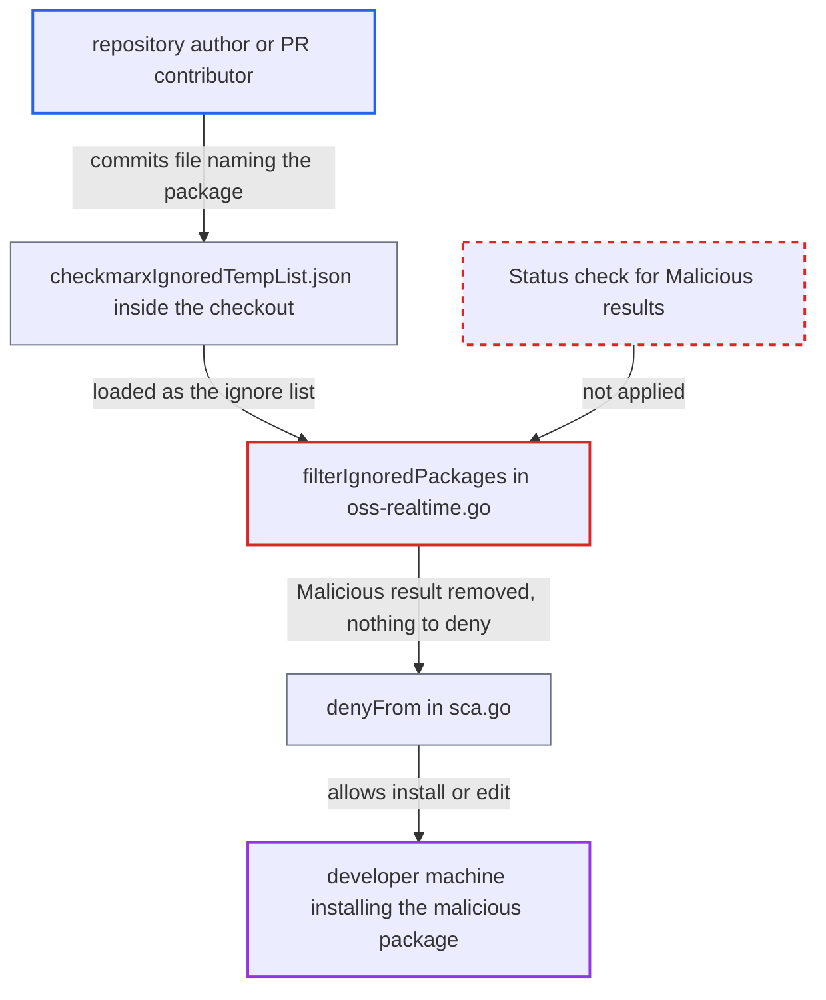

# SCA agent guardrail honours repo-resident ignore file, letting a repo suppress Malicious-package denies

| Field | Value |
|---|---|
| ID | `find_01CLNfP8KdfvVk2kgMEYtEhu` |
| Severity | **High** |
| Status | open |
| CWE | CWE-807 — Untrusted security-decision input |
| Created | 2026-10-22T13:59:26.958817Z |
| Claude Security | https://claude.ai/security/findings/find_01CLNfP8KdfvVk2kgMEYtEhu |

## Description

A repository author or PR contributor can make the AI-agent guardrail allow installing a package that the scanner flags `Malicious`. The attack needs the victim to open the repository with a hook-protected agent, and it needs the agent to issue the install or manifest edit. The cause is that `runRealScan` reads its ignore list from `.checkmarx/checkmarxIgnoredTempList.json` inside the checkout, and `filterIgnoredPackages` drops listed packages without looking at `Status`.

1. **repository author or PR contributor** commits an ignore file that names a package the scanner flags `Malicious`. The file is `.checkmarx/checkmarxIgnoredTempList.json`, which `PathFor` resolves under the checkout's working directory, so repository content can supply it. ([`internal/services/realtimeengine/ignore/ignorefile.go:53-67`](https://github.com/cx-benchmark/ast-cli/blob/fd7806d4fa55005863ea1cb272ed9e9aadd49866/internal/services/realtimeengine/ignore/ignorefile.go#L53-L67))
2. **repository author or PR contributor** gets the package into play through a manifest or a planted instruction. The package is added to a committed `requirements.txt` that `pip install -r` will scan, or an instruction leads the agent to run `npm install` or `pip install` on it or to add it to a manifest. ([`internal/commands/agenthooks/sca/commands.go:480-504`](https://github.com/cx-benchmark/ast-cli/blob/fd7806d4fa55005863ea1cb272ed9e9aadd49866/internal/commands/agenthooks/sca/commands.go#L480-L504))
3. **developer's agent** issues the install or manifest edit during a routine task. `cxBeforeToolCall` calls `CheckBashInstall` with the event's `WorkDir`, and `cxBeforeFileEdit` does the same for manifest edits through `CheckManifestEdit`. ([`internal/commands/agenthooks/cx/hooks.go:85-93`](https://github.com/cx-benchmark/ast-cli/blob/fd7806d4fa55005863ea1cb272ed9e9aadd49866/internal/commands/agenthooks/cx/hooks.go#L85-L93))
4. **the function `runRealScan`** passes the repository's ignore file to `RunOssRealtimeScan`. The path comes from `existingIgnoreFilePath(s.workDir)`, and `workDir` is the hook event's `cwd`, which is the untrusted checkout. ([`internal/commands/agenthooks/sca/scan.go:50-65`](https://github.com/cx-benchmark/ast-cli/blob/fd7806d4fa55005863ea1cb272ed9e9aadd49866/internal/commands/agenthooks/sca/scan.go#L50-L65))
5. **the function `filterIgnoredPackages`** removes the listed package from the scan results. It matches on the `PackageManager_PackageName_PackageVersion` id and never checks `Status`, so a `Malicious` result is dropped like an accepted CVE. ([`internal/services/realtimeengine/ossrealtime/oss-realtime.go:103-150`](https://github.com/cx-benchmark/ast-cli/blob/fd7806d4fa55005863ea1cb272ed9e9aadd49866/internal/services/realtimeengine/ossrealtime/oss-realtime.go#L103-L150))
6. **the function `denyFrom`** allows the action because no package is left to deny. Sorting into malicious and vulnerable happens only after the filter, so the removed package never reaches the malicious bucket, and `denyFrom` allows when both buckets are empty. ([`internal/commands/agenthooks/sca/scan.go:97-118`](https://github.com/cx-benchmark/ast-cli/blob/fd7806d4fa55005863ea1cb272ed9e9aadd49866/internal/commands/agenthooks/sca/scan.go#L97-L118))

## Assessment

The attacker authors a repository or PR and needs no other access. They commit `.checkmarx/checkmarxIgnoredTempList.json` listing a package the Checkmarx scanner flags `Malicious`. Then they either add that package to `requirements.txt` or plant an instruction that leads the agent to run `npm install` or `pip install` on it, or to add it to a manifest. The victim opens the repository with a hook-protected agent and asks for a routine task such as setting up the project. Both hook entry points are affected: `CheckBashInstall` (explicit `npm`, `pip`, `dotnet`, `go` or `mvn` installs, and `pip install -r <file>` on a manifest inside the repository) and `CheckManifestEdit`. A second route to the same suppression is `cx ignore-vulnerability`, which appends any package entry without checking its status, so an agent steered by repository content can write the entry itself. Success depends on the agent actually issuing the install. The same workspace-anchored ignore lookup also feeds the ASCA, KICS and secrets guardrails, but those are separate engines and the report does not cover them.

Impact: The guardrail's deny for `Malicious` packages is defeated for any package the attacker names, so a package Checkmarx knows is malicious gets installed. The report assumes npm and pip then run the package's install-time scripts as the developer, with access to local files and Checkmarx credentials. This only matters for packages the scanner flags `Malicious`.

## Recommendation

(1) The verdict filter applies ignore entries to results whose `Status` is `Malicious`, although the product's own policy says a malicious package has no ignore path.

Fix criteria: A package the scanner reports as `Malicious` produces a deny from `CheckBashInstall` and `CheckManifestEdit` whatever any ignore file contains. To verify, list a Malicious-flagged package in `.checkmarx/checkmarxIgnoredTempList.json`. Run `npm install <pkg>` and `pip install -r requirements.txt` through the pre-tool-use hook. Both must still be denied.

(2) The suppression list that gates the agent hooks is read from `<cwd>/.checkmarx/checkmarxIgnoredTempList.json` inside the checkout, so committed repository files decide a security verdict.

Fix criteria: Ignore entries that relax a guardrail verdict come only from a source the repository cannot supply, such as a user-owned location outside the checkout or entries bound to the user who created them. Otherwise an ignore file that arrived with the repository is disregarded. To verify, a fresh clone that ships the ignore file gets the same verdicts as one without it.

## Evidence

**https://github.com/cx-benchmark/ast-cli**

- [`internal/commands/agenthooks/sca/scan.go:50-65`](https://github.com/cx-benchmark/ast-cli/blob/fd7806d4fa55005863ea1cb272ed9e9aadd49866/internal/commands/agenthooks/sca/scan.go#L50-L65)
- [`internal/services/realtimeengine/ossrealtime/oss-realtime.go:103-150`](https://github.com/cx-benchmark/ast-cli/blob/fd7806d4fa55005863ea1cb272ed9e9aadd49866/internal/services/realtimeengine/ossrealtime/oss-realtime.go#L103-L150)
- [`internal/services/realtimeengine/ignore/ignorefile.go:53-67`](https://github.com/cx-benchmark/ast-cli/blob/fd7806d4fa55005863ea1cb272ed9e9aadd49866/internal/services/realtimeengine/ignore/ignorefile.go#L53-L67)
- [`internal/commands/agenthooks/sca/scan.go:97-118`](https://github.com/cx-benchmark/ast-cli/blob/fd7806d4fa55005863ea1cb272ed9e9aadd49866/internal/commands/agenthooks/sca/scan.go#L97-L118)
- [`internal/commands/agenthooks/sca/sca.go:20-87`](https://github.com/cx-benchmark/ast-cli/blob/fd7806d4fa55005863ea1cb272ed9e9aadd49866/internal/commands/agenthooks/sca/sca.go#L20-L87)
- [`internal/commands/agenthooks/cx/hooks.go:85-93`](https://github.com/cx-benchmark/ast-cli/blob/fd7806d4fa55005863ea1cb272ed9e9aadd49866/internal/commands/agenthooks/cx/hooks.go#L85-L93)
- [`internal/commands/agenthooks/sca/commands.go:480-504`](https://github.com/cx-benchmark/ast-cli/blob/fd7806d4fa55005863ea1cb272ed9e9aadd49866/internal/commands/agenthooks/sca/commands.go#L480-L504)
- [`internal/commands/agenthooks/sca/prompts.go:143-147`](https://github.com/cx-benchmark/ast-cli/blob/fd7806d4fa55005863ea1cb272ed9e9aadd49866/internal/commands/agenthooks/sca/prompts.go#L143-L147)
- [`internal/commands/ignore_vulnerability.go:69-97`](https://github.com/cx-benchmark/ast-cli/blob/fd7806d4fa55005863ea1cb272ed9e9aadd49866/internal/commands/ignore_vulnerability.go#L69-L97)

