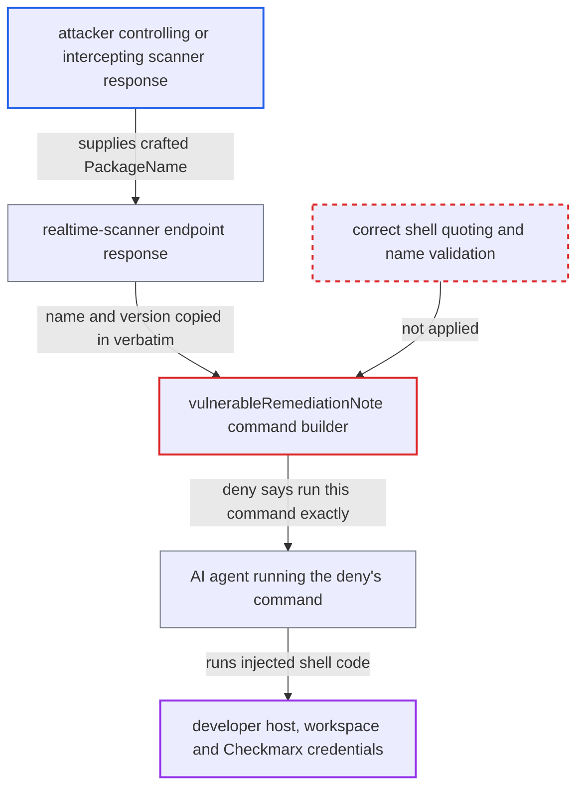

# SCA hook deny splices server-supplied package name/version unquoted into shell command agent must run

| Field | Value |
|---|---|
| ID | `find_01UZn2DZcXTzAugrce1DYoZu` |
| Severity | **High** |
| Status | open |
| CWE | CWE-78 — OS command injection |
| Created | 2026-10-22T13:58:06.874137Z |
| Claude Security | https://claude.ai/security/findings/find_01UZn2DZcXTzAugrce1DYoZu |

## Description

An attacker who controls or intercepts the Checkmarx realtime-scanner response can run arbitrary shell commands as the developer, on the machine that runs the AI agent and `cx`. The attack needs a spoofed or compromised endpoint, or a network position, plus the agent running a command it is told to run. The cause is that `vulnerableRemediationNote` puts server-supplied `PackageName` and `PackageVersion` into a shell command with quoting that does not stop shell syntax.

1. **the attacker** returns a crafted `Vulnerable` entry from the realtime-scanner endpoint. The `PackageName` holds a quote followed by shell code, for example `x'; <payload>; echo '`, or `$(<payload>)` for the Cursor branch.
2. **the scanner client in `ossrealtime/oss-realtime.go`** copies `PackageName` and `PackageVersion` into the result without validation. Every returned entry is appended, even one that matches no requested package, and no character check is applied. ([`internal/services/realtimeengine/ossrealtime/oss-realtime.go:152-170`](https://github.com/cx-benchmark/ast-cli/blob/fd7806d4fa55005863ea1cb272ed9e9aadd49866/internal/services/realtimeengine/ossrealtime/oss-realtime.go#L152-L170))
3. **`scanAndBucket`** treats the entry as vulnerable and sends it to the deny path. Any server `Status` other than `OK`, `Unknown`, `Malicious` or empty counts as vulnerable. ([`internal/commands/agenthooks/sca/scan.go:108-117`](https://github.com/cx-benchmark/ast-cli/blob/fd7806d4fa55005863ea1cb272ed9e9aadd49866/internal/commands/agenthooks/sca/scan.go#L108-L117))
4. **`vulnerableRemediationNote`** builds a `cx ignore-vulnerability --scan-type sca --data` command from the JSON of the package fields. `json.Marshal` does not escape `'`, `;`, `|`, `$` or backticks. The single quotes (default and POSIX Gemini branches) or double quotes (Cursor branch) therefore do not contain the payload. ([`internal/commands/agenthooks/sca/prompts.go:171-192`](https://github.com/cx-benchmark/ast-cli/blob/fd7806d4fa55005863ea1cb272ed9e9aadd49866/internal/commands/agenthooks/sca/prompts.go#L171-L192))
5. **the hook handlers in `cx/hooks.go`** return the deny text to the agent for an install command or a manifest edit. The text says `False positive: run exactly this command for it:` and is framed as a Checkmarx instruction that the agent should follow. ([`internal/commands/agenthooks/cx/hooks.go:86-92`](https://github.com/cx-benchmark/ast-cli/blob/fd7806d4fa55005863ea1cb272ed9e9aadd49866/internal/commands/agenthooks/cx/hooks.go#L86-L92))
6. **the AI agent** runs the suppress command in the developer's shell. The quote closes the argument early, so the injected code runs with the developer's rights.

## Assessment

The attacker must control the realtime-scanner response. That means a compromised or spoofed Checkmarx endpoint, or a network attacker or malicious proxy that can alter the traffic. The developer's agent then installs a package or edits a manifest. The hook posts to `/scan/packages` and gets back a `Vulnerable` entry with a malicious `PackageName`. The same endpoint's MCP `packageRemediation` returns `no_solution`, which meets the deny's false-positive condition. The agent then runs the suppress command, either through routine use or because the developer approves a `cx` command. The same pattern exists in `delta.go` under `guardrails/asca`, `kics` and `secrets`, where fields such as `FileName` can be controlled by the repository.

Impact: The attacker runs any shell code as the developer on the host that runs the agent and `cx`. That gives full access to the workspace and to the `~/.checkmarx` config. It also gives access to the keyring-held Checkmarx credentials reachable through `cx`, and lets the attacker modify or delete files. The code places no limit on the payload.

## Recommendation

(1) `vulnerableRemediationNote`, `cursorplugin.IgnoreVulnerabilityCommand` and `ignore.QuoteDataFlag` put server-supplied strings into a shell command line with ad-hoc quoting. The quoting does not neutralise `'`, `$(`, backticks or double quotes, so server data becomes shell syntax.

Fix criteria: No byte of a server-supplied value is placed where the target shell interprets it. This is done either by passing the payload as a file reference with a fixed path free of shell metacharacters (as `secrets/delta.go` does with `--data @file`), or by correct per-shell quoting of every interpolated field. For POSIX that means single-quoting and replacing `'` with `'\''`. For PowerShell it means doubling `'`. A response whose `PackageName` is `x'; touch /tmp/pwned; echo '` or `$(touch /tmp/pwned)` yields a command that creates no file under bash, zsh or PowerShell. The command also passes the name through intact.

(2) The `PackageName` and `PackageVersion` fields of the realtime-scanner response are accepted without checking that they match a requested package or are valid package identifiers. They are then used in commands shown to the agent.

Fix criteria: Response entries that do not match a requested package are dropped. Values containing characters outside the ecosystem's permitted set are rejected before any command is built. This covers quotes, whitespace, `$`, backticks, `;`, `|` and control characters. A response containing such values produces no suppress command.

## Evidence

**https://github.com/cx-benchmark/ast-cli**

- [`internal/commands/agenthooks/sca/prompts.go:171-192`](https://github.com/cx-benchmark/ast-cli/blob/fd7806d4fa55005863ea1cb272ed9e9aadd49866/internal/commands/agenthooks/sca/prompts.go#L171-L192)
- [`internal/commands/agenthooks/sca/prompts.go:226-230`](https://github.com/cx-benchmark/ast-cli/blob/fd7806d4fa55005863ea1cb272ed9e9aadd49866/internal/commands/agenthooks/sca/prompts.go#L226-L230)
- [`internal/commands/agenthooks/cursorplugin/plugin.go:25-46`](https://github.com/cx-benchmark/ast-cli/blob/fd7806d4fa55005863ea1cb272ed9e9aadd49866/internal/commands/agenthooks/cursorplugin/plugin.go#L25-L46)
- [`internal/services/realtimeengine/ossrealtime/oss-realtime.go:152-170`](https://github.com/cx-benchmark/ast-cli/blob/fd7806d4fa55005863ea1cb272ed9e9aadd49866/internal/services/realtimeengine/ossrealtime/oss-realtime.go#L152-L170)
- [`internal/commands/agenthooks/sca/scan.go:108-117`](https://github.com/cx-benchmark/ast-cli/blob/fd7806d4fa55005863ea1cb272ed9e9aadd49866/internal/commands/agenthooks/sca/scan.go#L108-L117)
- [`internal/commands/agenthooks/cx/hooks.go:86-92`](https://github.com/cx-benchmark/ast-cli/blob/fd7806d4fa55005863ea1cb272ed9e9aadd49866/internal/commands/agenthooks/cx/hooks.go#L86-L92)
- [`internal/services/realtimeengine/ignore/shellquote.go:16-22`](https://github.com/cx-benchmark/ast-cli/blob/fd7806d4fa55005863ea1cb272ed9e9aadd49866/internal/services/realtimeengine/ignore/shellquote.go#L16-L22)

