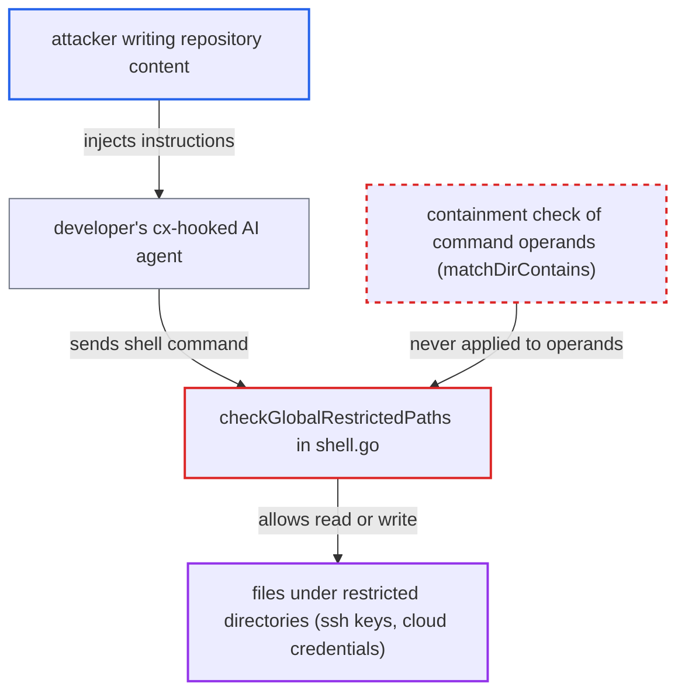

# Shell guardrail applies restricted_directories only to the working directory, never to command paths

| Field | Value |
|---|---|
| ID | `find_01LdDUBn34yhrXKjGYuGqmom` |
| Severity | **High** |
| Status | open |
| CWE | CWE-863 — Incorrect authorization |
| Created | 2026-10-22T14:20:50.182515Z |
| Claude Security | https://claude.ai/security/findings/find_01LdDUBn34yhrXKjGYuGqmom |

## Description

An attacker who plants instructions in repository content can get a developer's AI agent to read or write files in directories the organisation policy marks as restricted, such as `/home/*/.ssh` or `/home/*/.aws`. This needs a policy that relies on `restricted_directories` and an agent that follows the injected text. The shell guardrail in `shell.go` compares those directories only with the working directory, never with the paths in the command.

1. **attacker** writes instructions into repository content. The text sits in a README, a comment or `CLAUDE.md` and tells the agent to run a command such as `cat /home/<user>/.aws/credentials` or to append a key to `~/.ssh/authorized_keys`.
2. **developer's cx-hooked agent** follows the injected text and issues a shell command. The policy lists `/home/*/.ssh` and `/home/*/.aws` under `restricted_directories` but has no matching `restricted_files` entry.
3. **the hook `cxBeforeToolCall`** passes the command to `CheckShellCommand` with the event's working directory. The working directory comes from the hook event, so a `cd /home/dev/.ssh && cat id_rsa` inside the command does not change it. ([`internal/commands/agenthooks/cx/hooks.go:73-96`](https://github.com/cx-benchmark/ast-cli/blob/fd7806d4fa55005863ea1cb272ed9e9aadd49866/internal/commands/agenthooks/cx/hooks.go#L73-L96))
4. **the guardrail `checkGlobalRestrictedPaths`** tests only the working directory against `restricted_directories`. `PathUnderAny(workDir, dirs)` is the only use of the directory list, and the agent's working directory is normally a project folder, not a secret store. `checkToolRestrictedPaths` has the same shape when a tool rule matches. ([`internal/commands/agenthooks/guardrails/shell.go:147-165`](https://github.com/cx-benchmark/ast-cli/blob/fd7806d4fa55005863ea1cb272ed9e9aadd49866/internal/commands/agenthooks/guardrails/shell.go#L147-L165))
5. **the guardrail** compares the command's tokens only with `restricted_files` and finds no match. No operand is ever compared with the directory list, so the check returns Allow. ([`internal/commands/agenthooks/guardrails/shell.go:147-165`](https://github.com/cx-benchmark/ast-cli/blob/fd7806d4fa55005863ea1cb272ed9e9aadd49866/internal/commands/agenthooks/guardrails/shell.go#L147-L165))
6. **the agent** runs the command on the developer's machine. It reads or writes the file under the restricted directory with the developer's rights. ([`internal/commands/agenthooks/cx/hooks.go:73-96`](https://github.com/cx-benchmark/ast-cli/blob/fd7806d4fa55005863ea1cb272ed9e9aadd49866/internal/commands/agenthooks/cx/hooks.go#L73-L96))

## Assessment

The attacker only needs to get text in front of an AI agent that is hooked by cx, for example through a README, comments or `CLAUDE.md` in a repository the developer opens. The organisation policy in `~/.checkmarx/policyhooks.json` must rely on `restricted_directories` for its protection, without an equivalent `restricted_files` glob. The agent must follow the injected instructions. Commands such as `cat /home/dev/.aws/credentials`, `tar czf /tmp/k.tgz /home/dev/.ssh`, `cp /home/dev/.ssh/id_rsa .` and `cd /home/dev/.ssh && cat id_rsa` pass with no quoting or obfuscation. A second route is the advisory `cx_shell_guard` tool in the `cx mcp` server. It calls `CheckShellCommand(cmd, "")` with an empty `workDir`, so `restricted_directories` is never evaluated there. `allowed_directories` has the same working-directory-only shape in `shell.go`, so it does not limit which paths a command touches either. The report assumes that `github.com/Checkmarx/ast-cx-hooks` v1.0.10 fills in the working directory and passes `Command` unchanged. It says the result does not depend on that value.

Impact: Any file under a restricted directory can be read into the agent's context, and can be created, overwritten or appended to (for example `authorized_keys` or cloud config). That gives credential disclosure and persistence as the developer. The report finds no availability effect beyond this.

## Recommendation

`checkGlobalRestrictedPaths` and `checkToolRestrictedPaths` in `shell.go` apply `restricted_directories` only to the hook's working directory. They never test the command's path operands. The containment rule used by `CheckPromptPaths` and `matchDirContains` is therefore not enforced on the shell route, and every caller of `CheckShellCommand` inherits the gap, including the advisory `cx mcp` tool with its empty `workDir`.

Fix criteria: Every path-shaped operand of the command is tested for containment in the effective restricted directories, in both the global and the tool-rule branches. This covers absolute paths, `~` and `$HOME` resolved to the home directory, and relative paths resolved against `workDir` and any `cd` target. The test uses the same `matchDirContains` semantics as the prompt route and runs even when `workDir` is empty. To verify, set `restricted_directories.linux=["/home/*/.ssh"]` with no `restricted_files`. Then `cat /home/dev/.ssh/id_rsa`, `cat ~/.ssh/id_rsa`, `cd /home/dev/.ssh && cat id_rsa` and `echo x >> /home/dev/.ssh/authorized_keys` must all be hard-blocked from cwd `/proj` and with an empty `workDir`.

## Evidence

**https://github.com/cx-benchmark/ast-cli**

- [`internal/commands/agenthooks/guardrails/shell.go:147-165`](https://github.com/cx-benchmark/ast-cli/blob/fd7806d4fa55005863ea1cb272ed9e9aadd49866/internal/commands/agenthooks/guardrails/shell.go#L147-L165)
- [`internal/commands/agenthooks/guardrails/shell.go:120-143`](https://github.com/cx-benchmark/ast-cli/blob/fd7806d4fa55005863ea1cb272ed9e9aadd49866/internal/commands/agenthooks/guardrails/shell.go#L120-L143)
- [`internal/commands/agenthooks/guardrails/shell.go:227-238`](https://github.com/cx-benchmark/ast-cli/blob/fd7806d4fa55005863ea1cb272ed9e9aadd49866/internal/commands/agenthooks/guardrails/shell.go#L227-L238)
- [`internal/commands/agenthooks/guardrails/prompt.go:687-745`](https://github.com/cx-benchmark/ast-cli/blob/fd7806d4fa55005863ea1cb272ed9e9aadd49866/internal/commands/agenthooks/guardrails/prompt.go#L687-L745)
- [`internal/commands/agenthooks/guardrails/match.go:65-87`](https://github.com/cx-benchmark/ast-cli/blob/fd7806d4fa55005863ea1cb272ed9e9aadd49866/internal/commands/agenthooks/guardrails/match.go#L65-L87)
- [`internal/commands/agenthooks/cx/hooks.go:73-96`](https://github.com/cx-benchmark/ast-cli/blob/fd7806d4fa55005863ea1cb272ed9e9aadd49866/internal/commands/agenthooks/cx/hooks.go#L73-L96)
- [`internal/commands/agenthooks/mcp/server.go:53-59`](https://github.com/cx-benchmark/ast-cli/blob/fd7806d4fa55005863ea1cb272ed9e9aadd49866/internal/commands/agenthooks/mcp/server.go#L53-L59)

