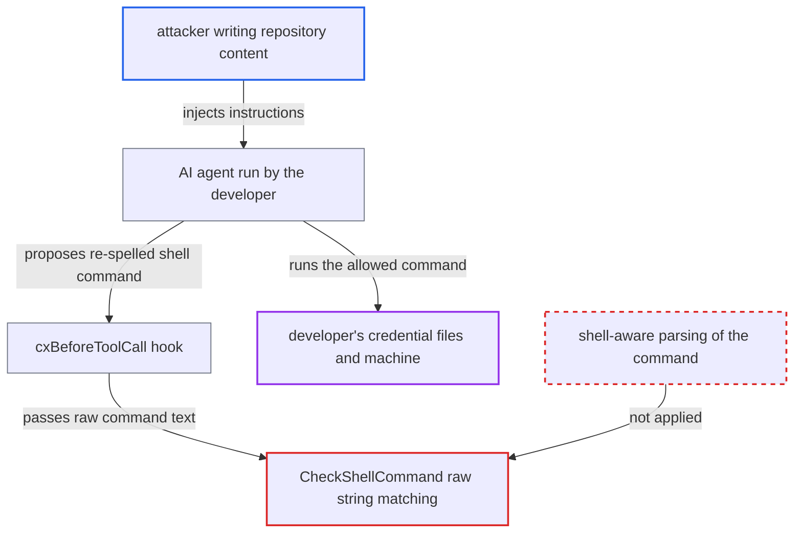

# Shell guardrail matches raw command text; quoting, globbing and expansion evade every rule

| Field | Value |
|---|---|
| ID | `find_01CKsfah2qgwTjN6tDKpUdaK` |
| Severity | **High** |
| Status | open |
| CWE | CWE-1289 — Protection mechanism bypass |
| Created | 2026-10-22T14:02:07.503781Z |
| Claude Security | https://claude.ai/security/findings/find_01CKsfah2qgwTjN6tDKpUdaK |

## Description

An attacker who plants instructions in repository content can get a developer's AI agent to run shell commands that the organisation's policy blocks. These include reading key files and running destructive tools. It needs a policy with matching entries and an agent that follows the injected text. `CheckShellCommand` matches the raw command text, so a re-spelled command passes.

1. **attacker** plants instructions in repository content. The text sits in a README, comments or config that a developer later opens with a cx-hooked AI agent, and it tells the agent to run a command such as `r''m -rf ~`.
2. **AI agent** proposes the shell command. The agent follows the injected text and the host sends the event to `cx hooks <route>`.
3. **the hook `cxBeforeToolCall`** hands the raw command to `CheckShellCommand`. This is the only policy gate on the shell call, besides the SCA install check. ([`internal/commands/agenthooks/cx/hooks.go:73-95`](https://github.com/cx-benchmark/ast-cli/blob/fd7806d4fa55005863ea1cb272ed9e9aadd49866/internal/commands/agenthooks/cx/hooks.go#L73-L95))
4. **`CheckShellCommand`** checks `blacklist_tools` with `strings.Contains` on the lowercased raw string. A blacklisted `rm -rf` is not found in `rm -fr ~` or `r''m -rf ~`, though bash runs both as `rm -rf`. ([`internal/commands/agenthooks/guardrails/shell.go:24-35`](https://github.com/cx-benchmark/ast-cli/blob/fd7806d4fa55005863ea1cb272ed9e9aadd49866/internal/commands/agenthooks/guardrails/shell.go#L24-L35))
5. **`FindMatchingToolRule` and `containsAsToken`** fail to select the tool rule when the tool name is obfuscated. `m''vn deploy` contains no `mvn` substring, so `args_exclude`, `args_include` and the allowed and restricted path checks are all skipped. ([`internal/commands/agenthooks/guardrails/policy.go:390-456`](https://github.com/cx-benchmark/ast-cli/blob/fd7806d4fa55005863ea1cb272ed9e9aadd49866/internal/commands/agenthooks/guardrails/policy.go#L390-L456))
6. **`findRestrictedFileInCommand`** splits the command with `strings.Fields` and compares tokens that still carry quotes and shell syntax. With `/etc/shadow` restricted, `cat "/etc/shadow"`, `cat /etc/shadow;` and `cat /etc/shad*` are not matched, while plain `cat /etc/shadow` is blocked. ([`internal/commands/agenthooks/guardrails/shell.go:179-209`](https://github.com/cx-benchmark/ast-cli/blob/fd7806d4fa55005863ea1cb272ed9e9aadd49866/internal/commands/agenthooks/guardrails/shell.go#L179-L209))
7. **`cxBeforeToolCall`** returns `agenthooks.Allow()` and the shell runs the command. The shell removes the quotes and expands the globs, so the command does what the policy meant to forbid. ([`internal/commands/agenthooks/cx/hooks.go:73-95`](https://github.com/cx-benchmark/ast-cli/blob/fd7806d4fa55005863ea1cb272ed9e9aadd49866/internal/commands/agenthooks/cx/hooks.go#L73-L95))

## Assessment

The attacker only needs to get text in front of an AI agent, for example in a README, comments or config of a repository the developer opens with a cx-hooked agent such as Claude Code or Cursor. The attack needs an organisation policy in `~/.checkmarx/policyhooks.json` with matching entries, and an agent that follows the injected text. The report also assumes that `github.com/Checkmarx/ast-cx-hooks` v1.0.10 (not in the checkout) passes the command string through as `ev.Command` unchanged. The MCP tool `cx_shell_guard` uses the same matcher, but the model decides whether to call it, so it is no separate gate. Quoted paths are the normal form agents write, so the restricted-file check can fail even without deliberate obfuscation.

Impact: The injected agent can read files the policy restricts, such as keys and credentials. It can also run blacklisted destructive or network tools such as `rm -rf ~`, as the developer, on a workstation or CI host. Once the string match fails, the code imposes no further limit.

## Recommendation

Policy decisions are made on the unparsed command string, so the text that is checked differs from what the shell executes (quotes, escapes, expansions, globs, flag order, operators glued to words).

Fix criteria: The command is parsed with a shell-grammar parser into simple commands and words, with quotes and escapes removed. Words with unresolved expansions (`$(`, backticks, `$VAR`, `eval`, `bash -c`, globs, braces) are treated as matching or denied when policy entries exist. Tool rules and blacklist entries match on each simple command's resolved argv\[0] and its arguments in any order, and restricted files match on the cleaned words. Under a policy blocking `rm -rf`, `mvn deploy` and `/etc/shadow`, these are all denied: `r''m -rf ~`, `rm -fr ~`, `m''vn deploy`, `cat "/etc/shadow"`, `cat /etc/shadow;` and `cat /etc/shad*`.

## Evidence

**https://github.com/cx-benchmark/ast-cli**

- [`internal/commands/agenthooks/guardrails/shell.go:24-35`](https://github.com/cx-benchmark/ast-cli/blob/fd7806d4fa55005863ea1cb272ed9e9aadd49866/internal/commands/agenthooks/guardrails/shell.go#L24-L35)
- [`internal/commands/agenthooks/guardrails/policy.go:390-456`](https://github.com/cx-benchmark/ast-cli/blob/fd7806d4fa55005863ea1cb272ed9e9aadd49866/internal/commands/agenthooks/guardrails/policy.go#L390-L456)
- [`internal/commands/agenthooks/guardrails/shell.go:44-52`](https://github.com/cx-benchmark/ast-cli/blob/fd7806d4fa55005863ea1cb272ed9e9aadd49866/internal/commands/agenthooks/guardrails/shell.go#L44-L52)
- [`internal/commands/agenthooks/guardrails/shell.go:179-209`](https://github.com/cx-benchmark/ast-cli/blob/fd7806d4fa55005863ea1cb272ed9e9aadd49866/internal/commands/agenthooks/guardrails/shell.go#L179-L209)
- [`internal/commands/agenthooks/guardrails/match.go:32-52`](https://github.com/cx-benchmark/ast-cli/blob/fd7806d4fa55005863ea1cb272ed9e9aadd49866/internal/commands/agenthooks/guardrails/match.go#L32-L52)
- [`internal/commands/agenthooks/cx/hooks.go:73-95`](https://github.com/cx-benchmark/ast-cli/blob/fd7806d4fa55005863ea1cb272ed9e9aadd49866/internal/commands/agenthooks/cx/hooks.go#L73-L95)
- [`internal/commands/agenthooks/sca/commands.go:223-290`](https://github.com/cx-benchmark/ast-cli/blob/fd7806d4fa55005863ea1cb272ed9e9aadd49866/internal/commands/agenthooks/sca/commands.go#L223-L290)

