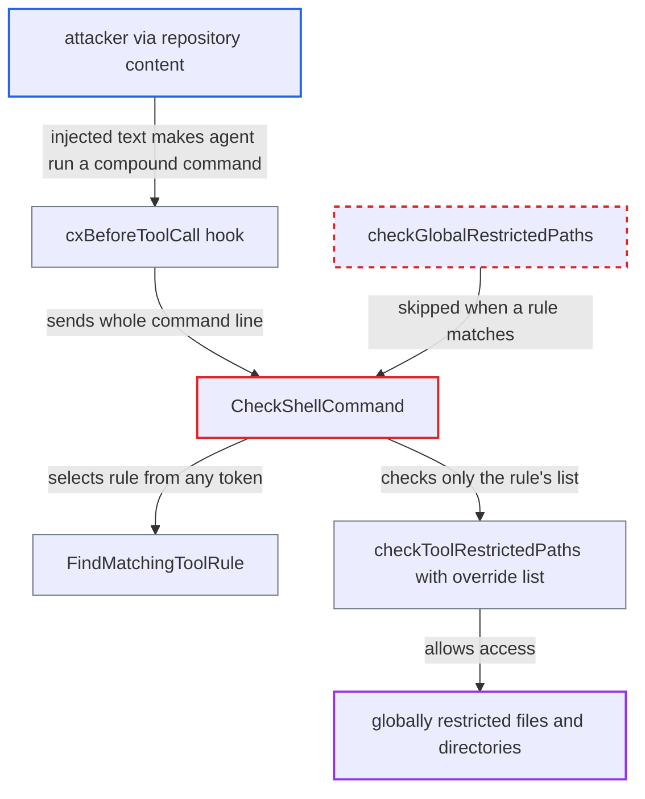

# Tool-rule restricted-path override applies to whole compound command, dropping global restrictions

| Field | Value |
|---|---|
| ID | `find_01LqAznCqB9APMnqnfUihtNc` |
| Severity | **High** |
| Status | open |
| CWE | CWE-863 — Incorrect authorization |
| Created | 2026-10-22T14:24:16.697600Z |
| Claude Security | https://claude.ai/security/findings/find_01LqAznCqB9APMnqnfUihtNc |

## Description

An attacker who plants instructions in a repository can make a developer's AI agent read or overwrite files the organisation marked as restricted, such as SSH keys and cloud credentials. This needs a tool rule with `merge_strategy` set to `override` for the restricted lists, for example an `aws` rule, and an agent that follows the injected text. The cause is that `FindMatchingToolRule` matches the tool name anywhere in the command, so `CheckShellCommand` skips the global restricted-path check.

1. **attacker** plants instructions in repository content. The text tells the agent to run a command such as `cat ~/.ssh/id_rsa && aws --version`, which ends with the name of a tool that has an exempting rule.
2. **the hook `cxBeforeToolCall`** passes the agent's shell command to `CheckShellCommand`. Every agent shell call is gated this way, and the whole compound line is passed as one command. ([`internal/commands/agenthooks/cx/hooks.go:73-96`](https://github.com/cx-benchmark/ast-cli/blob/fd7806d4fa55005863ea1cb272ed9e9aadd49866/internal/commands/agenthooks/cx/hooks.go#L73-L96))
3. **`FindMatchingToolRule`** selects the `aws` rule from a token anywhere in the line. It returns the first enabled rule whose tool name appears as a whole token, whether or not that program handles the file operand. A trailing `&& aws --version`, `; aws help` or `# aws` is enough. ([`internal/commands/agenthooks/guardrails/policy.go:382-415`](https://github.com/cx-benchmark/ast-cli/blob/fd7806d4fa55005863ea1cb272ed9e9aadd49866/internal/commands/agenthooks/guardrails/policy.go#L382-L415))
4. **`CheckShellCommand`** skips `checkGlobalRestrictedPaths` because a rule matched. The global check is reached only when no rule matched, so the documented hard block on global restricted paths never runs. ([`internal/commands/agenthooks/guardrails/shell.go:37-57`](https://github.com/cx-benchmark/ast-cli/blob/fd7806d4fa55005863ea1cb272ed9e9aadd49866/internal/commands/agenthooks/guardrails/shell.go#L37-L57))
5. **`checkToolRestrictedPaths`** checks every operand against the rule's own list only. Under `override`, `ResolveRestrictedPaths` returns just the rule's list. When that list is nil or empty, the `len(effectiveFiles) > 0` condition fails and no file is checked. ([`internal/commands/agenthooks/guardrails/shell.go:120-143`](https://github.com/cx-benchmark/ast-cli/blob/fd7806d4fa55005863ea1cb272ed9e9aadd49866/internal/commands/agenthooks/guardrails/shell.go#L120-L143))
6. **the hook `cxBeforeToolCall`** returns `agenthooks.Allow()` and the agent runs every part of the line. The restricted file is read, copied or overwritten even though a global entry lists it. ([`internal/commands/agenthooks/cx/hooks.go:73-96`](https://github.com/cx-benchmark/ast-cli/blob/fd7806d4fa55005863ea1cb272ed9e9aadd49866/internal/commands/agenthooks/cx/hooks.go#L73-L96))

## Assessment

The attacker writes repository content that a developer opens with an agent using the cx hooks. The organisation policy must have global `restricted_files` or `restricted_directories`. It must also have an enabled tool rule whose `merge_strategy` for those lists is `override` with a narrower or empty list. The agent must follow the injected text. The attacker appends the exempted tool's name to any command, for example `cat /home/dev/.ssh/id_rsa && aws --version`, `cp /home/dev/.aws/credentials /tmp/x ; aws help` or `cat /home/dev/.ssh/id_rsa # aws`. The same works for `restricted_directories`: a rule that overrides it drops the global working-directory check for any command that names the tool. The report assumes `github.com/Checkmarx/ast-cx-hooks` v1.0.10 passes the command through unchanged as `ev.Command`.

Impact: Every global restricted entry that the exempting rule leaves out can be bypassed. Files the organisation marked secret, such as keys, cloud credentials and `.env`, can be read into the agent's context. Those files can also be overwritten or appended to, for example `authorized_keys`, by any program and not only the exempted tool. The blacklist still runs first and still applies, and the report establishes no availability effect.

## Recommendation

(1) `FindMatchingToolRule` picks one rule from any token in the whole command. `CheckShellCommand` then applies only that rule's restricted lists, which may override the global ones, to every operand on the line.

Fix criteria: A tool rule's override of the global restricted lists applies only to the operands of an invocation of that tool. Operands of every other simple command are still checked against the global `restricted_files` and `restricted_directories`. Commands are split on `;`, `&&`, `||`, `|`, `&` and newlines, with `#` comments removed. With global `restricted_files=["id_rsa"]` and an `aws` rule overriding `restricted_files` to `[]`, `cat /home/dev/.ssh/id_rsa && aws --version` and `cat /home/dev/.ssh/id_rsa # aws` are hard-blocked. `aws configure list` still passes.

(2) Global restricted entries are skipped whenever any tool rule matches. The documented enforcement step for global restricted paths in `shell.go` therefore depends on a rule choice the attacker can influence.

Fix criteria: Global restricted files and directories are enforced for every command segment, unless that segment's own command is the tool whose rule overrides them. A compound command with a non-exempt segment that touches a globally restricted path is denied. This holds for the mixed compound commands above. It also holds for an override of `restricted_directories` when run from a restricted working directory.

## Evidence

**https://github.com/cx-benchmark/ast-cli**

- [`internal/commands/agenthooks/guardrails/shell.go:37-57`](https://github.com/cx-benchmark/ast-cli/blob/fd7806d4fa55005863ea1cb272ed9e9aadd49866/internal/commands/agenthooks/guardrails/shell.go#L37-L57)
- [`internal/commands/agenthooks/guardrails/policy.go:382-415`](https://github.com/cx-benchmark/ast-cli/blob/fd7806d4fa55005863ea1cb272ed9e9aadd49866/internal/commands/agenthooks/guardrails/policy.go#L382-L415)
- [`internal/commands/agenthooks/guardrails/shell.go:120-143`](https://github.com/cx-benchmark/ast-cli/blob/fd7806d4fa55005863ea1cb272ed9e9aadd49866/internal/commands/agenthooks/guardrails/shell.go#L120-L143)
- [`internal/commands/agenthooks/guardrails/policy.go:460-484`](https://github.com/cx-benchmark/ast-cli/blob/fd7806d4fa55005863ea1cb272ed9e9aadd49866/internal/commands/agenthooks/guardrails/policy.go#L460-L484)
- [`internal/commands/agenthooks/guardrails/policy.go:129-140`](https://github.com/cx-benchmark/ast-cli/blob/fd7806d4fa55005863ea1cb272ed9e9aadd49866/internal/commands/agenthooks/guardrails/policy.go#L129-L140)
- [`internal/commands/agenthooks/guardrails/shell.go:9-24`](https://github.com/cx-benchmark/ast-cli/blob/fd7806d4fa55005863ea1cb272ed9e9aadd49866/internal/commands/agenthooks/guardrails/shell.go#L9-L24)
- [`internal/commands/agenthooks/guardrails/policy.go:283-328`](https://github.com/cx-benchmark/ast-cli/blob/fd7806d4fa55005863ea1cb272ed9e9aadd49866/internal/commands/agenthooks/guardrails/policy.go#L283-L328)
- [`internal/commands/agenthooks/cx/hooks.go:73-96`](https://github.com/cx-benchmark/ast-cli/blob/fd7806d4fa55005863ea1cb272ed9e9aadd49866/internal/commands/agenthooks/cx/hooks.go#L73-L96)

