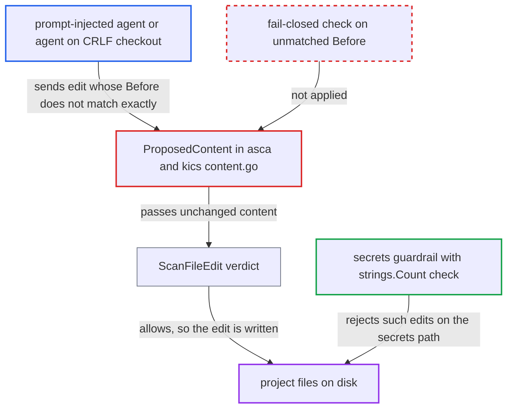

# ASCA and KICS guardrails fail open when an edit's Before text is not found, scanning content that differs from what is written

| Field | Value |
|---|---|
| ID | `find_01SwUqgkHMECM5fXgUuyHgY6` |
| Severity | **Medium** |
| Status | open |
| CWE | CWE-636 — Failing open |
| Created | 2026-10-22T14:08:38.370990Z |
| Claude Security | https://claude.ai/security/findings/find_01SwUqgkHMECM5fXgUuyHgY6 |

## Description

A code-writing agent can get insecure code or insecure infrastructure files past the ASCA and KICS guardrails, which then allow the edit without a scan of what is written. A prompt-injected agent can do this on purpose, and on CRLF checkouts it happens without any attacker. The cause is that `ProposedContent` skips an edit whose `Before` text is not found.

1. **attacker or agent** issues a string-replace edit whose old text matches only under the agent tool's own matching rules. For example, `old_string` uses LF line endings against a CRLF file on disk, or straight quotes where the file has curly ones. The agent's own tool still matches it, but a byte-exact search does not.
2. **the function `ProposedContent`** fails to find `Before` in the file and skips the diff. It runs `strings.Index(current, before)`, hits the "malformed edit; fail-open" branch and continues. It then returns the unchanged disk content. Line endings are normalised only when `agent == AgentCopilotCLI`. ([`internal/commands/agenthooks/guardrails/asca/content.go:24-64`](https://github.com/cx-benchmark/ast-cli/blob/fd7806d4fa55005863ea1cb272ed9e9aadd49866/internal/commands/agenthooks/guardrails/asca/content.go#L24-L64))
3. **the KICS content builder** skips an unmatched `Before` in the same way. It normalises line endings, but `if idx < 0 { continue }` still fails open on any other mismatch. It also replaces only the first occurrence. ([`internal/commands/agenthooks/guardrails/kics/content.go:18-40`](https://github.com/cx-benchmark/ast-cli/blob/fd7806d4fa55005863ea1cb272ed9e9aadd49866/internal/commands/agenthooks/guardrails/kics/content.go#L18-L40))
4. **the function `ScanFileEdit`** scans the unchanged text and allows the edit. With `originalContent != ""`, the delta against the same text is empty. The verdict is allow, with no note, no ask and no telemetry. ([`internal/commands/agenthooks/guardrails/asca/asca.go:58-61`](https://github.com/cx-benchmark/ast-cli/blob/fd7806d4fa55005863ea1cb272ed9e9aadd49866/internal/commands/agenthooks/guardrails/asca/asca.go#L58-L61))
5. **the agent's own tool** writes the edit to disk with its own matching. The vulnerable `new_string` lands in the project, although the scanner never saw it.

## Assessment

The attacker is someone who can plant content that prompt-injects the agent. Alternatively, any agent on a CRLF checkout (Windows, or `core.autocrlf=true`) triggers it with no attacker. The agent sends an `Edit`, `MultiEdit` or `StrReplace` edit that its own tool can match but a byte-exact search cannot. Examples are LF against CRLF, or normalised quotes. A `replace_all` edit also changes every occurrence, while the hook replaces only the first. The report names the affected agents: Claude, Gemini, Codex, Droid, Windsurf and Cursor. On a CRLF checkout, every Claude, Cursor, Gemini or Codex edit fails to match for ASCA. The secrets guardrail on the same event fails closed, and the SCA path `fullAfterContent` mitigates the same mismatch.

Impact: Vulnerable code or insecure IaC reaches the developer's project without the ASCA or KICS deny or remediation guidance. The effect is on the integrity of the codebase and of the guardrail verdict. The report names no confidentiality or availability effect by itself.

## Recommendation

The hook rebuilds the post-edit content differently from the agent tool and treats any difference as allow. An unmatched `Before` is skipped, only the first occurrence is replaced, and line endings are normalised only for Copilot CLI.

Fix criteria: When a `Before` cannot be found exactly once, after the same normalisations the agent tools apply, ASCA and KICS fail closed (reject or ask, as the secrets path does). At minimum they scan the `After` snippet and show a note. Line endings are normalised for every agent, not only Copilot. An LF `Before` against a CRLF file with a vulnerable `After` is denied by ASCA and KICS. An edit with two occurrences of `Before` is not scanned as a single replacement.

## Evidence

**https://github.com/cx-benchmark/ast-cli**

- [`internal/commands/agenthooks/guardrails/asca/content.go:24-64`](https://github.com/cx-benchmark/ast-cli/blob/fd7806d4fa55005863ea1cb272ed9e9aadd49866/internal/commands/agenthooks/guardrails/asca/content.go#L24-L64)
- [`internal/commands/agenthooks/guardrails/kics/content.go:18-40`](https://github.com/cx-benchmark/ast-cli/blob/fd7806d4fa55005863ea1cb272ed9e9aadd49866/internal/commands/agenthooks/guardrails/kics/content.go#L18-L40)
- [`internal/commands/agenthooks/guardrails/asca/asca.go:58-61`](https://github.com/cx-benchmark/ast-cli/blob/fd7806d4fa55005863ea1cb272ed9e9aadd49866/internal/commands/agenthooks/guardrails/asca/asca.go#L58-L61)
- [`internal/commands/agenthooks/guardrails/secrets/content.go:18-40`](https://github.com/cx-benchmark/ast-cli/blob/fd7806d4fa55005863ea1cb272ed9e9aadd49866/internal/commands/agenthooks/guardrails/secrets/content.go#L18-L40)
- [`internal/commands/agenthooks/cx/hooks.go:182-214`](https://github.com/cx-benchmark/ast-cli/blob/fd7806d4fa55005863ea1cb272ed9e9aadd49866/internal/commands/agenthooks/cx/hooks.go#L182-L214)

