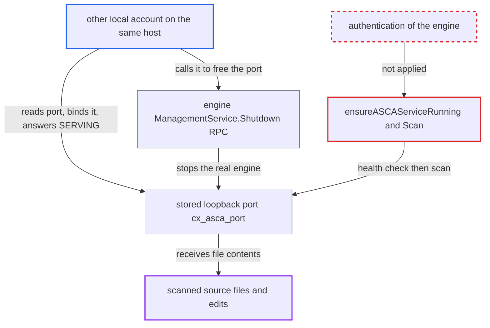

# ASCA client trusts any process on its stored loopback port, leaking scanned source

| Field | Value |
|---|---|
| ID | `find_019bMxPokdRewfknUaJKEu2J` |
| Severity | **Medium** |
| Status | open |
| CWE | CWE-923 — Improper endpoint restriction |
| Created | 2026-10-22T13:58:06.814197Z |
| Claude Security | https://claude.ai/security/findings/find_019bMxPokdRewfknUaJKEu2J |

## Description

Another unprivileged account on the same machine can receive the full text of source files that a developer scans with ASCA. It can also feed back fake scan results. The attacker needs a local account on a shared host and takes over the engine's stored loopback port. The CLI treats any process that answers a health check on that port as the trusted engine, with no authentication.

1. **Local attacker** finds the engine's port. The port appears in `ss -ltn`, in `/proc/net/tcp`, and in the engine's `-listen <port>` command-line argument, which other users can read. ([`internal/services/asca.go:285-315`](https://github.com/cx-benchmark/ast-cli/blob/fd7806d4fa55005863ea1cb272ed9e9aadd49866/internal/services/asca.go#L285-L315))
2. **Local attacker** takes over the stored port. The port is chosen once and kept as `cx_asca_port`, so after a reboot the attacker can bind it before the engine starts. Alternatively, the attacker calls the engine's unauthenticated `ManagementService.Shutdown` RPC and then binds the freed port. ([`internal/services/asca.go:212-227`](https://github.com/cx-benchmark/ast-cli/blob/fd7806d4fa55005863ea1cb272ed9e9aadd49866/internal/services/asca.go#L212-L227))
3. **Local attacker** calls `Shutdown` to free the port. The CLI calls `Shutdown` with no credentials or metadata, so the engine cannot tell the attacker from the CLI. Whether the engine honours this is an assumption, because the engine binary is not in the repository. ([`internal/wrappers/grpcs/asca-grpc.go:111-129`](https://github.com/cx-benchmark/ast-cli/blob/fd7806d4fa55005863ea1cb272ed9e9aadd49866/internal/wrappers/grpcs/asca-grpc.go#L111-L129))
4. **Attacker's fake server** answers the health check with SERVING. `HealthCheck` only asks for `SERVING` on service `VorpalEngine`, so a fake gRPC server passes. ([`internal/wrappers/grpcs/asca-grpc.go:99-109`](https://github.com/cx-benchmark/ast-cli/blob/fd7806d4fa55005863ea1cb272ed9e9aadd49866/internal/wrappers/grpcs/asca-grpc.go#L99-L109))
5. **the CLI function `ensureASCAServiceRunning`** accepts the fake server as the engine. It decides the engine is present only because `HealthCheck()` succeeds on the configured port, so it never starts a real engine. ([`internal/services/asca.go:248-267`](https://github.com/cx-benchmark/ast-cli/blob/fd7806d4fa55005863ea1cb272ed9e9aadd49866/internal/services/asca.go#L248-L267))
6. **the CLI method `Scan`** sends the file name and complete file contents to the fake server. The connection uses `insecure.NewCredentials()` with no token or peer check. The `ScanDetails` the server answers with are returned as the scan result. ([`internal/wrappers/grpcs/asca-grpc.go:37-78`](https://github.com/cx-benchmark/ast-cli/blob/fd7806d4fa55005863ea1cb272ed9e9aadd49866/internal/wrappers/grpcs/asca-grpc.go#L37-L78))
7. **the ASCA guardrail for AI-agent edits** sends proposed edits to the same port. It reads the same stored port, so the fake server receives the edits. The server can return no findings, and then the guardrail never blocks. ([`internal/commands/agenthooks/guardrails/asca/asca.go:63-95`](https://github.com/cx-benchmark/ast-cli/blob/fd7806d4fa55005863ea1cb272ed9e9aadd49866/internal/commands/agenthooks/guardrails/asca/asca.go#L63-L95))

## Assessment

The attacker is another unprivileged account on the same host, such as a shared Linux dev server, a VS Code Remote-SSH target or a shared CI runner. The attacker needs no special rights. They read the port and take it in one of two ways. The first is to bind it while the engine is not running, for example after a reboot, because the stored port is reused. The second is to call `ManagementService.Shutdown` and bind the freed port. The next routine `cx scan asca` then triggers the leak. That run comes from the VS Code extension on each open or edit of a supported file, or from the AI-agent guardrail. The pre-bind path depends only on CLI code. The report assumes the engine honours an unauthenticated `Shutdown` and binds loopback, because the engine is not in the repository.

Impact: For as long as the hijack lasts, the attacker receives the full text of every supported source file the developer opens or edits, and of AI-proposed edits checked by the guardrail. The attacker also chooses the findings shown, and can make the guardrail always allow. The attacker can also stop the engine at will, which disables the feature.

## Recommendation

(1) The CLI treats any process that answers a gRPC health check on a shared loopback TCP port as the engine and sends it source code. It never verifies that this is the engine it launched.

Fix criteria: Each CLI-to-engine session is mutually authenticated. One way is a per-launch random secret passed out of band, not in argv, and required as gRPC metadata on every RPC including `Shutdown`. Another is an owner-only Unix-domain socket or named pipe in a private directory. A foreign process on the stored port that answers SERVING is rejected and gets no source. An unauthenticated `Scan` or `Shutdown` from another account fails.

(2) The port is persisted as `cx_asca_port` and reused indefinitely, and it is advertised on the engine's command line. This gives the hijack a stable, discoverable target across restarts.

Fix criteria: A failed endpoint authentication is treated as the engine not running, and it leads to launching a fresh, authenticated engine. The listen endpoint is not the only identity check. The stored port does not let another account pre-occupy it and receive scans.

## Evidence

**https://github.com/cx-benchmark/ast-cli**

- [`internal/services/asca.go:248-267`](https://github.com/cx-benchmark/ast-cli/blob/fd7806d4fa55005863ea1cb272ed9e9aadd49866/internal/services/asca.go#L248-L267)
- [`internal/wrappers/grpcs/client.go:45-47`](https://github.com/cx-benchmark/ast-cli/blob/fd7806d4fa55005863ea1cb272ed9e9aadd49866/internal/wrappers/grpcs/client.go#L45-L47)
- [`internal/wrappers/grpcs/asca-grpc.go:37-78`](https://github.com/cx-benchmark/ast-cli/blob/fd7806d4fa55005863ea1cb272ed9e9aadd49866/internal/wrappers/grpcs/asca-grpc.go#L37-L78)
- [`internal/wrappers/grpcs/asca-grpc.go:99-109`](https://github.com/cx-benchmark/ast-cli/blob/fd7806d4fa55005863ea1cb272ed9e9aadd49866/internal/wrappers/grpcs/asca-grpc.go#L99-L109)
- [`internal/services/asca.go:212-227`](https://github.com/cx-benchmark/ast-cli/blob/fd7806d4fa55005863ea1cb272ed9e9aadd49866/internal/services/asca.go#L212-L227)
- [`internal/commands/asca/asca-engine.go:40-41`](https://github.com/cx-benchmark/ast-cli/blob/fd7806d4fa55005863ea1cb272ed9e9aadd49866/internal/commands/asca/asca-engine.go#L40-L41)
- [`internal/commands/agenthooks/guardrails/asca/asca.go:63-95`](https://github.com/cx-benchmark/ast-cli/blob/fd7806d4fa55005863ea1cb272ed9e9aadd49866/internal/commands/agenthooks/guardrails/asca/asca.go#L63-L95)
- [`internal/services/asca.go:285-315`](https://github.com/cx-benchmark/ast-cli/blob/fd7806d4fa55005863ea1cb272ed9e9aadd49866/internal/services/asca.go#L285-L315)
- [`internal/wrappers/grpcs/asca-grpc.go:111-129`](https://github.com/cx-benchmark/ast-cli/blob/fd7806d4fa55005863ea1cb272ed9e9aadd49866/internal/wrappers/grpcs/asca-grpc.go#L111-L129)

