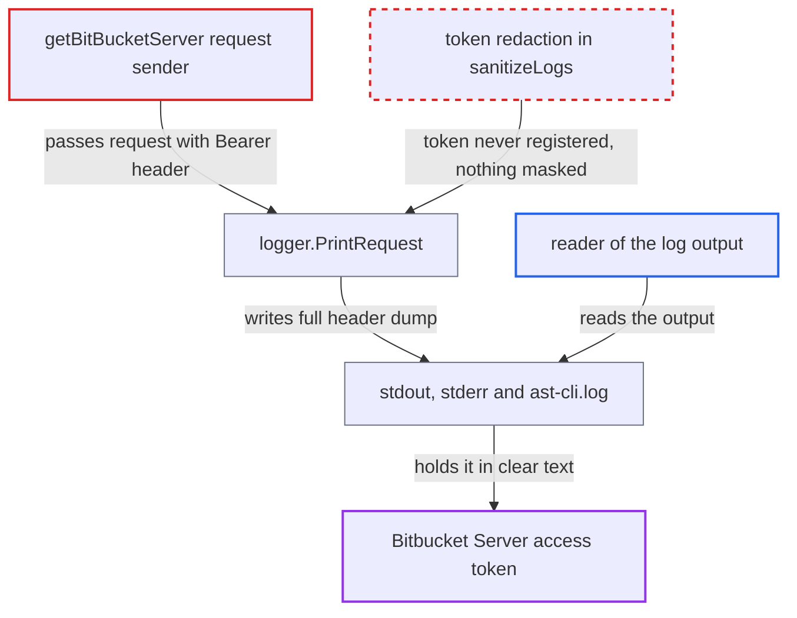

# Bitbucket Server contributor-count writes its Bearer token unmasked to debug logs

| Field | Value |
|---|---|
| ID | `find_01EhX4AGQTF5HsBeyL2dK83L` |
| Severity | **Medium** |
| Status | open |
| CWE | CWE-532 — Sensitive information in log |
| Created | 2026-10-22T13:59:27.037882Z |
| Claude Security | https://claude.ai/security/findings/find_01EhX4AGQTF5HsBeyL2dK83L |

## Description

Anyone who can read the CLI's debug output can take the Bitbucket Server HTTP access token that an operator passed to `cx utils contributor-count bitbucket-server`. It happens only when `--debug`, `--log-file` or `--log-file-console` is set. `getBitBucketServer` logs each request with its Bearer header, and the logger never masks this token.

1. **operator or CI job** runs the Bitbucket Server contributor-count command with verbose logging. The command is `cx utils contributor-count bitbucket-server --server-url <url> --token <token>`, with `--debug`, `--log-file` or `--log-file-console` set. ([`internal/commands/util/usercount/bitbucketserver/bitbucket-server.go:74`](https://github.com/cx-benchmark/ast-cli/blob/fd7806d4fa55005863ea1cb272ed9e9aadd49866/internal/commands/util/usercount/bitbucketserver/bitbucket-server.go#L74))
2. **the function `getBitBucketServer`** adds the Bearer token header and passes the request to `logger.PrintRequest`. The `Authorization: Bearer <token>` header is still on the request when it is logged, and every page of projects, repos and commits takes this path. ([`internal/wrappers/bitbucketserver/bitbucket-server-http.go:151-180`](https://github.com/cx-benchmark/ast-cli/blob/fd7806d4fa55005863ea1cb272ed9e9aadd49866/internal/wrappers/bitbucketserver/bitbucket-server-http.go#L151-L180))
3. **the function `PrintRequest`** dumps the whole request, headers included, through `PrintIfVerbose`. `httputil.DumpRequest` keeps every header except `Host`, `Transfer-Encoding` and `Trailer`, so the `Authorization` header is written out. ([`internal/logger/utils.go:57-75`](https://github.com/cx-benchmark/ast-cli/blob/fd7806d4fa55005863ea1cb272ed9e9aadd49866/internal/logger/utils.go#L57-L75))
4. **the sanitizer `sanitizeLogs`** finds nothing to mask. It masks only the viper values of the keys in `sanitizeFlags` and values passed to `RegisterSensitiveValue`. The viper key `token` is bound to another command's unchanged flag, so it is empty here. `bitbucketServerToken` is never registered. ([`internal/commands/util/pr.go:200-201`](https://github.com/cx-benchmark/ast-cli/blob/fd7806d4fa55005863ea1cb272ed9e9aadd49866/internal/commands/util/pr.go#L200-L201))
5. **the logger** writes the token in clear text to stderr, stdout and/or `ast-cli.log`. The log file is created with mode `0666` before umask, so other local users can read it. ([`internal/commands/root.go:445-450`](https://github.com/cx-benchmark/ast-cli/blob/fd7806d4fa55005863ea1cb272ed9e9aadd49866/internal/commands/root.go#L445-L450))
6. **attacker** reads the log output and copies the token. The reader may use a CI log viewer, a log aggregator or the local file.

## Assessment

An operator or CI job runs the command with `--debug`, `--log-file` or `--log-file-console`. This is the CLI's documented troubleshooting path. The attacker needs read access to the resulting output. That could be a CI log viewer, a log aggregator, or a local user reading the `ast-cli.log` file, which is created with mode `0666` before umask. The attacker needs no other access. The GitHub and GitLab contributor-count commands avoid the problem by calling `viper.BindPFlag(params.SCMTokenFlag, ...)`. The Bitbucket Server command has no equivalent.

Impact: The full Bitbucket Server HTTP access token is disclosed in the CLI's logs, although the logger is meant to mask SCM tokens. The report finds no effect on the host's integrity or availability.

Subsequent-system impact: The token authenticates to the Bitbucket Server instance, which is a separate system. Its holder can read every project and repository the token can reach, including commit history and source. Write access depends on the token's permissions, which the report says the code does not establish. This command itself needs only read access.

## Recommendation

`getBitBucketServer` logs the request after attaching the Bearer token. The token was never registered with the logger's redaction, so `PrintRequest` writes it verbatim.

Fix criteria: With `--debug`, `--log-file` or `--log-file-console` enabled, no output of `cx utils contributor-count bitbucket-server` contains the token value. Check this by running the command against a stub Bitbucket Server with a known token. Then search stdout, stderr and `ast-cli.log` for that token. The fix is either to register the token as sensitive before the first request, or to redact `Authorization` by header name in request dumps.

## Evidence

**https://github.com/cx-benchmark/ast-cli**

- [`internal/wrappers/bitbucketserver/bitbucket-server-http.go:151-180`](https://github.com/cx-benchmark/ast-cli/blob/fd7806d4fa55005863ea1cb272ed9e9aadd49866/internal/wrappers/bitbucketserver/bitbucket-server-http.go#L151-L180)
- [`internal/logger/utils.go:57-75`](https://github.com/cx-benchmark/ast-cli/blob/fd7806d4fa55005863ea1cb272ed9e9aadd49866/internal/logger/utils.go#L57-L75)
- [`internal/logger/utils.go:19-27`](https://github.com/cx-benchmark/ast-cli/blob/fd7806d4fa55005863ea1cb272ed9e9aadd49866/internal/logger/utils.go#L19-L27)
- [`internal/commands/util/usercount/bitbucketserver/bitbucket-server.go:74`](https://github.com/cx-benchmark/ast-cli/blob/fd7806d4fa55005863ea1cb272ed9e9aadd49866/internal/commands/util/usercount/bitbucketserver/bitbucket-server.go#L74)
- [`internal/commands/util/pr.go:200-201`](https://github.com/cx-benchmark/ast-cli/blob/fd7806d4fa55005863ea1cb272ed9e9aadd49866/internal/commands/util/pr.go#L200-L201)
- [`internal/commands/util/usercount/github.go:86`](https://github.com/cx-benchmark/ast-cli/blob/fd7806d4fa55005863ea1cb272ed9e9aadd49866/internal/commands/util/usercount/github.go#L86)
- [`internal/commands/root.go:445-450`](https://github.com/cx-benchmark/ast-cli/blob/fd7806d4fa55005863ea1cb272ed9e9aadd49866/internal/commands/root.go#L445-L450)

