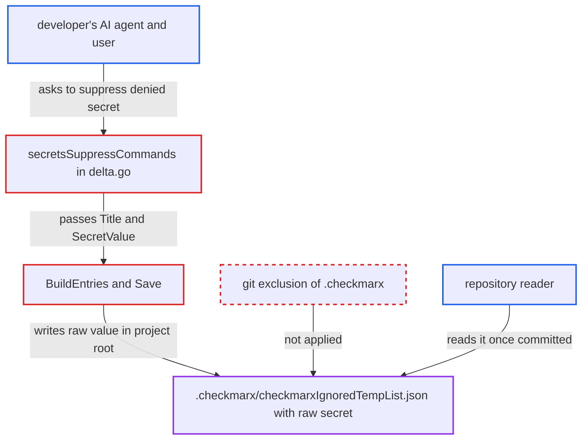

# CLI secret suppression stores raw secret value in project .checkmarx ignore file

| Field | Value |
|---|---|
| ID | `find_01V3R78hJKFvqtBmGgKmkskW` |
| Severity | **Medium** |
| Status | open |
| CWE | CWE-313 — Cleartext storage |
| Created | 2026-10-22T14:22:09.626878Z |
| Claude Security | https://claude.ai/security/findings/find_01V3R78hJKFvqtBmGgKmkskW |

## Description

A raw credential that a developer chose to suppress is copied in plain text into a file inside the project. Anyone who can read the repository learns it if the developer commits that file. It matters most when the secret was in an untracked file such as a gitignored `.env`. The cause is that `BuildEntries` and `Save` store `SecretValue` verbatim, and nothing excludes `.checkmarx/` from git.

1. **AI agent** tries to write a real credential into an untracked file such as a gitignored `.env`. The secrets guardrail detects the value with 2ms and denies the write, then emits a `cx ignore-vulnerability --scan-type secrets` suppress command for each finding. ([`internal/commands/agenthooks/guardrails/secrets/delta.go:153-203`](https://github.com/cx-benchmark/ast-cli/blob/fd7806d4fa55005863ea1cb272ed9e9aadd49866/internal/commands/agenthooks/guardrails/secrets/delta.go#L153-L203))
2. **user and agent** run the emitted suppress command after the user explicitly asks to ignore the finding. The deny text allows suppressing a real secret only on an explicit user request, and the agent then retries the blocked write. ([`internal/commands/agenthooks/guardrails/secrets/prompts.go:44-62`](https://github.com/cx-benchmark/ast-cli/blob/fd7806d4fa55005863ea1cb272ed9e9aadd49866/internal/commands/agenthooks/guardrails/secrets/prompts.go#L44-L62))
3. **the function `secretsSuppressCommands`** writes a `{Title, SecretValue}` payload to a temp file used as `--data`. The file is created with `os.CreateTemp` and mode 0600, so only the same OS user can read it, and it is never removed. ([`internal/commands/agenthooks/guardrails/secrets/delta.go:153-203`](https://github.com/cx-benchmark/ast-cli/blob/fd7806d4fa55005863ea1cb272ed9e9aadd49866/internal/commands/agenthooks/guardrails/secrets/delta.go#L153-L203))
4. **the `ignore-vulnerability` command** reads the payload and builds the ignore entry through `BuildEntries`. `BuildEntries` refuses a secrets entry without `SecretValue` and keeps the entry unchanged, so the raw credential becomes the stored entry. ([`internal/services/realtimeengine/ignore/builder.go:114-122`](https://github.com/cx-benchmark/ast-cli/blob/fd7806d4fa55005863ea1cb272ed9e9aadd49866/internal/services/realtimeengine/ignore/builder.go#L114-L122))
5. **`ignore.Save`** writes the entries as JSON to `<workDir>/.checkmarx/checkmarxIgnoredTempList.json`. The file is inside the project root, and nothing adds `.checkmarx/` or the file to `.gitignore` or `.git/info/exclude`. ([`internal/services/realtimeengine/ignore/ignorefile.go:132-144`](https://github.com/cx-benchmark/ast-cli/blob/fd7806d4fa55005863ea1cb272ed9e9aadd49866/internal/services/realtimeengine/ignore/ignorefile.go#L132-L144))
6. **developer** commits the project with a command such as `git add -A`, which picks up the untracked `.checkmarx/` directory. The credential was deliberately kept out of version control, but it now sits in a tracked file that any repository reader can open.

## Assessment

The trigger is local. A developer's AI agent tries to put a real credential into an untracked file, most likely a gitignored `.env`, which is also where the deny message's own advice to use environment variables points. The secrets guardrail denies the write, and the user then explicitly tells the agent to ignore the finding. The exposure needs a later step: the developer commits `.checkmarx/`, for example with `git add -A`. For a secret written into a tracked file the extra copy adds nothing. The temp payload is readable only by the same OS user, so on its own it exposes nothing to another party. `cx scan create` also zips the ignore file, but the zip goes to the configured tenant, which already receives `*.env` files, so the upload adds no new recipient. The finding assumes `github.com/checkmarx/2ms/v3` v3.21.0 fills `Secret.Value` with the unredacted match.

Impact: The project gets a plain-text copy of a credential in a file whose name does not say it holds secrets. The copy stays after the secret is removed from source, because nothing deletes the entry. The CLI itself suffers no loss of integrity or availability.

Subsequent-system impact: The leaked value is a credential for another service, such as cloud, SaaS or a database, and 2ms may have confirmed it as live when `WithValidation: true`. Whoever holds it gets whatever access it grants. The report does not say how far that access reaches.

## Recommendation

(1) Secrets ignore entries use the plaintext value as their identity. `BuildEntries`, `filterIgnoredSecrets`, `buildIgnoreMap` and the hook payload all carry `SecretValue`, so each suppression record is a cleartext copy of the credential.

Fix criteria: No CLI ignore file and no hook `--data` payload holds the secret in recoverable form. A suppressed secret is identified by a one-way digest of rule and value, and the `--ignored-file-path` reader matches that digest. Any temp payload is removed after use. To verify, run the guardrail deny and the emitted suppress command, then grep `.checkmarx/checkmarxIgnoredTempList.json` and the temp dir for the value. It must be absent, and the finding must stay suppressed on rescan.

(2) The ignore file is created inside the project root with no version-control exclusion and no warning. A local suppression record therefore becomes a repository artifact.

Fix criteria: Suppression data derived from secrets is either stored outside the repository or reliably excluded from version control. To verify, suppress a secret in a git working tree. `git status` and `git add -A` must not stage any file that holds secret-derived data.

## Evidence

**https://github.com/cx-benchmark/ast-cli**

- [`internal/services/realtimeengine/ignore/builder.go:114-122`](https://github.com/cx-benchmark/ast-cli/blob/fd7806d4fa55005863ea1cb272ed9e9aadd49866/internal/services/realtimeengine/ignore/builder.go#L114-L122)
- [`internal/services/realtimeengine/ignore/ignorefile.go:132-144`](https://github.com/cx-benchmark/ast-cli/blob/fd7806d4fa55005863ea1cb272ed9e9aadd49866/internal/services/realtimeengine/ignore/ignorefile.go#L132-L144)
- [`internal/services/realtimeengine/secretsrealtime/secrets-realtime.go:45-63`](https://github.com/cx-benchmark/ast-cli/blob/fd7806d4fa55005863ea1cb272ed9e9aadd49866/internal/services/realtimeengine/secretsrealtime/secrets-realtime.go#L45-L63)
- [`internal/commands/agenthooks/guardrails/secrets/delta.go:153-203`](https://github.com/cx-benchmark/ast-cli/blob/fd7806d4fa55005863ea1cb272ed9e9aadd49866/internal/commands/agenthooks/guardrails/secrets/delta.go#L153-L203)
- [`internal/commands/agenthooks/guardrails/secrets/prompts.go:44-62`](https://github.com/cx-benchmark/ast-cli/blob/fd7806d4fa55005863ea1cb272ed9e9aadd49866/internal/commands/agenthooks/guardrails/secrets/prompts.go#L44-L62)
- [`internal/commands/ignore_vulnerability.go:45-96`](https://github.com/cx-benchmark/ast-cli/blob/fd7806d4fa55005863ea1cb272ed9e9aadd49866/internal/commands/ignore_vulnerability.go#L45-L96)
- [`internal/commands/scan.go:1882-1886`](https://github.com/cx-benchmark/ast-cli/blob/fd7806d4fa55005863ea1cb272ed9e9aadd49866/internal/commands/scan.go#L1882-L1886)

