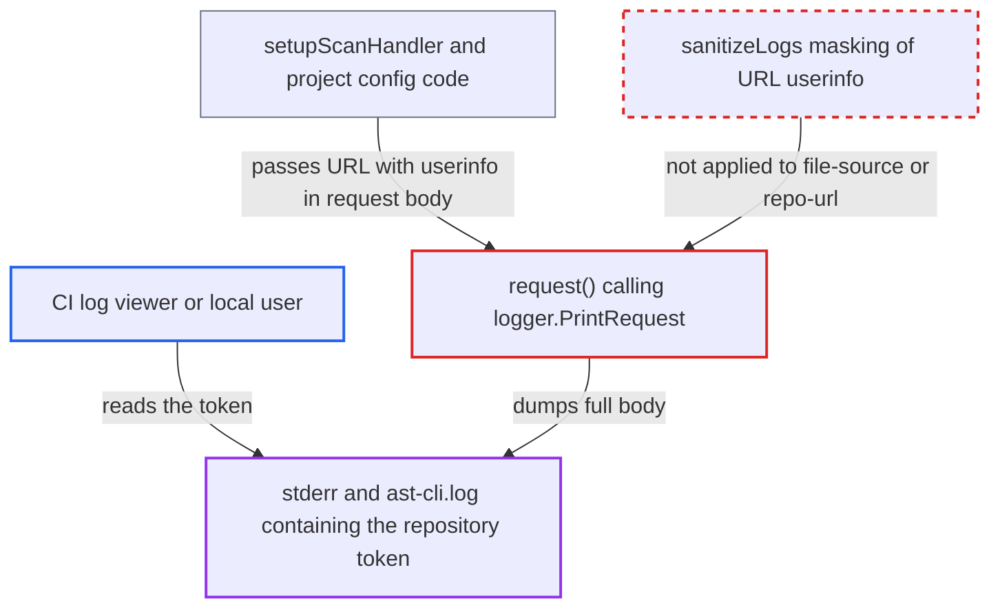

# Credentials in git repository URLs (--file-source, --repo-url) logged unmasked in request dumps

| Field | Value |
|---|---|
| ID | `find_01DXJX19HmGuVsDNBh22SqTx` |
| Severity | **Medium** |
| Status | open |
| CWE | CWE-532 — Sensitive information in log |
| Created | 2026-10-22T14:23:14.420295Z |
| Claude Security | https://claude.ai/security/findings/find_01DXJX19HmGuVsDNBh22SqTx |

## Description

Anyone who can read a CLI log or CI job output can recover a private repository token that was embedded in a git URL. The token is written in clear text when `--debug`, `--log-file` or `--log-file-console` is on and the URL has credentials. The cause is that `--file-source` and `--repo-url` values reach the request dump, and `sanitizeLogs` never masks the URL's userinfo.

1. **operator or CI job** runs the CLI with a token inside an HTTPS git URL. For an HTTPS private repository, the only way to give the CLI a token is as URL userinfo, such as `https://x-access-token:<PAT>@github.com/org/repo.git`, because `--ssh-key` accepts only SSH URLs. ([`internal/commands/scan.go:3074-3110`](https://github.com/cx-benchmark/ast-cli/blob/fd7806d4fa55005863ea1cb272ed9e9aadd49866/internal/commands/scan.go#L3074-L3110))
2. **`IsGitURL`** classifies the value as a git source. The unanchored `gitURLRegex` matches the URL with userinfo, so it is not treated as a local path. ([`internal/commands/util/utils.go:115-124`](https://github.com/cx-benchmark/ast-cli/blob/fd7806d4fa55005863ea1cb272ed9e9aadd49866/internal/commands/util/utils.go#L115-L124))
3. **`setupScanHandler`** copies the URL unchanged into `ScanHandler.RepoURL`. Nothing parses the URL, strips its userinfo, or calls `logger.RegisterSensitiveValue` for it. `updateProjectConfigurationIfNeeded` does the same for `--repo-url`. ([`internal/commands/scan.go:3034-3059`](https://github.com/cx-benchmark/ast-cli/blob/fd7806d4fa55005863ea1cb272ed9e9aadd49866/internal/commands/scan.go#L3034-L3059))
4. **`ScansHTTPWrapper.Create`** sends the URL as `repoUrl` in the JSON request body. The body is built with `bytes.NewBuffer`, so its `ContentLength` is known and a request dump includes it. The project path goes through `UpdateConfiguration` to `request(..., true)`. ([`internal/wrappers/scans-http.go:40-59`](https://github.com/cx-benchmark/ast-cli/blob/fd7806d4fa55005863ea1cb272ed9e9aadd49866/internal/wrappers/scans-http.go#L40-L59))
5. **`request()`** calls `logger.PrintRequest` on the outbound request. This call is made for every request, before it is sent. ([`internal/wrappers/client.go:814-820`](https://github.com/cx-benchmark/ast-cli/blob/fd7806d4fa55005863ea1cb272ed9e9aadd49866/internal/wrappers/client.go#L814-L820))
6. **`PrintRequest` and `sanitizeLogs`** write the full body, including the token, to stderr or `ast-cli.log`. `sanitizeLogs` masks only the viper values of `sanitizeFlags` and registered sensitive values. `file-source` and `repo-url` are not in that list and no userinfo is registered, so the token is printed byte for byte. ([`internal/logger/utils.go:19-100`](https://github.com/cx-benchmark/ast-cli/blob/fd7806d4fa55005863ea1cb272ed9e9aadd49866/internal/logger/utils.go#L19-L100))
7. **attacker** reads the token from the log output. The attacker is someone who views the CI job log or its archived artifacts, or another local account that reads `ast-cli.log`.

## Assessment

An operator or CI job runs `cx scan create -s https://user:<token>@host/org/repo.git`, or `cx project create --repo-url` with a similar URL. One of `--debug`, `--log-file` or `--log-file-console` must be on, and the URL must carry credentials. The attacker needs only to read the output. That can be a viewer of the CI job log or archived artifacts, or another local account reading `ast-cli.log`. The `0666` creation mode of `ast-cli.log` widens who can read the token. Both the scan path and the project path lead to the same dump.

Impact: The token is written to the CLI's console or log file in clear, recoverable form. Nothing else on the CLI host is affected, and the leak needs verbose logging and a credential-bearing URL.

Subsequent-system impact: The leaked userinfo authenticates to the source-control host named in the URL, outside the CLI. It is at least enough to clone the customer's private repository, so the source code is exposed. Write access depends on the token's scope on that host, which the report does not establish.

## Recommendation

Repository URLs from `--file-source` and `--repo-url` can carry userinfo credentials. They are copied unchanged into request bodies that `request()` dumps. Their userinfo is never masked or registered as a sensitive value, unlike `scs-repo-url` and `ssh-value`.

Fix criteria: With `--debug`, `--log-file` or `--log-file-console`, no scan-create or project-configuration request with userinfo in its repository URL shows the password, the token or the full userinfo in console or log-file output. This holds in raw and in JSON-escaped form. Run `cx scan create -s https://u:*@host/o/r.git --debug` and `cx project create --repo-url https://u:*@host/o/r.git --debug` against a stub endpoint. Then confirm `SECRET` is absent from stderr and from `ast-cli.log`.

## Evidence

**https://github.com/cx-benchmark/ast-cli**

- [`internal/commands/scan.go:3034-3059`](https://github.com/cx-benchmark/ast-cli/blob/fd7806d4fa55005863ea1cb272ed9e9aadd49866/internal/commands/scan.go#L3034-L3059)
- [`internal/commands/util/utils.go:115-124`](https://github.com/cx-benchmark/ast-cli/blob/fd7806d4fa55005863ea1cb272ed9e9aadd49866/internal/commands/util/utils.go#L115-L124)
- [`internal/commands/scan.go:3074-3110`](https://github.com/cx-benchmark/ast-cli/blob/fd7806d4fa55005863ea1cb272ed9e9aadd49866/internal/commands/scan.go#L3074-L3110)
- [`internal/wrappers/scans-http.go:40-59`](https://github.com/cx-benchmark/ast-cli/blob/fd7806d4fa55005863ea1cb272ed9e9aadd49866/internal/wrappers/scans-http.go#L40-L59)
- [`internal/commands/project.go:304-334`](https://github.com/cx-benchmark/ast-cli/blob/fd7806d4fa55005863ea1cb272ed9e9aadd49866/internal/commands/project.go#L304-L334)
- [`internal/wrappers/client.go:814-820`](https://github.com/cx-benchmark/ast-cli/blob/fd7806d4fa55005863ea1cb272ed9e9aadd49866/internal/wrappers/client.go#L814-L820)
- [`internal/logger/utils.go:19-100`](https://github.com/cx-benchmark/ast-cli/blob/fd7806d4fa55005863ea1cb272ed9e9aadd49866/internal/logger/utils.go#L19-L100)

