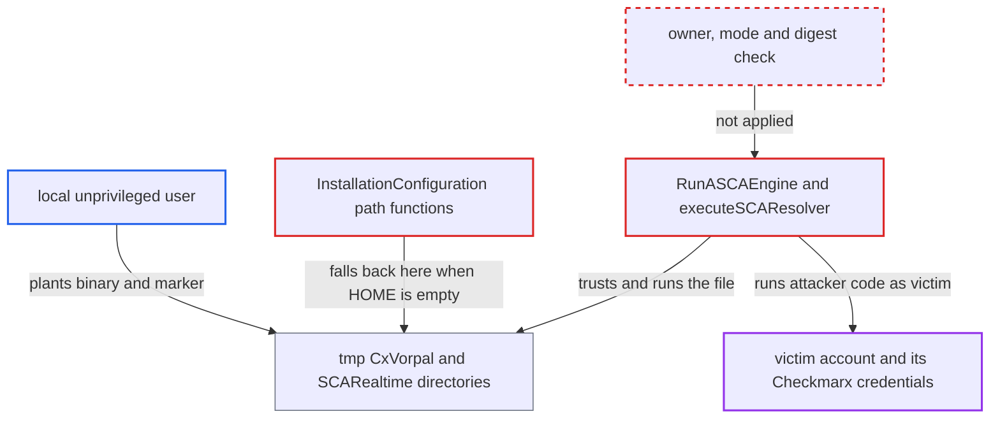

# Engine paths fall back to shared temp dir when $HOME is empty; planted engine binary is executed

| Field | Value |
|---|---|
| ID | `find_01RYVM5jfuFnSXqQB4Cu3ASy` |
| Severity | **Medium** |
| Status | open |
| CWE | CWE-379 — Insecure temporary file |
| Created | 2026-10-22T14:02:07.648598Z |
| Claude Security | https://claude.ai/security/findings/find_01RYVM5jfuFnSXqQB4Cu3ASy |

## Description

A local user on a shared Linux or macOS host can get their own program run as another user, or as root for a root service. It works only when the victim runs `cx scan asca` or `cx scan sca-realtime` with `$HOME` empty or unset. The engine paths then fall back to fixed directories under `os.TempDir()`, and the code runs whatever file it finds there without checking who owns it.

1. **local attacker** creates the fixed engine directory in the shared temp location and plants files. The attacker creates `/tmp/CxVorpal/`, drops a malicious `vorpal_linux_x64`, and adds a mode-0666 copy of the public `hash.txt` for the `--asca-latest-version` case. This only works before the victim's first install or after `/tmp` is cleaned. ([`internal/services/osinstaller/os-installer-structs.go:23-48`](https://github.com/cx-benchmark/ast-cli/blob/fd7806d4fa55005863ea1cb272ed9e9aadd49866/internal/services/osinstaller/os-installer-structs.go#L23-L48))
2. **victim running the CLI** starts `cx scan asca` or `cx scan sca-realtime` with `$HOME` empty. `os.UserHomeDir()` fails, so `ExecutableFilePath`, `HashFilePath` and `WorkingDir` fall back to `os.TempDir()`, which is `$TMPDIR` or `/tmp`. The rest of the CLI still works through `user.Current()`, so nothing shows the fallback happened. ([`internal/services/osinstaller/os-installer-structs.go:23-48`](https://github.com/cx-benchmark/ast-cli/blob/fd7806d4fa55005863ea1cb272ed9e9aadd49866/internal/services/osinstaller/os-installer-structs.go#L23-L48))
3. **`manageASCAInstallation`** skips installation because a file already exists at the executable path. It only calls `os.Stat` and does not check the file's owner, mode or digest, unless `--asca-latest-version` is given. ([`internal/services/asca.go:195-210`](https://github.com/cx-benchmark/ast-cli/blob/fd7806d4fa55005863ea1cb272ed9e9aadd49866/internal/services/asca.go#L195-L210))
4. **`downloadNotNeeded`** reports the install as up to date when the planted marker matches the public one. This applies with `--asca-latest-version`, and always for `sca-realtime`. The planted copy of the public marker passes. The archive checksum check at lines 88-108 runs only on a fresh download, so it never sees the planted binary. ([`internal/services/osinstaller/os-installer.go:130-159`](https://github.com/cx-benchmark/ast-cli/blob/fd7806d4fa55005863ea1cb272ed9e9aadd49866/internal/services/osinstaller/os-installer.go#L130-L159))
5. **`RunASCAEngine` or `executeSCAResolver`** executes the planted binary as the invoking user. For ASCA, `RunASCAEngine` runs `exec.Command(ascaconfig.Params.ExecutableFilePath(), ...)`. `checkLicense` is skipped for the default `--agent` value `ASTCLI`, so no credentials are needed to reach this. For SCA, `executeSCAResolver` runs `/tmp/SCARealtime/ScaResolver`. ([`internal/services/asca.go:248-303`](https://github.com/cx-benchmark/ast-cli/blob/fd7806d4fa55005863ea1cb272ed9e9aadd49866/internal/services/asca.go#L248-L303))

## Assessment

The attacker is an unprivileged local account on a shared Linux or macOS host. They create the fixed engine directories and plant the files, then wait. The victim is another user, or a root service, that later runs `cx scan asca` or `cx scan sca-realtime` with `$HOME` empty and `$TMPDIR` unset. This happens under systemd system units without `User=`, configuration-management `exec` resources, and launchers that sanitise the environment. The attacker does not control the empty `$HOME`. They also need a planting window, either before the victim's first install or after `/tmp` is cleaned. With a normal `$HOME` this is not exploitable on its own, because `~/.checkmarx` is created 0700 by `verifyConfigDir`. Windows is largely unaffected, because `GetTempPath` normally resolves to a per-user `%TEMP%`. A minor extra factor is that `createWorkingDirectory` uses `fs.ModePerm`, so the directory's protection depends on the umask.

Impact: The attacker's binary runs as the victim account, or as root for a root service. It can read the victim's Checkmarx credentials (`~/.checkmarx`, keyring, `CX_*` env) and the source being scanned, and can change anything that account can. `ConfigureIndependentProcess` detaches it, so it keeps running after the CLI exits.

## Recommendation

(1) When `$HOME` is empty, the engine install and execution paths fall back to a fixed directory inside the shared, world-writable `os.TempDir()`. The rest of the CLI finds the home directory through `user.Current()`.

Fix criteria: Engines are never installed to, or run from, a directory that other users can create or write. The base directory is resolved the same way as in `configuration.LoadConfiguration`. If no private per-user directory is available, the CLI fails with an explicit error. To check, run `cx scan asca` and `cx scan sca-realtime` with `HOME=` and a pre-created, attacker-owned `/tmp/CxVorpal/vorpal_*` and `/tmp/SCARealtime/ScaResolver`. Neither planted file may be executed.

(2) `manageASCAInstallation`, `downloadNotNeeded`, `RunASCAEngine` and `executeSCAResolver` trust any file at the expected path. Existence, or a matching version marker, is the only check. So a binary that never passed checksum verification gets executed.

Fix criteria: Before an engine runs, the binary and its directory are confirmed to be owned by the current user and not writable by group or others. Ideally the binary is also confirmed to still match the digest verified at install time. If these checks fail, the CLI refuses to run the engine, or reinstalls it into a private directory created with mode 0700 regardless of umask.

## Evidence

**https://github.com/cx-benchmark/ast-cli**

- [`internal/services/osinstaller/os-installer-structs.go:23-48`](https://github.com/cx-benchmark/ast-cli/blob/fd7806d4fa55005863ea1cb272ed9e9aadd49866/internal/services/osinstaller/os-installer-structs.go#L23-L48)
- [`internal/services/asca.go:195-210`](https://github.com/cx-benchmark/ast-cli/blob/fd7806d4fa55005863ea1cb272ed9e9aadd49866/internal/services/asca.go#L195-L210)
- [`internal/services/asca.go:248-303`](https://github.com/cx-benchmark/ast-cli/blob/fd7806d4fa55005863ea1cb272ed9e9aadd49866/internal/services/asca.go#L248-L303)
- [`internal/services/osinstaller/os-installer.go:130-159`](https://github.com/cx-benchmark/ast-cli/blob/fd7806d4fa55005863ea1cb272ed9e9aadd49866/internal/services/osinstaller/os-installer.go#L130-L159)
- [`internal/commands/scarealtime/sca-realtime.go:78-113`](https://github.com/cx-benchmark/ast-cli/blob/fd7806d4fa55005863ea1cb272ed9e9aadd49866/internal/commands/scarealtime/sca-realtime.go#L78-L113)
- [`internal/wrappers/configuration/configuration.go:235-241`](https://github.com/cx-benchmark/ast-cli/blob/fd7806d4fa55005863ea1cb272ed9e9aadd49866/internal/wrappers/configuration/configuration.go#L235-L241)

