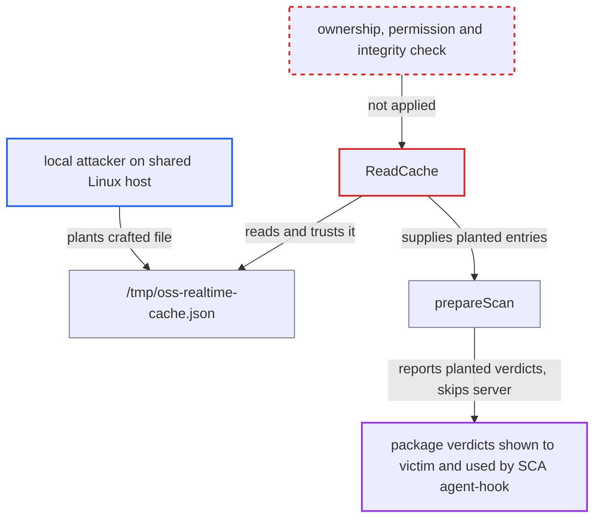

# OSS realtime cache read from predictable world-writable temp path lets local user poison results

| Field | Value |
|---|---|
| ID | `find_01HEwSi2bLEC8T9hHpi2mZAj` |
| Severity | **Medium** |
| Status | open |
| CWE | CWE-377 — Insecure temporary file |
| Created | 2026-10-22T14:02:46.872662Z |
| Claude Security | https://claude.ai/security/findings/find_01HEwSi2bLEC8T9hHpi2mZAj |

## Description

A local user on a shared Linux host can plant a fake package-verdict cache that the victim's OSS realtime scans then trust. Malicious packages can be shown as clean, or clean ones flagged, and the SCA agent-hook deny decision is affected too. The cause is `osscache.ReadCache`, which reads a fixed file in `/tmp` without checking who owns it. `prepareScan` then skips the server lookup for every cached package.

1. **local attacker** creates `/tmp/oss-realtime-cache.json` with crafted entries. The file is readable by all and owned by the attacker. Its entries mark a package such as `npm-evil-pkg-1.0.0` as `OK` with empty `vulnerabilities`, and its `ttl` is set far in the future.
2. **victim's IDE extension or SCA agent hook** runs `cx scan oss-realtime` during normal use. The IDE extension runs it on every manifest edit, and the SCA agent-hook guardrail runs the same engine, so the victim does nothing unusual.
3. **`ReadCache`** opens the planted file and decodes its JSON. The file has a fixed, predictable name in the shared `/tmp`. It is trusted as long as its own `ttl` is in the future, with no check of owner, permissions or integrity. ([`internal/services/realtimeengine/ossrealtime/osscache/oss-realtime-cache.go:19-40`](https://github.com/cx-benchmark/ast-cli/blob/fd7806d4fa55005863ea1cb272ed9e9aadd49866/internal/services/realtimeengine/ossrealtime/osscache/oss-realtime-cache.go#L19-L40))
4. **`prepareScan`** returns the cached `Status` and `Vulnerabilities` for each matching package. Any package whose `manager-name-version` key is in the cache is never sent to the Checkmarx realtime scanner API, so the planted entry replaces the server verdict. ([`internal/services/realtimeengine/ossrealtime/oss-realtime.go:281-303`](https://github.com/cx-benchmark/ast-cli/blob/fd7806d4fa55005863ea1cb272ed9e9aadd49866/internal/services/realtimeengine/ossrealtime/oss-realtime.go#L281-L303))
5. **`WriteCache`** fails to refresh the cache, and the failure goes unnoticed. `os.Create` fails with EACCES because the attacker owns the file, under the kernel default `fs.protected_regular`. The caller logs this only in verbose mode, so the poisoned file is never replaced and never expires. ([`internal/services/realtimeengine/ossrealtime/osscache/oss-realtime-cache.go:42-60`](https://github.com/cx-benchmark/ast-cli/blob/fd7806d4fa55005863ea1cb272ed9e9aadd49866/internal/services/realtimeengine/ossrealtime/osscache/oss-realtime-cache.go#L42-L60))

## Assessment

The attacker is any other local user or process on a multi-user Linux host where the victim runs the Checkmarx IDE extension or CLI. Examples are a shared workstation, a dev server or a CI runner. The attacker needs only the ability to write to `/tmp`, and the victim has to do nothing beyond normal use. A second route exists when the cache file is writable by the victim. The cache then leaks to other users the names and versions of every package the victim scans. On macOS and Windows the temp directory is per-user, so the issue is specific to Linux.

Impact: The attacker controls the OSS realtime verdicts shown to the developer and used by the SCA agent-hook gate. Malicious or vulnerable packages can appear as OK, or arbitrary packages can be flagged. Confidentiality loss is limited to learning which packages and versions the victim scans, and only when the cache is writable. The report names no availability impact.

## Recommendation

(1) The cache sits at a fixed name in `/tmp`, a directory shared with other users. `ReadCache` trusts it without any ownership or integrity check, so another local user can supply the verdicts the engine uses in place of the server's.

Fix criteria: Cache data comes only from the current user. It is stored under a per-user directory such as `os.UserCacheDir()` or the CLI config dir, created 0700. At minimum, a file not owned by the current uid, or with group or world write bits, is refused. The file is created with `O_EXCL` and 0600 and symlinks are never followed. To verify, plant a cache file as another user and confirm the engine ignores it and still queries the server.

(2) A failure to write the cache is silently swallowed and logged only in verbose mode. A planted file therefore persists indefinitely and the tampering stays hidden from the user.

Fix criteria: A cache read or write error caused by unexpected ownership or permissions is surfaced as a warning that shows without verbose mode. The cache is bypassed for that run.

## Evidence

**https://github.com/cx-benchmark/ast-cli**

- [`internal/services/realtimeengine/ossrealtime/osscache/oss-realtime-cache.go:19-40`](https://github.com/cx-benchmark/ast-cli/blob/fd7806d4fa55005863ea1cb272ed9e9aadd49866/internal/services/realtimeengine/ossrealtime/osscache/oss-realtime-cache.go#L19-L40)
- [`internal/services/realtimeengine/ossrealtime/osscache/oss-realtime-cache.go:42-60`](https://github.com/cx-benchmark/ast-cli/blob/fd7806d4fa55005863ea1cb272ed9e9aadd49866/internal/services/realtimeengine/ossrealtime/osscache/oss-realtime-cache.go#L42-L60)
- [`internal/services/realtimeengine/ossrealtime/oss-realtime.go:281-303`](https://github.com/cx-benchmark/ast-cli/blob/fd7806d4fa55005863ea1cb272ed9e9aadd49866/internal/services/realtimeengine/ossrealtime/oss-realtime.go#L281-L303)

