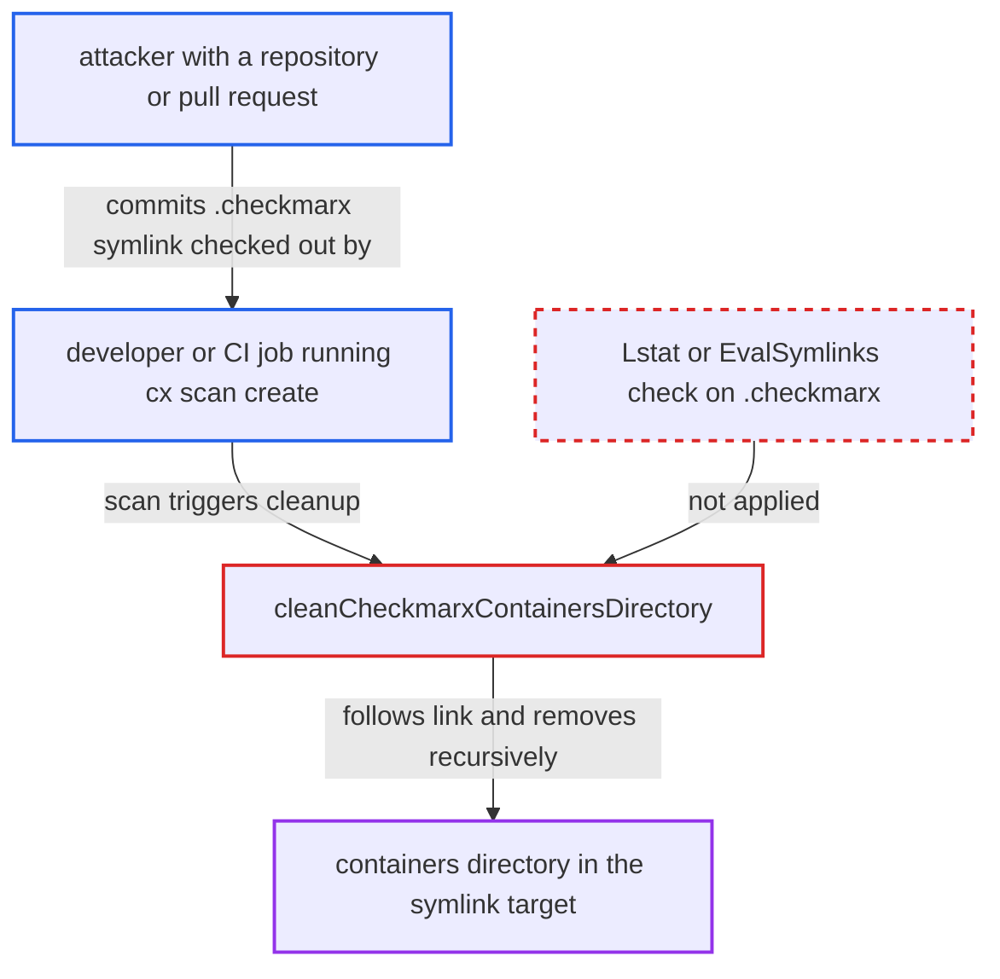

# Repo-controlled .checkmarx symlink turns container-scan cleanup into arbitrary directory deletion

| Field | Value |
|---|---|
| ID | `find_01RwRL9ot4Ejx9YVHLU19GYh` |
| Severity | **Medium** |
| Status | open |
| CWE | CWE-61 — Symlink following |
| Created | 2026-10-22T14:03:08.329571Z |
| Claude Security | https://claude.ai/security/findings/find_01RwRL9ot4Ejx9YVHLU19GYh |

## Description

A malicious repository can make the Checkmarx CLI delete a `containers` directory anywhere the scanning user can write, along with everything under it. This hits rootless podman storage, or Docker, podman and CRI-O state when the scan runs as root. It needs a Linux or macOS checkout scanned with the containers engine in local resolution mode. The cause is `cleanCheckmarxContainersDirectory`, which follows a committed `.checkmarx` symlink into `os.RemoveAll`.

1. **attacker** commits a symlink named `.checkmarx` to the repository. The link points to a chosen directory, either absolute such as `/var/lib` or relative such as `../../.local/share`, and git checks it out as a real symlink on Linux and macOS.
2. **developer or CI job** runs `cx scan create -s <checkout>` with the containers engine in local resolution mode. Local resolution comes from `--containers-local-resolution`, or `enforceLocalResolutionForTarFiles` turns it on when a `--container-images` entry is a tar or `oci-dir:` reference. ([`internal/commands/scan.go:2691-2745`](https://github.com/cx-benchmark/ast-cli/blob/fd7806d4fa55005863ea1cb272ed9e9aadd49866/internal/commands/scan.go#L2691-L2745))
3. **`getUploadURLFromSource`** runs the container resolver on the source directory and then calls `cleanCheckmarxContainersDirectory`. The cleanup runs after resolver success, after compression, on resolver failure and on compression failure, so the resolver does not have to succeed. ([`internal/commands/scan.go:2326-2381`](https://github.com/cx-benchmark/ast-cli/blob/fd7806d4fa55005863ea1cb272ed9e9aadd49866/internal/commands/scan.go#L2326-L2381))
4. **`cleanCheckmarxContainersDirectory`** builds `<source>/.checkmarx/containers`, checks it with `os.Stat` and calls `os.RemoveAll`. Nothing checks that `.checkmarx` is a symlink or that the resolved path stays inside the source tree, so the kernel follows the link. ([`internal/commands/scan.go:2402-2417`](https://github.com/cx-benchmark/ast-cli/blob/fd7806d4fa55005863ea1cb272ed9e9aadd49866/internal/commands/scan.go#L2402-L2417))
5. **`os.RemoveAll`** deletes `<link target>/containers` and everything below it. The deletion runs with the scanning user's privileges, and the attacker picks the parent directory while the deleted entry is always named `containers`. ([`internal/commands/scan.go:2402-2417`](https://github.com/cx-benchmark/ast-cli/blob/fd7806d4fa55005863ea1cb272ed9e9aadd49866/internal/commands/scan.go#L2402-L2417))

## Assessment

The attacker authors a repository or pull request that contains a `.checkmarx` symlink to a directory of their choice. A developer or CI job checks it out on Linux or macOS and runs `cx scan create -s <checkout>`. The scan must include the `containers` engine, which is on by default when the tenant is licensed (`validateScanTypes`). It must also use local resolution, either through `--containers-local-resolution` or through a tar or `oci-dir:` entry in `--container-images`. A valuable `containers` directory must exist at a guessable path. Examples are `~/.local/share/containers` and `~/.config/containers` for any user, or `/var/lib/containers`, `/var/lib/docker/containers` and `/etc/containers` when the scan runs as root. Windows checkouts are not affected by default, because `core.symlinks` is false there.

Impact: The attacker can delete `<dir>/containers` and everything under it that the scanning user can remove, with no way to recover it. Examples are podman images, containers and volumes, or a root runner's container state and policy, which breaks container workloads and builds. The attacker cannot choose content or read anything, so the damage is limited to this deletion.

## Recommendation

`cleanCheckmarxContainersDirectory` and the resolver output path it cleans assume `<source>/.checkmarx` is a plain directory inside the scanned tree. That tree is untrusted repository content and can contain symlinks.

Fix criteria: Before writing to or removing `<source>/.checkmarx/containers`, the CLI uses `Lstat` to confirm that neither `.checkmarx` nor `containers` is a symlink. Alternatively, it resolves the path with `filepath.EvalSymlinks` and requires the result to stay inside the source directory. It skips the removal otherwise. A stronger option is to have the resolver write to a CLI-created temporary directory outside the source tree and remove only that. To verify, scan a checkout containing `.checkmarx -> /tmp/victim` with `/tmp/victim/containers/keep` present, using `--containers-local-resolution`. The file `/tmp/victim/containers/keep` must still exist afterwards.

## Evidence

**https://github.com/cx-benchmark/ast-cli**

- [`internal/commands/scan.go:2402-2417`](https://github.com/cx-benchmark/ast-cli/blob/fd7806d4fa55005863ea1cb272ed9e9aadd49866/internal/commands/scan.go#L2402-L2417)
- [`internal/commands/scan.go:2326-2381`](https://github.com/cx-benchmark/ast-cli/blob/fd7806d4fa55005863ea1cb272ed9e9aadd49866/internal/commands/scan.go#L2326-L2381)
- [`internal/commands/scan.go:2422-2447`](https://github.com/cx-benchmark/ast-cli/blob/fd7806d4fa55005863ea1cb272ed9e9aadd49866/internal/commands/scan.go#L2422-L2447)
- [`internal/commands/scan.go:2691-2745`](https://github.com/cx-benchmark/ast-cli/blob/fd7806d4fa55005863ea1cb272ed9e9aadd49866/internal/commands/scan.go#L2691-L2745)

