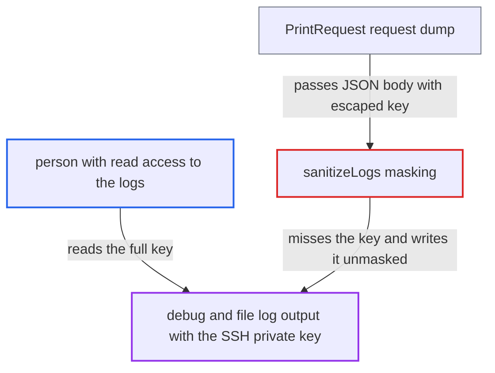

# SSH private key leaks into debug logs because masking misses its JSON-escaped form

| Field | Value |
|---|---|
| ID | `find_012mXKxtgaRqmumkZmToNVb3` |
| Severity | **Medium** |
| Status | open |
| CWE | CWE-532 — Sensitive information in log |
| Created | 2026-10-22T13:57:40.537933Z |
| Claude Security | https://claude.ai/security/findings/find_012mXKxtgaRqmumkZmToNVb3 |

## Description

Anyone who can read the CLI's debug or file logs can recover the full SSH private key that an operator passed with `--ssh-key`. This happens only when `--debug`, `--log-file` or `--log-file-console` is on. `sanitizeLogs` masks the key only in its raw multi-line form, but the logged request body holds the JSON-escaped form, so the mask never matches.

1. **operator or CI job** runs `cx project create` or `cx scan create` with `--ssh-key` and debug or file logging on. The key file is read verbatim, with no trimming, and put in the request as the credential `Value`. ([`internal/commands/project.go:315-331`](https://github.com/cx-benchmark/ast-cli/blob/fd7806d4fa55005863ea1cb272ed9e9aadd49866/internal/commands/project.go#L315-L331))
2. **the CLI commands** store the raw key in viper under `params.SSHValue` for masking. `defineSSHCredentials` in the scan path does the same, and the logger lists `params.SSHValue` in `sanitizeFlags` as a secret to hide. ([`internal/commands/scan.go:3096-3110`](https://github.com/cx-benchmark/ast-cli/blob/fd7806d4fa55005863ea1cb272ed9e9aadd49866/internal/commands/scan.go#L3096-L3110))
3. **the wrapper code** turns the configuration into a JSON body with `json.Marshal`. `encoding/json` writes each line break of the key as the two characters `\n`, so the key becomes one line. ([`internal/wrappers/projects-http.go:78-92`](https://github.com/cx-benchmark/ast-cli/blob/fd7806d4fa55005863ea1cb272ed9e9aadd49866/internal/wrappers/projects-http.go#L78-L92))
4. **`request()`** calls `logger.PrintRequest(req)` before sending. This happens on every request, so both the project-configuration and scan-create bodies reach the logger. ([`internal/wrappers/client.go:814-821`](https://github.com/cx-benchmark/ast-cli/blob/fd7806d4fa55005863ea1cb272ed9e9aadd49866/internal/wrappers/client.go#L814-L821))
5. **`PrintRequest`** dumps the request including its body through `httputil.DumpRequest`. The body is included when the request is under 1 MB, and the dump then goes through `sanitizeLogs`. ([`internal/logger/utils.go:57-75`](https://github.com/cx-benchmark/ast-cli/blob/fd7806d4fa55005863ea1cb272ed9e9aadd49866/internal/logger/utils.go#L57-L75))
6. **`sanitizeLogs`** runs `strings.ReplaceAll` with the raw multi-line key and finds no match. The logged text has `\n` escapes where the raw key has real line breaks, so nothing is replaced and the whole key is written out. ([`internal/logger/utils.go:87-99`](https://github.com/cx-benchmark/ast-cli/blob/fd7806d4fa55005863ea1cb272ed9e9aadd49866/internal/logger/utils.go#L87-L99))
7. **log reader** reads the log and copies the private key. The key is in stderr, in `ast-cli.log`, or in the console output and log file when `--log-file-console` is used.

## Assessment

A user or CI job runs `cx project create --repo-url git@host:org/repo --ssh-key key` or `cx scan create -s git@host:org/repo --ssh-key key`. Either command is run with `--debug`, `--log-file` or `--log-file-console`. The attacker needs only read access to the resulting log, for example in a CI log viewer or a log aggregator. Without one of those logging options, the report does not describe a leak. The `ast-cli.log` file in the `--log-file` directory is created with mode `0666` before umask.

Impact: The complete SSH private key, with every base64 line intact, is written to the logs, even though the project tried to mask it. The CLI host itself suffers no other damage.

Subsequent-system impact: The leaked key is the credential used to clone the customer's repository from the SCM host, which is outside the CLI. Whoever reads the log can clone that source code. Whether the key also allows writes depends on its privileges on the SCM host, and the report says the code does not establish that.

## Recommendation

`sanitizeLogs` masks registered secrets only in their raw byte form, but request bodies are logged JSON-encoded. Multi-line secrets such as SSH private keys therefore never match the mask and are logged in full.

Fix criteria: No line of the SSH private key, raw or JSON-escaped, appears in `--debug`, `--log-file` or `--log-file-console` output. To check, run `cx project create --ssh-key` and `cx scan create --ssh-key` against a stub endpoint with debug and file logging on. Then search the output for each base64 line of the key and for its `\n`-joined form. The credential value in the project-configuration and scan-create bodies shows as redacted, or bodies that carry credentials are not dumped at all.

## Evidence

**https://github.com/cx-benchmark/ast-cli**

- [`internal/logger/utils.go:87-99`](https://github.com/cx-benchmark/ast-cli/blob/fd7806d4fa55005863ea1cb272ed9e9aadd49866/internal/logger/utils.go#L87-L99)
- [`internal/logger/utils.go:57-75`](https://github.com/cx-benchmark/ast-cli/blob/fd7806d4fa55005863ea1cb272ed9e9aadd49866/internal/logger/utils.go#L57-L75)
- [`internal/commands/project.go:315-331`](https://github.com/cx-benchmark/ast-cli/blob/fd7806d4fa55005863ea1cb272ed9e9aadd49866/internal/commands/project.go#L315-L331)
- [`internal/wrappers/projects-http.go:78-92`](https://github.com/cx-benchmark/ast-cli/blob/fd7806d4fa55005863ea1cb272ed9e9aadd49866/internal/wrappers/projects-http.go#L78-L92)
- [`internal/commands/scan.go:3096-3110`](https://github.com/cx-benchmark/ast-cli/blob/fd7806d4fa55005863ea1cb272ed9e9aadd49866/internal/commands/scan.go#L3096-L3110)
- [`internal/wrappers/client.go:814-821`](https://github.com/cx-benchmark/ast-cli/blob/fd7806d4fa55005863ea1cb272ed9e9aadd49866/internal/wrappers/client.go#L814-L821)

