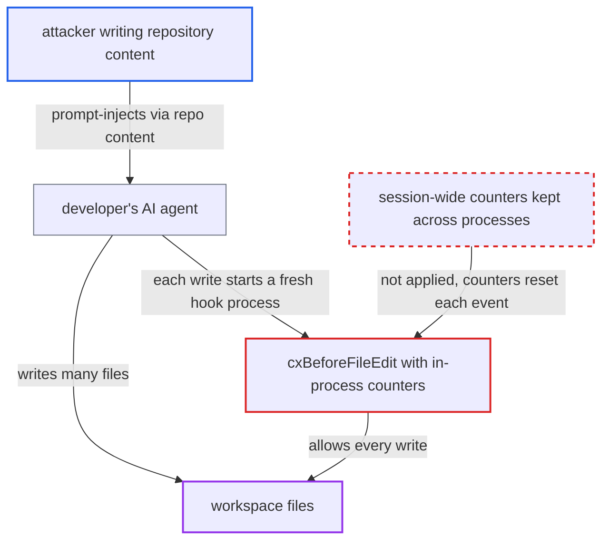

# Blast-radius and total-size write limits are per-process counters, so they never trigger

| Field | Value |
|---|---|
| ID | `find_01PD3sqcXG8TbR9wAojuSfBL` |
| Severity | **Low** |
| Status | open |
| CWE | CWE-693 — Protection mechanism failure |
| Created | 2026-10-22T14:02:07.580146Z |
| Claude Security | https://claude.ai/security/findings/find_01PD3sqcXG8TbR9wAojuSfBL |

## Description

An attacker who can influence a developer's AI agent can make it write more files, and more total bytes, than the organisation's session limits allow. The limits must be enabled in `~/.checkmarx/policyhooks.json`, and they are off by default. The counters in `policy.go` live in process memory, but every hook event runs in a new process, so the limits never trigger. Content checks on each write still run.

1. **attacker** plants prompt-injection text in repository content. The text is meant to make the developer's AI agent write or edit many files when it works on the repository.
2. **developer's AI agent** follows the injected instructions and writes many files. The developer only has to run the agent on the repository, and each file write fires a pre-write hook event.
3. **`HookDispatchCommands`** serves each event with a new one-shot `cx hooks <route>` process. The process registers handlers, dispatches one event and exits, so no in-memory counter survives to the next event. ([`internal/commands/agenthooks.go:163-189`](https://github.com/cx-benchmark/ast-cli/blob/fd7806d4fa55005863ea1cb272ed9e9aadd49866/internal/commands/agenthooks.go#L163-L189))
4. **the handler `cxBeforeFileEdit`** calls the blast-radius and total-size checks once for the current event. The package-level counters `blastRadiusCount` and `totalFileSizeBytes` start at zero in every new process. ([`internal/commands/agenthooks/cx/hooks.go:124-133`](https://github.com/cx-benchmark/ast-cli/blob/fd7806d4fa55005863ea1cb272ed9e9aadd49866/internal/commands/agenthooks/cx/hooks.go#L124-L133))
5. **`CheckAndIncrementBlastRadius`** raises the counter to 1 and allows the write. It returns early when `Threshold <= 0`, and otherwise denies only when the count is above `Threshold`, so 1 never exceeds an enabled threshold. ([`internal/commands/agenthooks/guardrails/policy.go:142-195`](https://github.com/cx-benchmark/ast-cli/blob/fd7806d4fa55005863ea1cb272ed9e9aadd49866/internal/commands/agenthooks/guardrails/policy.go#L142-L195))
6. **`CheckAndIncrementTotalFileSize`** compares only the current event's bytes with `max_total_file_size_kb`. The session total is never accumulated, so the check works only as a per-event size limit. ([`internal/commands/agenthooks/guardrails/policy.go:142-195`](https://github.com/cx-benchmark/ast-cli/blob/fd7806d4fa55005863ea1cb272ed9e9aadd49866/internal/commands/agenthooks/guardrails/policy.go#L142-L195))

## Assessment

The attacker needs only to get prompt-injection text into repository content that the developer's AI agent reads. The developer then runs the agent on that repository. The attack works only if the organisation has enabled `default_policy.blast_radius_limit.threshold` or `context_policy.files_limits.max_total_file_size_kb` in `~/.checkmarx/policyhooks.json`, because the project does not ship them enabled. The report assumes that `agenthooks.Dispatch` in `github.com/Checkmarx/ast-cx-hooks v1.0.10` handles only the single event piped to its process. That package was not available to the scanner. The unit tests in `policy_test.go` and `hooks_test.go` call the check repeatedly inside one test process, so they pass while the shipped path does nothing. The counter also goes up once per event rather than once per file, so a working counter would under-count multi-file edits.

Impact: An agent under attacker influence can modify more files, and write more bytes, than the session cap allows, so a mass rewrite of the workspace goes unchecked. The loss is a limit on volume only. Each write still passes the ASCA, KICS, SCA and secrets guardrails, nothing is disclosed and availability is not affected.

## Recommendation

Counters meant to cover a whole session are kept in process memory, but each hook event runs in its own short-lived process. The policy threshold is compared with a count of at most one, and the size cap with one event's bytes.

Fix criteria: Per-session write counts and byte totals survive across hook processes. They are keyed by the event's session id, stored safely on disk like the session tally, and cleared when the session ends. Every file in a multi-file event is counted. With threshold N, the (N+1)-th write in a session, made as a separate `cx hooks` process, is denied. A session whose summed write sizes pass `max_total_file_size_kb` is denied. A test that runs the hook as N+1 separate processes proves both.

## Evidence

**https://github.com/cx-benchmark/ast-cli**

- [`internal/commands/agenthooks/guardrails/policy.go:142-195`](https://github.com/cx-benchmark/ast-cli/blob/fd7806d4fa55005863ea1cb272ed9e9aadd49866/internal/commands/agenthooks/guardrails/policy.go#L142-L195)
- [`internal/commands/agenthooks/cx/hooks.go:124-133`](https://github.com/cx-benchmark/ast-cli/blob/fd7806d4fa55005863ea1cb272ed9e9aadd49866/internal/commands/agenthooks/cx/hooks.go#L124-L133)
- [`internal/commands/agenthooks.go:163-189`](https://github.com/cx-benchmark/ast-cli/blob/fd7806d4fa55005863ea1cb272ed9e9aadd49866/internal/commands/agenthooks.go#L163-L189)
- [`internal/commands/agenthooks/sessiontally/sessiontally.go:1-10`](https://github.com/cx-benchmark/ast-cli/blob/fd7806d4fa55005863ea1cb272ed9e9aadd49866/internal/commands/agenthooks/sessiontally/sessiontally.go#L1-L10)

