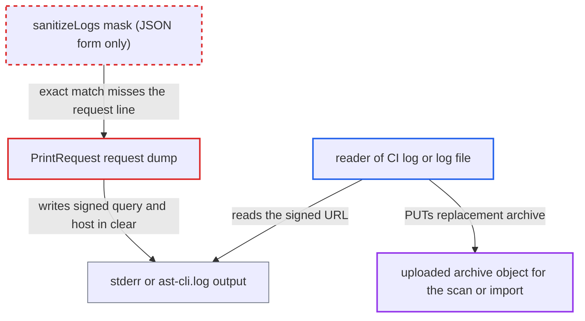

# Presigned upload URL logged in verbose request dump; mask covers only its JSON form

| Field | Value |
|---|---|
| ID | `find_01KMKMcNWDwNDQ9ihdKQ7N1N` |
| Severity | **Low** |
| Status | open |
| CWE | CWE-532 — Sensitive information in log |
| Created | 2026-10-22T14:08:13.803622Z |
| Claude Security | https://claude.ai/security/findings/find_01KMKMcNWDwNDQ9ihdKQ7N1N |

## Description

Someone who can read a CI log or a CLI log file can recover a signed upload URL that the CLI tries to hide, then overwrite the uploaded scan or import source. It needs verbose logging (`--debug`, `--log-file` or `--log-file-console`) and a scan source of 1 MB or more, or `cx import`. The cause is that `UploadFile` masks the URL only in its JSON-quoted form, which never matches the logged request line.

1. **the method `UploadFile`** registers the presigned URL for masking in its JSON form only. It stores the `json.Marshal`ed URL, with surrounding quotes and `&` written as `\u0026`, under `params.UploadURLEnv`, so the mask matches only where the URL sits inside a JSON body. ([`internal/wrappers/uploads-http.go:62-67`](https://github.com/cx-benchmark/ast-cli/blob/fd7806d4fa55005863ea1cb272ed9e9aadd49866/internal/wrappers/uploads-http.go#L62-L67))
2. **the method `UploadFile`** unmarshals the URL back to its raw form and sends it as a `PUT` through `SendHTTPRequestByFullURLContentLength`. The request's `ContentLength` is set to the archive size, and the bearer token is added only when `MINIO_ENABLED` is on (default `true`). ([`internal/wrappers/uploads-http.go:82-93`](https://github.com/cx-benchmark/ast-cli/blob/fd7806d4fa55005863ea1cb272ed9e9aadd49866/internal/wrappers/uploads-http.go#L82-L93))
3. **the function `request()`** calls `logger.PrintRequest` on the outgoing `PUT` before sending it. This happens for every outbound request, including the presigned upload. ([`internal/wrappers/client.go:814-820`](https://github.com/cx-benchmark/ast-cli/blob/fd7806d4fa55005863ea1cb272ed9e9aadd49866/internal/wrappers/client.go#L814-L820))
4. **the function `PrintRequest`** dumps the request with `httputil.DumpRequest(r, r.ContentLength < 1000000)`. For an archive of 1 MB or more the body is left out, so the dump is plain text: `PUT /<object path>?<signed query> HTTP/1.1` plus a `Host:` header. ([`internal/logger/utils.go:45-75`](https://github.com/cx-benchmark/ast-cli/blob/fd7806d4fa55005863ea1cb272ed9e9aadd49866/internal/logger/utils.go#L45-L75))
5. **the function `sanitizeLogs`** fails to mask the dump. It does a byte-exact `strings.ReplaceAll` with the quoted JSON value, which never occurs in the request line, so the full signed query and the host go to stderr, `ast-cli.log`, or both. ([`internal/logger/utils.go:87-100`](https://github.com/cx-benchmark/ast-cli/blob/fd7806d4fa55005863ea1cb272ed9e9aadd49866/internal/logger/utils.go#L87-L100))
6. **a reader of the log** rebuilds the URL and sends a `PUT` with a replacement archive. This works while the signature is valid and before the scan engines fetch the object.

## Assessment

A user or CI job runs `cx scan create` on a local source of 1 MB or more, or runs `cx import`, with `--debug`, `--log-file` or `--log-file-console`. The attacker is anyone who can read that CI log or log file. The attack also needs a storage endpoint that accepts the URL without the bearer token the CLI adds under `MINIO_ENABLED`, and the attacker must win the window before the engines fetch the object. Which of these holds is decided server-side, and the report does not say. An archive under 1 MB is dumped with its binary body, which is replaced by a "binary data" message, so it does not leak. A SARIF file used by `cx import` is UTF-8 text, so its dump is printed at any size. The multipart path (`UploadFileInMultipart`, used above 5 GB when `INCREASE_FILE_UPLOAD_LIMIT` is on) is a second way in. It registers no mask, `getPresignedURLForMultipartUploading` dumps the response body carrying each part URL, and `uploadPart` dumps each `PUT`.

Impact: The attacker learns a signed, time-limited URL that allows a `PUT` to one object until the signature expires. The report treats this as low severity. The URL does not allow reading the uploaded source, and the CLI host itself is not affected.

Subsequent-system impact: The CLI hands this URL to Checkmarx One as the scan or import source. Overwriting the object lets the attacker make the tenant scan, or import results from, content of the attacker's choosing. That can give a clean result that passes a scan gate, or fake imported findings, for that one scan or import. The report establishes no read of other tenant data and no service outage.

## Recommendation

The presigned upload URL is masked only in its JSON-quoted form (`uploads-http.go:62-67`). `PrintRequest` writes it as path plus signed query in the request line, and the multipart path registers no mask while dumping responses that carry part URLs. Verbose logs therefore disclose the signed URL.

Fix criteria: No form of any presigned URL, single or multipart part (raw, request-URI path plus query, or JSON-escaped), appears in `--debug`, `--log-file` or `--log-file-console` output. Verify against a stub uploads service that returns a URL with a marker query parameter. Run `cx scan create --debug` with a source over 1 MB, `cx import --debug` with a SARIF file, and a multipart upload. Search the output for the marker and for the signature value, and find neither.

## Evidence

**https://github.com/cx-benchmark/ast-cli**

- [`internal/wrappers/uploads-http.go:62-67`](https://github.com/cx-benchmark/ast-cli/blob/fd7806d4fa55005863ea1cb272ed9e9aadd49866/internal/wrappers/uploads-http.go#L62-L67)
- [`internal/wrappers/uploads-http.go:82-93`](https://github.com/cx-benchmark/ast-cli/blob/fd7806d4fa55005863ea1cb272ed9e9aadd49866/internal/wrappers/uploads-http.go#L82-L93)
- [`internal/wrappers/client.go:378-403`](https://github.com/cx-benchmark/ast-cli/blob/fd7806d4fa55005863ea1cb272ed9e9aadd49866/internal/wrappers/client.go#L378-L403)
- [`internal/wrappers/client.go:814-820`](https://github.com/cx-benchmark/ast-cli/blob/fd7806d4fa55005863ea1cb272ed9e9aadd49866/internal/wrappers/client.go#L814-L820)
- [`internal/logger/utils.go:45-75`](https://github.com/cx-benchmark/ast-cli/blob/fd7806d4fa55005863ea1cb272ed9e9aadd49866/internal/logger/utils.go#L45-L75)
- [`internal/logger/utils.go:87-100`](https://github.com/cx-benchmark/ast-cli/blob/fd7806d4fa55005863ea1cb272ed9e9aadd49866/internal/logger/utils.go#L87-L100)
- [`internal/wrappers/uploads-http.go:115-128`](https://github.com/cx-benchmark/ast-cli/blob/fd7806d4fa55005863ea1cb272ed9e9aadd49866/internal/wrappers/uploads-http.go#L115-L128)
- [`internal/commands/scan.go:2554-2574`](https://github.com/cx-benchmark/ast-cli/blob/fd7806d4fa55005863ea1cb272ed9e9aadd49866/internal/commands/scan.go#L2554-L2574)
- [`internal/commands/util/import.go:103-110`](https://github.com/cx-benchmark/ast-cli/blob/fd7806d4fa55005863ea1cb272ed9e9aadd49866/internal/commands/util/import.go#L103-L110)
- [`internal/wrappers/uploads-http.go:261-334`](https://github.com/cx-benchmark/ast-cli/blob/fd7806d4fa55005863ea1cb272ed9e9aadd49866/internal/wrappers/uploads-http.go#L261-L334)

