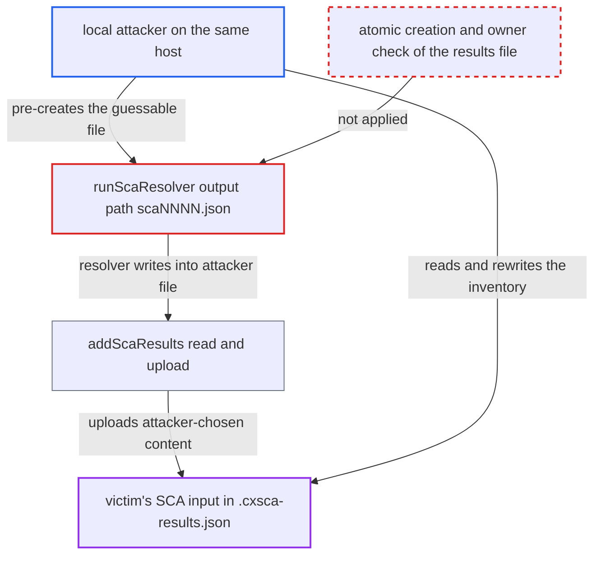

# SCA resolver output path derived from temp file name is pre-creatable by other local users

| Field | Value |
|---|---|
| ID | `find_01VAsSVgkDHbHuRGH4p5RPU1` |
| Severity | **Low** |
| Status | open |
| CWE | CWE-377 — Insecure temporary file |
| Created | 2026-10-22T14:04:56.533792Z |
| Claude Security | https://claude.ai/security/findings/find_01VAsSVgkDHbHuRGH4p5RPU1 |

## Description

A local user on the same Unix host can read and replace the dependency inventory that another user's scan uploads. A pre-created directory or FIFO can instead make that scan fail. This needs a host without `fs.protected_regular` and a resolver that opens its output file with plain create or truncate. The cause is `runScaResolver`, which passes the resolver a `.json` path derived from a temp file name and never creates it.

1. **the function `runScaResolver`** creates a temp file and derives a different output path from its name. `ioutil.TempFile("", "sca")` safely creates `scaNNNN`, but the code ignores that file and builds `scaFile.Name() + ".json"`, which nothing creates or reserves. ([`internal/commands/scan.go:2102-2141`](https://github.com/cx-benchmark/ast-cli/blob/fd7806d4fa55005863ea1cb272ed9e9aadd49866/internal/commands/scan.go#L2102-L2141))
2. **the function `runScaResolver`** passes the derived path to the external SCA Resolver as `-r`. The resolver creates or opens this path only after it has resolved dependencies, so the path stays unreserved for seconds to minutes. ([`internal/commands/scan.go:2102-2141`](https://github.com/cx-benchmark/ast-cli/blob/fd7806d4fa55005863ea1cb272ed9e9aadd49866/internal/commands/scan.go#L2102-L2141))
3. **local attacker** watches the shared temp directory and pre-creates `scaNNNN.json`. The `scaNNNN` name is visible to anyone who can list `/tmp`, so the attacker makes `scaNNNN.json` with a permissive mode such as 0666 while the resolver is still running. ([`internal/commands/scan.go:2102-2141`](https://github.com/cx-benchmark/ast-cli/blob/fd7806d4fa55005863ea1cb272ed9e9aadd49866/internal/commands/scan.go#L2102-L2141))
4. **the SCA Resolver** writes its results into the attacker-owned file. This assumes the resolver opens `-r` with ordinary create or truncate semantics, not `O_EXCL` or write-then-rename. ([`internal/commands/scan.go:2102-2141`](https://github.com/cx-benchmark/ast-cli/blob/fd7806d4fa55005863ea1cb272ed9e9aadd49866/internal/commands/scan.go#L2102-L2141))
5. **local attacker** reads the victim's dependency list and rewrites the file content. The attacker owns the file, so the attacker can do this before the CLI reads it back. ([`internal/commands/scan.go:2144-2167`](https://github.com/cx-benchmark/ast-cli/blob/fd7806d4fa55005863ea1cb272ed9e9aadd49866/internal/commands/scan.go#L2144-L2167))
6. **the function `addScaResults`** reads the path and puts the bytes into the upload zip as `.cxsca-results.json`. `ioutil.ReadFile` follows symlinks and does no owner or file-type check, and the `os.Remove` cannot delete an attacker-owned file in sticky `/tmp`. ([`internal/commands/scan.go:2144-2167`](https://github.com/cx-benchmark/ast-cli/blob/fd7806d4fa55005863ea1cb272ed9e9aadd49866/internal/commands/scan.go#L2144-L2167))
7. **the function `compressFolder`** uploads the zip as part of the normal scan. Whenever `--sca-resolver` is given, the results are included, so the attacker's content becomes the scan's SCA input. ([`internal/commands/scan.go:1706-1711`](https://github.com/cx-benchmark/ast-cli/blob/fd7806d4fa55005863ea1cb272ed9e9aadd49866/internal/commands/scan.go#L1706-L1711))

## Assessment

The attacker is an unprivileged local user on the same Unix host, for example a shared build or developer machine. The victim runs a scan with `--sca-resolver`. The attacker watches the shared temp directory (inotify works) for the new `scaNNNN` entry. The attacker then creates `scaNNNN.json` before the resolver writes it. The attack needs a host without `fs.protected_regular` (kernel default 0, older or non-systemd distributions, or a custom shared `TMPDIR`) and a resolver that opens `-r` with create or truncate semantics. With `fs.protected_regular=1` (set by systemd 241 and later), the resolver's open of a foreign file in sticky `/tmp` is blocked, so the attack only makes the scan fail. A symlink variant, where the resolver would overwrite a victim-owned file, is blocked by `fs.protected_symlinks=1`. A pre-created directory, FIFO or other file the resolver cannot open also makes the scan fail. macOS and Windows are not affected by default, because `os.TempDir()` is a per-user directory there. The resolver is external and not pinned by the CLI, and the report assumes how it opens the file.

Impact: The attacker can read the victim's resolved dependency list and choose the SCA input that is uploaded for the scan. That falsifies the scan's dependency inventory, its findings and any threshold or policy gate built on it. The attacker can also make `--sca-resolver` scans fail. Each effect is limited to the SCA input of scans on that host.

## Recommendation

The results path given to the external resolver is derived from a securely created temp file instead of being that file. Other local users can pre-create it. The reader `addScaResults` also reads it by path with no ownership or file-type check.

Fix criteria: Other local users cannot guess or pre-create the output location. For example, the path is inside a private directory made with `os.MkdirTemp` (mode 0700), or the `.json` file itself is created with `os.CreateTemp` and that exact name is passed. Before reading, the code runs `Lstat` and requires a regular file owned by the current user. To verify, pre-create `<tmp>/scaNNNN.json` as a file or symlink from another user. It must not influence the uploaded `.cxsca-results.json`.

## Evidence

**https://github.com/cx-benchmark/ast-cli**

- [`internal/commands/scan.go:2102-2141`](https://github.com/cx-benchmark/ast-cli/blob/fd7806d4fa55005863ea1cb272ed9e9aadd49866/internal/commands/scan.go#L2102-L2141)
- [`internal/commands/scan.go:2144-2167`](https://github.com/cx-benchmark/ast-cli/blob/fd7806d4fa55005863ea1cb272ed9e9aadd49866/internal/commands/scan.go#L2144-L2167)
- [`internal/commands/scan.go:1706-1711`](https://github.com/cx-benchmark/ast-cli/blob/fd7806d4fa55005863ea1cb272ed9e9aadd49866/internal/commands/scan.go#L1706-L1711)
- [`internal/commands/scan.go:2295-2303`](https://github.com/cx-benchmark/ast-cli/blob/fd7806d4fa55005863ea1cb272ed9e9aadd49866/internal/commands/scan.go#L2295-L2303)

