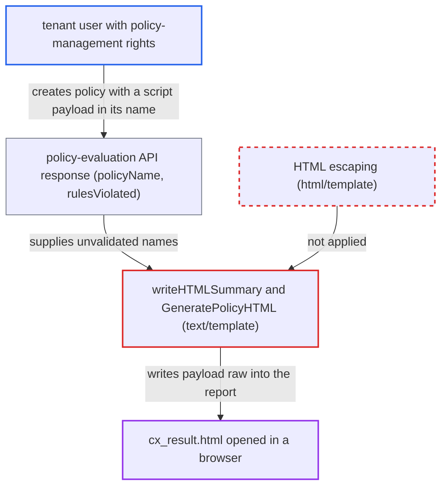

# summaryHTML report uses text/template, embedding server policy names and scan IDs unescaped

| Field | Value |
|---|---|
| ID | `find_01TxLjyg4rX86EoSj4vkQ7gK` |
| Severity | **Low** |
| Status | open |
| CWE | CWE-79 — Cross-site scripting |
| Created | 2026-10-22T13:58:11.864030Z |
| Claude Security | https://claude.ai/security/findings/find_01TxLjyg4rX86EoSj4vkQ7gK |

## Description

A Checkmarx One tenant user who can manage policies can run script in the browser of anyone who opens a `cx_result.html` report from the CLI. The script can spoof scan results and the 'More details' link. The cause is that `writeHTMLSummary` uses `text/template`, and `GeneratePolicyHTML` builds raw HTML from policy and rule names, so server strings are never escaped.

1. **tenant user with policy-management rights** creates a policy or rule whose name holds an HTML or script payload. The CLI decodes `policyName` and `rulesViolated` as plain strings and does not validate them; the report assumes the server does not restrict the characters either. ([`internal/wrappers/policy.go:9-16`](https://github.com/cx-benchmark/ast-cli/blob/fd7806d4fa55005863ea1cb272ed9e9aadd49866/internal/wrappers/policy.go#L9-L16))
2. **developer or CI job** runs `cx scan create` or `cx results show` with `--report-format summaryHTML`. `HandlePolicyEvaluation` fetches the policy evaluation, and `filterViolatedRules` keeps only policies with violations, so the payload policy needs a rule that fires on the scan. ([`internal/commands/result.go:1158-1175`](https://github.com/cx-benchmark/ast-cli/blob/fd7806d4fa55005863ea1cb272ed9e9aadd49866/internal/commands/result.go#L1158-L1175))
3. **the method `GeneratePolicyHTML`** concatenates `policy.Name` and the joined `RulesViolated` into `<td>` cells. No escaping is applied, and the result is returned as a ready-made HTML string. ([`internal/wrappers/results-summary.go:231-277`](https://github.com/cx-benchmark/ast-cli/blob/fd7806d4fa55005863ea1cb272ed9e9aadd49866/internal/wrappers/results-summary.go#L231-L277))
4. **the function `writeHTMLSummary`** renders the template with `text/template` and writes `cx_result.html`. `text/template` does no HTML, attribute or URL escaping, so `{{.ScanID}}`, `{{.BaseURI}}` in an `href`, and `{{.GeneratePolicyHTML}}` are written verbatim. ([`internal/commands/result.go:895-906`](https://github.com/cx-benchmark/ast-cli/blob/fd7806d4fa55005863ea1cb272ed9e9aadd49866/internal/commands/result.go#L895-L906))
5. **victim** opens `cx_result.html` in a browser. The injected markup runs as script in the page.

## Assessment

The main attacker is a Checkmarx One tenant user with policy-management rights. They give a policy or rule a payload name, and a scan must trigger that rule. A compromised or spoofed endpoint is another way in: it can return a crafted `id`, `projectId` or `policyName`. A `javascript:` value in the unverified access-token `BaseURLKey` claim can reach the `href` through `BaseURI`. A scan id containing `">` and a script tag can also break out, because `generateScanSummaryURL` does not escape `ScanID`. It also uses `BaseURI` as the `fmt.Sprintf` format string. A developer or CI job must generate the `summaryHTML` report, and someone must then open it. The `markdown` format (`writeMarkdownSummary`, `GeneratePolicyMarkdown`) inserts the same values raw. That allows markup, link and table injection in whatever renders the markdown. Whether script can run there depends on the external renderer, and the report does not claim it.

Impact: The attacker controls the markup of the HTML report. They can spoof scan results, policy-violation status and the 'More details' link. The report holds only scan metadata and counts, and the CLI process itself is not otherwise affected.

Subsequent-system impact: The attacker's script runs in the browser of whoever opens `cx_result.html`, in the origin the report is served from. It can redirect the user, phish for Checkmarx credentials, or send the report contents out. The code gives it no further reach, and a local `file://` open is an isolated origin.

## Recommendation

(1) `writeHTMLSummary` renders server-derived strings (`ScanID`, `BaseURI`, policy and rule names) with `text/template`, which applies no escaping. `GeneratePolicyHTML` returns raw HTML built by string concatenation, so even a safe template engine would trust it.

Fix criteria: Every server-derived value in the HTML summary is escaped for its context (element text, attribute, URL), and URL attributes reject non-http(s) schemes. The policy table is produced by escaped template constructs, not pre-built HTML. A policy name, rule name and scan id of `">` produce only entity-encoded text and a well-formed `href` in `cx_result.html`.

(2) `writeMarkdownSummary` and `GeneratePolicyMarkdown` write the same untrusted values raw into markdown, so they can add markup, links or table breaks to the markdown report.

Fix criteria: Policy and rule names and `BaseURI` written to the markdown summary have markdown and HTML metacharacters (`<`, `>`, `|`, `[`, `]`, `(`, `)`) escaped or neutralised. With the same payloads, the generated `.md` contains no raw HTML tags, no injected links and no broken table rows.

## Evidence

**https://github.com/cx-benchmark/ast-cli**

- [`internal/commands/result.go:895-906`](https://github.com/cx-benchmark/ast-cli/blob/fd7806d4fa55005863ea1cb272ed9e9aadd49866/internal/commands/result.go#L895-L906)
- [`internal/wrappers/results-summary.go:231-277`](https://github.com/cx-benchmark/ast-cli/blob/fd7806d4fa55005863ea1cb272ed9e9aadd49866/internal/wrappers/results-summary.go#L231-L277)
- [`internal/wrappers/results-summary.go:750-773`](https://github.com/cx-benchmark/ast-cli/blob/fd7806d4fa55005863ea1cb272ed9e9aadd49866/internal/wrappers/results-summary.go#L750-L773)
- [`internal/wrappers/policy.go:9-16`](https://github.com/cx-benchmark/ast-cli/blob/fd7806d4fa55005863ea1cb272ed9e9aadd49866/internal/wrappers/policy.go#L9-L16)
- [`internal/commands/result.go:1158-1175`](https://github.com/cx-benchmark/ast-cli/blob/fd7806d4fa55005863ea1cb272ed9e9aadd49866/internal/commands/result.go#L1158-L1175)
- [`internal/commands/result.go:651-692`](https://github.com/cx-benchmark/ast-cli/blob/fd7806d4fa55005863ea1cb272ed9e9aadd49866/internal/commands/result.go#L651-L692)
- [`internal/commands/result.go:1089-1095`](https://github.com/cx-benchmark/ast-cli/blob/fd7806d4fa55005863ea1cb272ed9e9aadd49866/internal/commands/result.go#L1089-L1095)
- [`internal/wrappers/results-summary.go:279-290`](https://github.com/cx-benchmark/ast-cli/blob/fd7806d4fa55005863ea1cb272ed9e9aadd49866/internal/wrappers/results-summary.go#L279-L290)

