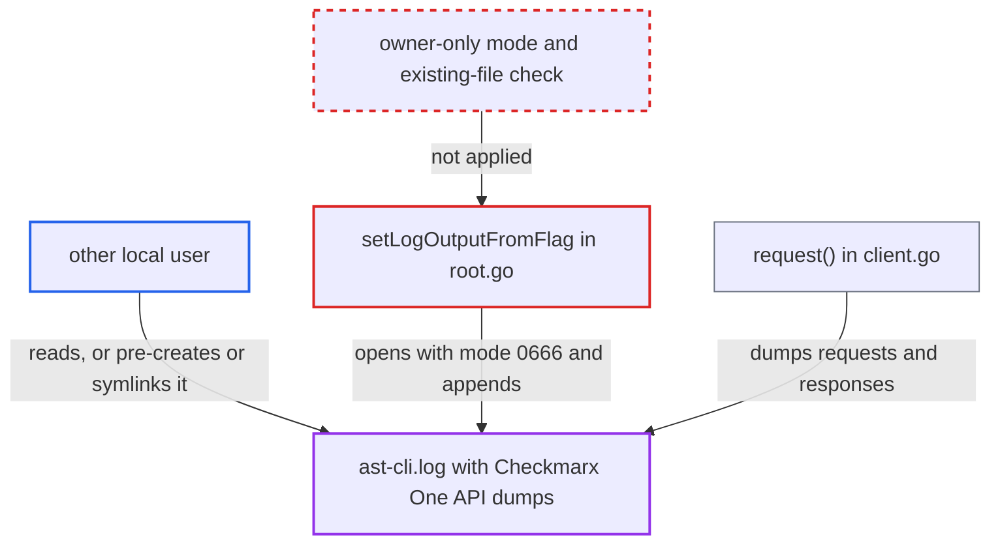

# Verbose HTTP-dump log file created world-readable at a fixed, non-exclusive path

| Field | Value |
|---|---|
| ID | `find_015rb9gEshgQTgdChGWgf7Kt` |
| Severity | **Low** |
| Status | open |
| CWE | CWE-732 — Incorrect permission assignment |
| Created | 2026-10-22T14:06:13.516356Z |
| Claude Security | https://claude.ai/security/findings/find_015rb9gEshgQTgdChGWgf7Kt |

## Description

A local user on a shared developer or CI host can read another user's Checkmarx One API traffic from a verbose log file. They can also, in a limited way, make the victim's process append log text to a file the attacker owns or picks. This needs the victim to run the CLI with `--log-file` or `--log-file-console`, and the directory must be readable by the attacker. `setLogOutputFromFlag` opens `ast-cli.log` with mode `0666` and no checks on an existing file.

1. **the victim** runs the CLI with `--log-file <dir>` or `--log-file-console <dir>`. `PersistentPreRunE` calls `customLogConfiguration` for every command when either flag is set. ([`internal/commands/root.go:413-468`](https://github.com/cx-benchmark/ast-cli/blob/fd7806d4fa55005863ea1cb272ed9e9aadd49866/internal/commands/root.go#L413-L468))
2. **the function `setLogOutputFromFlag`** opens `<dir>/ast-cli.log` with `O_CREATE|O_WRONLY|O_APPEND` and mode `0666`. The name is fixed, the mode is not owner-only, and there is no `O_EXCL`, no `O_NOFOLLOW` and no owner check, so under a `022` umask a new file is `0644` and an existing file or symlink is reused. ([`internal/commands/root.go:445-450`](https://github.com/cx-benchmark/ast-cli/blob/fd7806d4fa55005863ea1cb272ed9e9aadd49866/internal/commands/root.go#L445-L450))
3. **the logger** turns on `PrintIfVerbose` because a log-file flag is set. Full request and response dumps, with headers and bodies up to 1 MB, are therefore written to the log. ([`internal/logger/utils.go:57-85`](https://github.com/cx-benchmark/ast-cli/blob/fd7806d4fa55005863ea1cb272ed9e9aadd49866/internal/logger/utils.go#L57-L85))
4. **the method `request()`** dumps every Checkmarx One API request and response into the log file. `logger.PrintRequest` and `logger.PrintResponse` record scan results, project data, upload URLs and token-request bodies. ([`internal/wrappers/client.go:814-854`](https://github.com/cx-benchmark/ast-cli/blob/fd7806d4fa55005863ea1cb272ed9e9aadd49866/internal/wrappers/client.go#L814-L854))
5. **another local user** reads `<dir>/ast-cli.log`. The file is world-readable under the common umask, and the attacker only needs access to the directory.

## Assessment

The attacker is another local account on a shared developer or CI host. The victim only has to run `cx ... --log-file <dir>` as usual. The directory can be `/tmp`, a CI workspace, or a `0755` home directory such as on macOS and older Ubuntu/Debian. With the default `022` umask the file is `0644`, so the attacker reads it. A second route needs a directory the attacker can write to. The attacker pre-creates `ast-cli.log` with mode `0666`, so the victim's traffic lands in a file the attacker owns, even under a strict umask. Alternatively, the attacker plants a symlink so the victim's process appends log text to another file the victim owns.

Impact: The attacker reads the victim's Checkmarx One API traffic: scan results with code locations, project data, upload URLs, and any secret the substring-based masking misses. Credentials the resolver registers are normally masked, so credential theft depends on those separate masking gaps. The pre-create and symlink routes allow only limited corruption, because the appended text is mostly not attacker-controlled. This holds only in a non-sticky shared directory.

## Recommendation

`setLogOutputFromFlag` creates the verbose log with mode `0666` at the fixed name `ast-cli.log`. It follows or appends to whatever file or symlink is already there. Another local user can therefore read the HTTP dumps, or redirect them into a file the attacker owns or picks.

Fix criteria: A newly created log file is owner-only (`0600` or stricter), whatever the umask. The CLI refuses to write, or safely recreates the file, when an existing `ast-cli.log` is a symlink, is not owned by the current user, or is readable or writable by group or others. Verify by running `cx scan list --log-file /tmp` as user A and confirming user B cannot read `/tmp/ast-cli.log`. Then pre-create the file, or a symlink to it, as user B and confirm A's run refuses to log into it.

## Evidence

**https://github.com/cx-benchmark/ast-cli**

- [`internal/commands/root.go:445-450`](https://github.com/cx-benchmark/ast-cli/blob/fd7806d4fa55005863ea1cb272ed9e9aadd49866/internal/commands/root.go#L445-L450)
- [`internal/commands/root.go:413-468`](https://github.com/cx-benchmark/ast-cli/blob/fd7806d4fa55005863ea1cb272ed9e9aadd49866/internal/commands/root.go#L413-L468)
- [`internal/logger/utils.go:57-85`](https://github.com/cx-benchmark/ast-cli/blob/fd7806d4fa55005863ea1cb272ed9e9aadd49866/internal/logger/utils.go#L57-L85)
- [`internal/wrappers/client.go:814-854`](https://github.com/cx-benchmark/ast-cli/blob/fd7806d4fa55005863ea1cb272ed9e9aadd49866/internal/wrappers/client.go#L814-L854)
- [`internal/configfile/configfile.go:15-20`](https://github.com/cx-benchmark/ast-cli/blob/fd7806d4fa55005863ea1cb272ed9e9aadd49866/internal/configfile/configfile.go#L15-L20)

